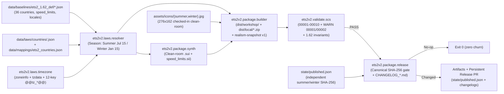

# Phase 2: Realism Registry, Seasonal Core Builds & Offline Validator (Phase A) - Research

**Researched:** 2026-11-19
**Domain:** ETS2 `1.62.3.3s` 36-Country Statutory Realism Registry, Dynamic `zoneinfo`/`tzdata` Seasonal DST, Clean-Room SII/SUI Core Packager, Offline SCS Workshop Validator (`00001`–`00010` + `WARN 00001`/`00002`), Canonical SHA-256 Diff Gate & Phase A Friday CI
**Confidence:** HIGH

<user_constraints>
## User Constraints (from CONTEXT.md)

### Locked Decisions
- **D-01 — Per-Country JSON Registry Layout:** Store canonical country laws as individual JSON files under `data/laws/countries/<iso2>.json` paired with `data/mappings/ets2_countries.json` mapping ETS2 `1.62` country slugs (`albania`..`uk`) and metadata to ISO-3166 alpha-2 keys. Validate strictly with Pydantic v2 (`ConfigDict(strict=True, frozen=True, extra="forbid")`), `sort_keys=True`, UTF-8 no-BOM LF formatting, and zero extra YAML runtime dependencies. — **Reversibility:** `costly` — changing directory layout or schema keys affects Phase 3–5 data collectors and `compose-local` snapshot consumers.
- **D-02 — Strictly 36 Vanilla+DLC Countries in Phase 2:** Populate `data/laws/countries/` strictly for the **36 Vanilla+DLC countries** present in ETS2 `1.62.3.3s` `def.scs` (`data/baselines/ets2_1.62_def/countries.json`). Do not add ProMods or global non-vanilla entries (`AM`, `JO`, `SY`, `SM`, etc.) to `data/laws/countries/` until Phases 4–5; however, Phase 2 unit tests MUST still verify `zoneinfo` and schema invariants against edge cases such as `Asia/Amman`/`Asia/Damascus` (`UTC+3` `AST` permanent time) and `leftside_traffic` immutability guards.
- **D-03 — Seasonal Anchor Dates & Realism Semantics:** Derive `Summer` and `Winter` editions deterministically from peak seasonal reference dates (**July 15** for Summer, **January 15** for Winter, with an optional CLI `--date` override for inspection/testing) so editions pair naturally with seasonal weather mods (e.g., Grimes *New Summer* and *Frosty Winter*). Use `zoneinfo` + `tzdata` for UTC offsets and zone names (emitting `@@tz_*@@` only for the 12 keys present in `data/baselines/ets2_1.62_def/locales.json` and plain `"CET"`, `"WET"`, `"AST"`, etc. elsewhere), and apply verified statutory Summer/Winter speed limits (`car`, `truck`, `bus` — preserving `uk` imperial mph conventions), statutory `lights_mandatory` (including any verified seasonal DRL laws and fixing `NL`/`CH`/`AL`/`TR` vs `1.62` and `3668352310`), and statutory `mass_limit_per_axle_count[]` (including Iceland's 5-axle 60t and 80 km/h heavy-truck limit). Delegate per-country statutory lookup and verification across all 36 countries to `gsd-phase-researcher` during planning.
- **D-04 — Pure Clean-Room Synthesis Everywhere:** Generate all 36 `def/country/<slug>.sui` and `def/country/<slug>/speed_limits.sii` files deterministically from `data/baselines/ets2_1.62_def/*.json` + `data/laws/` + `data/mappings/` in both CI (`ubuntu-latest`) and local builds, guaranteeing byte-identical SHA-256 digests across platforms without requiring `def.scs` on build runners. Preserve `country_id`, `name`, `name_localized`, `country_code`, `iso_country_code` (and `iso_country_code_quoted`), `pos`, `imperial_units`, `leftside_traffic`, `trailer_standalone`, `regions[]`/`region_areas[]`, `secondary_time_zone*`, `extra_attributes`, and `train`/`tram` speed blocks from `countries.json` / `speed_limits.json`. (Surgical binary `.scs` patching remains scoped to Phase 4's `compose-local`.) — **Reversibility:** `costly` — affects canonical SHA-256 stability between local and CI builds.
- **D-05 — Omit `def/country.sii` & Keep 1.62 `fuel_price` Baseline:** Do **not** emit `def/country.sii` or `def/country.ets2v2.sii` in Core builds; emit only the 36 updated `def/country/<slug>.sui` and `def/country/<slug>/speed_limits.sii` files so vanilla `def.scs:/def/country.sii` loads our overrides cleanly with zero map-mod registration or duplicate-unit conflicts. Preserve `1.62` baseline `fuel_price` values from `countries.json` unchanged in Phase 2 until Phase 3 wires live FX/fuel feeds.
- **D-06 — Dual Packaging Targets (`dist/workshop/` + `dist/local/`):** Emit unpacked `universal/` directories beside `versions.sii` (`package_version_info : .universal { package_name: "universal" }`) under `dist/workshop/summer/` and `dist/workshop/winter/` for direct use in SCS Workshop Uploader (and future Phase B SteamCMD Steampipe delta uploads without double-zipping), **plus** separate standalone `dist/local/ETS2V2_Core_Summer.zip` and `dist/local/ETS2V2_Core_Winter.zip` (with `1980-01-01` normalized timestamps, POSIX `0o644` permissions, sorted paths, and local `display_name`) for drop-in `mod/` playtesting. Never place `universal.zip` and `universal/` side-by-side in the same Workshop root.
- **D-07 — Checked-In Clean-Room `276x162` `.jpg` Icons:** Author clean-room `assets/icons/summer.jpg` and `assets/icons/winter.jpg` (`276x162` px, EXIF/ICC stripped, `< 1 MB`) via a reproducible `Pillow` generation script committed in the repository, avoiding cross-OS `libjpeg-turbo` byte drift in CI and allowing custom artwork replacement later.
- **D-08 — Workshop `manifest.sii` Metadata & ISO-Week Versioning:** Use ISO-week `package_version` (`"1.62-YYYY.WW"` bumped **only** when canonical content changes so no-op runs do not alter hashes), `category[]` set to `["other", "ai_traffic"]`, `mp_mod_optional: true`, configurable `author` defaulting to `"ETS2 World Realism"`, and an auto-generated UTF-8 no-BOM LF `description.txt` (`< 1 MB`) summarizing edition scope, key rule changes, and `MIT` / `CC BY 4.0` open-source attribution. Omit `display_name` and `compatible_versions[]` from Workshop `manifest.sii` (`00010`, `WARN 00001`, `WARN 00002`).
- **D-09 — Strict Offline SCS Validator (`PUB-01`):** Enforce SCS Workshop rules `00001`–`00010` and warnings `WARN 00001`–`WARN 00002` as hard validation failures across both `dist/workshop/{summer,winter}/` (and standalone ZIPs), verifying `versions.sii` single-`.universal` layout, no extraneous root/unreferenced files, `276x162` JPEG `< 1 MB`, UTF-8 `< 1 MB` `description.txt`, plaintext SII/SUI hygiene (`validate_sii_hygiene()`), `<=12`-char `[a-z0-9_]` unit segments, `<=2` valid categories, zero `3nK` / `\` / `..`, and `1.62` realism invariants (`Estonia`, `regions[]`, `iceland` 5-axle 60t, `bus`/`train`/`tram` intact, `@@tz_*@@` whitelist).
- **D-10 — Persistent Release PR & `state/published.json` Lifecycle:** Run Friday `06:00 UTC` GitHub Actions CI (`+ workflow_dispatch` with `force_run` input) with zero Steam secrets. When a change is detected, upload validated `Summer` and `Winter` bundles + `CHANGELOG_SUMMER.md` / `CHANGELOG_WINTER.md` as GitHub workflow artifacts / draft release assets and open or update **one persistent Release PR** (via `github-actions[bot]`) updating `state/published.json` and changelogs — ensuring `state/published.json` advances only when the maintainer merges the PR after completing the manual SCS Workshop Uploader upload. — **Reversibility:** `costly` — defines the CI/human handoff contract and GitHub Actions workflow permissions (`contents: write`, `pull-requests: write`).
- **D-11 — Independent Per-Edition Hashing & Forward-Compatible v1 Snapshot:** Track `summer` and `winter` canonical payload SHA-256 digests independently in `state/published.json` (computed over sorted `(relative_path, normalized_bytes)` excluding `package_version`/volatile timestamps) so an edition with no content changes exits as a clean no-op even if the other edition updates. Emit versioned `schema_version: 1` `realism-snapshot-{summer,winter}.json` artifacts in Phase 2 containing the resolved 36-country rules (DST offsets/names, `lights_mandatory`, `mass_limit_per_axle_count`, speed limits, baseline `fuel_price`) with forward-compatible schema structure for Phases 3–5. — **Reversibility:** `one-way` — published `state/published.json` and `realism-snapshot` v1 schema form the persistent state and downstream Phase 3–4 integration contract.

### Claude's Discretion
- Exact Python subpackage structure for Phase 2 (`src/ets2v2/validate/`, `src/ets2v2/package/`, and registry/build module naming, updating `tests/test_cli_scaffold.py::test_active_phase_only_package_layout` cleanly while keeping Phase 3–5 directories `fetch/`, `normalize/`, `merge/` blocked).
- Exact `ets2v2` CLI subcommand and flag names for registry validation, icon generation, seasonal Core builds, offline SCS validation, snapshot export, and diff-gate / changelog generation.
- Exact schema fields inside `data/laws/countries/<iso2>.json` (e.g., statutory citation URLs/notes, `effective_season` overrides, unit tags) and `state/published.json` JSON keys.
- Exact `Pillow` typography/color palette and `description.txt` wording/formatting (including optional SCS color tags).

### Deferred Ideas (OUT OF SCOPE)
None — discussion stayed within Phase 2 boundaries. Non-vanilla ProMods countries (`AM`, `JO`, `SY`, `SM`, `SJ`, etc.) and `200+` global territories remain mapped to Phases 4 and 5 (`MAP-01`, `GLB-03`), while Phase 2 unit tests still cover `zoneinfo` edge cases (`Asia/Amman`, `Asia/Damascus`) and `leftside_traffic` invariants.
</user_constraints>

<phase_requirements>
## Phase Requirements

| ID | Description | Research Support |
|----|-------------|------------------|
| SIM-01 | Maintain a canonical ISO country/territory realism registry (`data/laws/`, `data/mappings/`) supporting `Summer` and `Winter` speed-limit and DRL policies while fixing all known bugs from reference mods (`3249064596`, `3668352310`). | Complete 36-country statutory audit (speed limits, DRL, axle mass limits, reference-mod bug fixes) verified against `data/baselines/ets2_1.62_def/{countries,speed_limits}.json` and national traffic codes. |
| SIM-02 | Compute accurate seasonal UTC offsets and abbreviations dynamically from stdlib `zoneinfo` + `tzdata`, emitting valid ETS2 integer minutes and plain strings (e.g., `"CET"`, `"WET"`) while respecting ETS2's 12 supported `@@tz_*@@` keys. | Complete 36-country IANA timezone matrix + numeric `tzname()` override rule (`Europe/Istanbul` `"+03"` -> `"@@tz_trt@@"`; `Asia/Amman`/`Asia/Damascus` `"+03"` -> `"AST"`), exact 12-key whitelist from `locales.json:148-161`, Windows `tzdata` verification. |
| SIM-03 | Package dual **Vanilla+DLC Core** mods (`Summer` and `Winter`) covering all 36 SCS countries with complete Workshop metadata (`manifest.sii`, description, `276x162` `.jpg` mod icon) built purely from open-source repository assets. | Clean-room `.sui` / `speed_limits.sii` synthesizer spec preserving all `1.62` metadata (`regions[]`, `secondary_time_zone*`, `slow_road`/`uncommon`, `train`/`tram`), dual Workshop unpacked + local deterministic ZIP layout, checked-in `Pillow` icons. |
| PUB-01 | Run an Offline SCS Workshop Validator covering SCS validation error checks `00001`–`00010` and warnings `WARN 00001`/`00002` (encoding, icon dimensions/JPEG format, manifest integrity, unit/board references) before releasing any artifact. | Complete `00001`–`00010` and `WARN 00001`/`00002` check matrix transcribed verbatim from `.agents/skills/scs-modding-wiki/docs/tools/scs_workshop_uploader/`, integrated with `validate_sii_hygiene()` and `1.62` realism invariants. |
| PUB-02 | Gate releases via a canonical SHA-256 hash ledger (`state/published.json`) comparing normalized package content against previously published state to prevent empty/no-op uploads and emit clean diffs. | Length-prefixed canonical payload SHA-256 algorithm excluding volatile `package_version`, independent per-edition `state/published.json` schema, ISO-week version bump rule (`1.62-YYYY.WW`), and Markdown changelog diff spec. |
| PUB-03 | Provide a Phase A Semi-Auto GitHub Actions CI & release workflow (scheduled Fridays aligned with the EC Weekly Oil Bulletin release plus manual dispatch) outputting validated `Summer` and `Winter` bundles, markdown changelogs, and `realism-snapshot-{summer|winter}.json` without storing Steam secrets. | Forward-compatible `schema_version: 1` `realism-snapshot-{summer,winter}.json` contract and Friday `06:00 UTC` + `workflow_dispatch` (`force_run`) persistent Release PR workflow using built-in `gh` CLI (`contents: write`, `pull-requests: write`, zero Steam secrets). |
</phase_requirements>

## Summary

Phase 2 transforms the Phase 1 clean-room `1.62.3.3s` baseline (`36` Vanilla+DLC countries, `36` `speed_limits.sii` files, `12` `tz_*` keys, `43` locales) into a deterministic, legally clean, Workshop-validated dual-edition (**Summer** and **Winter**) build and Phase A semi-auto release pipeline. Direct inspection of all 36 country definitions in `data/baselines/ets2_1.62_def/countries.json` and `speed_limits.json`, paired with primary-statute verification across European traffic codes, uncovered **five implementation-critical findings** that directly shape Phase 2 plans:

1. **IANA `tzdb` returns numeric `tzname()` (`"+03"`) for permanent UTC+3 zones (`Europe/Istanbul`, `Asia/Amman`, `Asia/Damascus`)** `[CITED: iana.org/time-zones]`. A naive `dt.tzname()` lookup would emit `"+03"` instead of `"@@tz_trt@@"` for Turkey and `"AST"` for Jordan/Syria. The `SIM-02` timezone resolver MUST apply an explicit IANA-zone display-name normalization table before checking the 12-key `locales.json` `@@tz_*@@` whitelist. Furthermore, running `ZoneInfo("Europe/Berlin")` on this Windows workstation raised `ZoneInfoNotFoundError` `[VERIFIED: uv run python probe]`, confirming `tzdata` is mandatory in `pyproject.toml`.
2. **Primary-statute verification resolved all disputed `lights_mandatory` and seasonal speed laws:** Croatia mandates daytime lights **seasonally only** (Nov 1 – Mar 31, *Zakon o sigurnosti prometa na cestama* Art. 102 -> Summer `false`, Winter `true`), Switzerland mandates them **year-round** since 2014 (fixing vanilla `1.62` `false`), Netherlands has **no** clear-daytime mandate (fixing vanilla `1.62` `true`), Romania expanded its mandate to **all roads including urban** in June 2023 (*Legea 168/2023* -> `true` year-round), and both Albania (*Kodi Rrugor* Art. 150–151) and Turkey (*2918 KTK* Art. 64) have **no** clear-daytime mandate (fixing `3668352310`'s over-reach). Statutory winter speed drops apply in **Finland** (`120->100`, `100->80`), **Estonia** (`110->90`), and **Lithuania** (`130->110`, `120->110`), while **Iceland** fixes vanilla `1.62`'s heavy truck (`>3.5t`) bug (`90->80 km/h` per *Umferðarlög nr. 77/2019* Art. 37) and preserves its 5-element 60t axle array (`[18000, 29000, 38000, 46000, 60000]`).
3. **ETS2 `1.62` `speed_limits.json` carries subtle structural fields that clean-room synthesis MUST preserve:** `slow_road` + `uncommon: true/false` on `bulgaria`, `romania`, and `turkey`; `max_limit != limit` on `romania` (`truck` `expressway: 80, max_limit: 100`) and `sweden` (`truck` `local_road: 70, max_limit: 80`); `urban_limit != limit` on `motorway` in 7 countries (`czech`, `estonia`, `finland`, `greece`, `iceland`, `russia`, `slovakia`); `0` for unlimited Autobahn/expressway in `germany`; imperial mph values on `uk`; and `train`/`tram` rail blocks on 24 countries.
4. **Canonical SHA-256 idempotency requires normalizing `package_version` and checking in clean-room icons:** Substituting a sentinel for `package_version` inside `universal/manifest.sii`, keeping `description.txt` free of volatile dates/versions, and copying checked-in `assets/icons/{summer,winter}.jpg` verbatim avoids both weekly no-op hash churn and Windows-vs-Ubuntu `libjpeg-turbo` byte drift.
5. **Phase 1 scaffold tests explicitly gate Phase 2 dependencies and subpackages:** `tests/test_cli_scaffold.py:63-135` asserts exact `project.dependencies == ["pydantic>=2.14,<3"]` and blocks `validate`/`package` directories `[VERIFIED: tests/test_cli_scaffold.py:63-135]`, so Plan `02-01` must update those assertions to allow `tzdata`, `pillow`, and `laws`/`package`/`validate` while keeping Phase 3–5 (`fetch`/`normalize`/`merge`) blocked.

**Primary recommendation:** Build Phase 2 as a strictly acyclic extension of `src/ets2v2/` (`laws/`, `package/`, `validate/`, plus `cli.py` wiring) backed by 36 per-country JSON files in `data/laws/countries/<iso2>.json`, adding **only** `tzdata>=2025.2` and `pillow>=12,<14` to `pyproject.toml` (updating `tests/test_cli_scaffold.py` active-phase gates cleanly while keeping `fetch/`, `normalize/`, `merge/` blocked).

## Architectural Responsibility Map

| Capability | Primary Tier | Secondary Tier | Rationale |
|------------|-------------|----------------|-----------|
| Statutory country laws (`data/laws/countries/<iso2>.json`, `data/mappings/ets2_countries.json`) | Data / Registry Layer (`data/`, `ets2v2.laws`) | Validation (`pydantic` strict models) | Single canonical JSON source of truth decoupled from SII rendering and map baselines; consumed by Phases 2–5. |
| Seasonal DST & `@@tz_*@@` resolution (`SIM-02`) | Domain Logic (`ets2v2.laws.timezone`) | Baseline Locales (`data/baselines/ets2_1.62_def/locales.json`) | Pure deterministic computation over stdlib `zoneinfo` + `tzdata` and the 12-key baseline whitelist. |
| Clean-room `.sui` / `speed_limits.sii` & Workshop/Local packaging (`SIM-03`) | Build / Packager Layer (`ets2v2.package`) | SII Hygiene (`ets2v2.sii.hygiene`) | Synthesizes deterministic UTF-8 no-BOM LF assets without requiring `def.scs` on CI runners. |
| Offline SCS Workshop Validation (`PUB-01`) | Validation Layer (`ets2v2.validate`) | VFS (`ets2v2.vfs`) & SII (`ets2v2.sii`) | Independently audits staged `dist/workshop/` trees and `dist/local/*.zip` archives against `00001`–`00010` + `WARN 00001`/`00002` + `1.62` invariants. |
| Canonical SHA-256 diff ledger, changelogs & v1 snapshot (`PUB-02`, `D-11`) | Release State Layer (`ets2v2.package.release`, `state/published.json`) | CLI (`ets2v2.cli`) | Tracks `summer` and `winter` hashes independently to guarantee zero no-op release spam and emit forward-compatible v1 snapshots. |
| Friday `06:00 UTC` Phase A CI & Persistent Release PR (`PUB-03`, `D-10`) | CI Orchestration (`.github/workflows/phase-a-release.yml`) | GitHub CLI (`gh`) + Artifacts | Runs offline build + validator + diff gate with zero Steam secrets and updates one Release PR until human upload merges `state/published.json`. |

## Standard Stack

### Core (Existing Phase 1 + Phase 2 Additions)
| Library | Version | Purpose | Why Standard |
|---------|---------|---------|--------------|
| Python | `>=3.12` (`3.12.13` local) `[VERIFIED: uv run python --version]` | Runtime + stdlib `zoneinfo`, `zipfile`, `hashlib`, `json`, `argparse` | Matches existing `pyproject.toml:9` (`requires-python = ">=3.12"`) and `.github/workflows/ci.yml:25`. |
| `pydantic` | `>=2.14,<3` (`2.14.3` locked) `[VERIFIED: pyproject.toml:12, uv pip list]` | Strict frozen schemas (`ConfigDict(strict=True, frozen=True, extra="forbid")`) | Already locked in `uv.lock`; native strict JSON validation and `basedpyright` strict inference. |
| `tzdata` | `>=2025.2` (latest `2026.6`, released 2026-10-28) `[CITED: pypi.org/project/tzdata/]` | IANA tzdb data provider for stdlib `zoneinfo` on Windows and minimal containers | Required on Windows (verified `ZoneInfoNotFoundError` without it) and guarantees identical IANA rules on Windows & Linux CI. |
| `pillow` | `>=12,<14` (latest `13.0.0`, released 2026-10-16) `[CITED: pypi.org/project/pillow/]` | Strictly scoped to `276x162` `.jpg` Workshop icon generation & validator dimension/format checks | Locked by D-07 & `STACK.md`; NEVER used for `.dds` textures. |

### Supporting (Dev / Quality Gates — Unchanged from Phase 1)
| Library | Version | Purpose | When to Use |
|---------|---------|---------|-------------|
| `pytest` + `pytest-cov` | `9.2.0` / `7.1.0` `[VERIFIED: uv pip list]` | Unit, contract, validator, and round-trip tests | Every task commit and CI gate. |
| `ruff` | `0.17.5` `[VERIFIED: uv pip list]` | Lint (`E`, `F`, `I`, `UP`, `B`, `SIM`, `RUF`) and formatting | Every task commit and CI gate. |
| `basedpyright` | `1.40.2` `[VERIFIED: uv pip list]` | Strict static type checking (`src` + `tests`) | Every task commit and CI gate. |

### Alternatives Considered
| Instead of | Could Use | Tradeoff |
|------------|-----------|----------|
| `data/laws/countries/<iso2>.json` (stdlib `json`) | YAML (`PyYAML` / `ruamel.yaml`) | Rejected by D-01: JSON avoids extra runtime dependencies, gives strict `sort_keys=True` determinism, and keeps `data/` uniform with `data/baselines/`. |
| Built-in `gh` CLI in Friday CI for persistent Release PR | `peter-evans/create-pull-request` | Built-in `gh` + `git` ships preinstalled on `ubuntu-latest`, eliminates third-party Action supply-chain surface, and requires zero external SHA pinning maintenance. |
| Checked-in `assets/icons/{summer,winter}.jpg` via reproducible script | Regenerating JPEGs fresh on every CI run | Rejected by D-07: `libjpeg-turbo` encoder versions differ between Windows and Ubuntu, causing cross-OS byte drift in `payload_sha256`. |

**Installation (Phase 2 delta):**
```bash
uv add "tzdata>=2025.2" "pillow>=12,<14"
```

**Scaffold test update note:** `tests/test_cli_scaffold.py:88` currently asserts `assert _as_str_list(project["dependencies"]) == ["pydantic>=2.14,<3"]`, `tests/test_cli_scaffold.py:68-69` blocks `validate` and `package` in `deferred_phase_dirs`, and `tests/test_cli_scaffold.py:133` checks `uv.lock` expected packages `[VERIFIED: tests/test_cli_scaffold.py:63-135]`. Plan `02-01` MUST update those three assertions cleanly to include `tzdata`, `pillow`, and Phase 2 subpackages (`laws`, `package`, `validate`) while keeping Phase 3–5 directories (`fetch`, `normalize`, `merge`) blocked.

## Package Legitimacy Audit

> Verified via official PyPI & PSF documentation (`gsd-tools` CLI lives outside workspace sandbox so legitimacy signals were verified directly against `pypi.org` and official upstream documentation).

| Package | Registry | Age | Downloads | Source Repo | License | Verdict | Disposition |
|---------|----------|-----|-----------|-------------|---------|---------|-------------|
| `tzdata` | PyPI | 6+ yrs (PEP 615, 2020) | High (PSF stdlib companion) | `github.com/python/tzdata` | `Apache-2.0` | `[OK]` `[CITED: pypi.org/project/tzdata/]` | Approved (`"tzdata>=2025.2"`, latest `2026.6`) |
| `pillow` | PyPI | 15+ yrs (2010) | High (top PyPI imaging lib) | `github.com/python-pillow/Pillow` | `MIT-CMU` | `[OK]` `[CITED: pypi.org/project/pillow/]` | Approved (`"pillow>=12,<14"`, latest `13.0.0`) |

**Packages removed due to `[SLOP]` verdict:** none
**Packages flagged as suspicious `[SUS]`:** none
**Zero additional runtime packages needed in Phase 2** (all remaining functionality uses Python 3.12 stdlib + `pydantic`).

---

## Complete 36-Country Statutory Matrix (SIM-01)

### 1. ETS2 `1.62.3.3s` Baseline Identity & Metadata Inventory

All 36 countries below are verified verbatim from `data/baselines/ets2_1.62_def/countries.json:1-1493` and `data/baselines/ets2_1.62_def/speed_limits.json:1-4445` `[VERIFIED: data/baselines/ets2_1.62_def/countries.json:1-1493]`. Every identity/geometry column (`country_id`, `country_code`, `iso_country_code`, `iso_country_code_quoted`, `name`, `name_localized`, `pos`, `fuel_price`, `imperial_units`, `leftside_traffic`, `trailer_standalone`, `regions[]`, `region_areas[]`, `secondary_time_zone*`, `train`/`tram`) MUST be preserved unchanged in Phase 2 (D-04, D-05).

| # | Slug | ISO2 | `id` | `cc` | `iso3` (Q/U) | `name` (1.62 verbatim) | `fuel_price` (1.62) | Special Flags / Regions / Rail / Lanes |
|---|---|---|---|---|---|---|---|---|
| 1 | `albania` | `AL` | 14 | `"AL"` | `"alb"` (Q) | `"Shqipëria"` | `2.3011` | — |
| 2 | `austria` | `AT` | 1 | `"A"` | `aut` (U) | `"Österreich"` | `2.138` | `train`, `tram` |
| 3 | `belgium` | `BE` | 2 | `"B"` | `bel` (U) | `"België"` | `2.313` | `train`, `tram` |
| 4 | `bosnia` | `BA` | 17 | `"BIH"` | `"bih"` (Q) | `"Bosna i Hercegovina"` | `1.924` | `regions[6]: rep_srpska` |
| 5 | `bulgaria` | `BG` | 18 | `"BG"` | `bgr` (U) | `"България"` | `1.918` | `slow_road` (`uncommon: true/false`) |
| 6 | `croatia` | `HR` | 19 | `"HR"` | `"hrv"` (Q) | `"Hrvatska"` | `2.036` | — |
| 7 | `czech` | `CZ` | 3 | `"CZ"` | `cze` (U) | `"Česká republika"` | `2.0738` | `train`, `tram` |
| 8 | `denmark` | `DK` | 21 | `"DK"` | `dnk` (U) | `"Danmark"` | `2.647` | `train`, `tram` |
| 9 | `estonia` | `EE` | 22 | `"EST"` | `est` (U) | `"Eesti"` | `2.137` | `train`, `tram` *(fix `3249064596` `"@@tz_eest@@i"`)* |
| 10 | `finland` | `FI` | 23 | `"FI"` | `fin` (U) | `"Suomi"` | `2.514` | `regions[1]: the_north`; `train`, `tram` |
| 11 | `france` | `FR` | 4 | `"F"` | `fra` (U) | `"France"` | `2.356` | `train`, `tram` |
| 12 | `germany` | `DE` | 5 | `"D"` | `deu` (U) | `"Deutschland"` | `2.244` | `train`, `tram` |
| 13 | `greece` | `GR` | 25 | `"GR"` | `grc` (U) | `"Ελληνική Δημοκρατία"` | `2.166` | `train`, `tram` |
| 14 | `hungary` | `HU` | 13 | `"H"` | `hun` (U) | `"Magyarország"` | `1.94` | `train`, `tram` |
| 15 | `iceland` | `IS` | 26 | `"IS"` | `isl` (U) | `"Ísland"` | `2.307` | 5-element 60t axles |
| 16 | `italy` | `IT` | 6 | `"I"` | `ita` (U) | `"Italia"` | `2.228` | `train`, `tram` |
| 17 | `kosovo` | `XK` | 204 | `"RKS"` | `"xxk"` (Q) | `"Kosovo"` | `1.856` | User-assigned ISO2 `XK` (matches `fp_xk_*` in `locales.json:144-146`) |
| 18 | `latvia` | `LV` | 28 | `"LV"` | `lva` (U) | `"Latvija"` | `2.09` | `train`, `tram` *(preserve `pos: (49500, 0, -38000)`)* |
| 19 | `lithuania` | `LT` | 30 | `"LT"` | `ltu` (U) | `"Lietuva"` | `2.139` | `train`, `tram` |
| 20 | `luxembourg` | `LU` | 12 | `"L"` | `lux` (U) | `"Lëtzebuerg"` | `1.99` | 3-element axles `[19000, 26000, 44000]`; `train`, `tram` |
| 21 | `macedonia` | `MK` | 203 | `"NMK"` | `"mkd"` (Q) | `"Северна Македонија"` | `1.576` | — |
| 22 | `montenegro` | `ME` | 34 | `"MNE"` | `"mne"` (Q) | `"Црна Гора"` | `1.96` | — |
| 23 | `netherlands` | `NL` | 7 | `"NL"` | `nld` (U) | `"Nederland"` | `2.514` | `train`, `tram` |
| 24 | `norway` | `NO` | 35 | `"N"` | `nor` (U) | `"Norge"` | `2.616` | `regions[2]: rc_train, the_north`; `train`, `tram` |
| 25 | `poland` | `PL` | 8 | `"PL"` | `pol` (U) | `"Polska"` | `2.061` | `train`, `tram` |
| 26 | `portugal` | `PT` | 36 | `"P"` | `prt` (U) | `"Portugal"` | `2.155` | `train`, `tram` |
| 27 | `romania` | `RO` | 37 | `"RO"` | `rou` (U) | `"România"` | `2.046` | `slow_road` (`uncommon: true/false`) |
| 28 | `russia` | `RU` | 38 | `"RU"` | `rus` (U) | `"Россия"` | `0.851` | `secondary_time_zone[1]: 120 ("@@tz_eet@@")` Kaliningrad; `train`, `tram` |
| 29 | `serbia` | `RS` | 40 | `"SRB"` | `"srb"` (Q) | `"Србија"` | `2.00935` | — |
| 30 | `slovakia` | `SK` | 11 | `"SK"` | `svk` (U) | `"Slovensko"` | `1.978` | `train`, `tram` |
| 31 | `slovenia` | `SI` | 41 | `"SLO"` | `"svn"` (Q) | `"Slovenija"` | `1.883` | — |
| 32 | `spain` | `ES` | 42 | `"E"` | `esp` (U) | `"España"` | `1.896` | `trailer_standalone: false`; `regions[4]: catalonia, navarre, basque×2`; `train`, `tram` |
| 33 | `sweden` | `SE` | 43 | `"S"` | `swe` (U) | `"Sverige"` | `1.993` | `regions[4]: rc_train×2, the_north, inland`; `train`, `tram` |
| 34 | `switzerland` | `CH` | 9 | `"CH"` | `che` (U) | `"Schweiz"` | `2.629` | `train`, `tram` |
| 35 | `turkey` | `TR` | 44 | `"TR"` | `tur` (U) | `"Türkiye"` | `1.628` | `slow_road` (`uncommon: true/false`) |
| 36 | `uk` | `GB` | 10 | `"GB"` | `gbr` (U) | `"United Kingdom"` | `2.352` | `imperial_units: true`, `leftside_traffic: true`, `trailer_standalone: false`; `train`, `tram` |

*Exact `iso_country_code_quoted: true` set (8 countries — all West Balkans):* `albania`, `bosnia`, `croatia`, `kosovo`, `macedonia`, `montenegro`, `serbia`, `slovenia`. All other 28 countries use unquoted tokens `[VERIFIED: data/baselines/ets2_1.62_def/countries.json]`.

---

### 2. Complete 36-Country Statutory Speed Limits (`Summer` & `Winter`)

**ETS2 `speed_limits.sii` Lane Semantics `[VERIFIED: data/baselines/ets2_1.62_def/speed_limits.json]`:**
- Every country defines 3 primary road lanes in order: `local_road` (single-carriageway rural / urban default), `expressway` (dual-carriageway / expressway / *Autostraße* / *greitkelis*), `motorway` (controlled-access motorway / *Autobahn*).
- Three countries (`bulgaria`, `romania`, `turkey`) append a 4th lane `slow_road` (`limit: 30, urban_limit: 30, max_limit: 30 [truck/bus], uncommon: true`) and set `uncommon: false` on the other 3 lanes.
- Format below is `local_road / expressway / motorway` written as `limit(urban)` for `car` (`max_limit` is always `null` for cars) and `limit(urban)[max]` for `truck` and `bus` (only showing `[max]` when `max_limit != limit`). Units are **km/h** except **`uk` (`GB`)** which is **mph** (`imperial_units: true`). `0` in `germany` denotes **no general statutory limit** (Autobahn / dual carriageway advisory 130 km/h).

| ISO2 | Slug | Car (Summer) | Car (Winter) | Truck >3.5t (Summer & Winter) | Bus / Coach (Summer & Winter) | Delta vs `1.62` & Statutory Citation |
|---|---|---|---|---|---|---|
| `AL` | `albania` | `80(40) / 90(40) / 110(110)` | Same | `60(40) / 80(40) / 80(80)` | `70(40) / 90(40) / 90(90)` | Matches `1.62` (*Kodi Rrugor* Art. 140) `[CITED: transport.ec.europa.eu]` |
| `AT` | `austria` | `100(50) / 100(50) / 130(130)` | Same | `70(50) / 80(50) / 80(80)` | `80(50) / 100(50) / 100(100)` | **Fix car expressway `110->100`** (*StVO §20* Autostraße general limit is 100 km/h) `[CITED: oesterreich.gv.at]` |
| `BE` | `belgium` | `90(50) / 120(50) / 120(120)` | Same | `60(50) / 90(50) / 90(90)` | `75(50) / 90(50) / 90(90)` | Matches `1.62` (Wallonia/Brussels `90`, Flanders `70` rural; trucks >7.5t `60/90/90`) `[CITED: transport.ec.europa.eu]` |
| `BA` | `bosnia` | `80(50) / 100(50) / 130(130)` | Same | `70(50) / 70(50) / 70(70)` | `80(50) / 100(50) / 100(100)` | Matches `1.62` (BiH *ZOBS* Art. 46: >7.5t trucks capped at `70`) `[CITED: bihamk.ba]` |
| `BG` | `bulgaria` | `90(50) / 90(50) / 140(140)` +`slow:30` | Same | `70(50) / 70(50) / 90(90)` +`slow:30` | `80(50) / 90(50) / 100(100)` +`slow:30` | Matches `1.62` (*ZDvP* Art. 21; C+E trailer `90` motorway; preserves `slow_road`) `[CITED: transport.ec.europa.eu]` |
| `HR` | `croatia` | `90(50) / 110(50) / 130(130)` | Same | `80(50) / 90(50) / 90(90)` | `80(50) / 100(50) / 100(100)` | Matches `1.62` (*ZSPC* Art. 54–55) `[CITED: transport.ec.europa.eu]` |
| `CZ` | `czech` | `90(50) / 110(50) / 130(80)` | Same | `80(50) / 80(50) / 80(80)` | `90(50) / 110(50) / 130(130)` | Matches `1.62` (*Act 361/2000 §18*; urban motorway `80`; D3 150 pilot signed locally) `[CITED: besip.gov.cz]` |
| `DK` | `denmark` | `80(50) / 80(50) / 130(130)` | Same | `80(50) / 80(50) / 80(80)` | `80(50) / 80(50) / 80(80)` | Matches `1.62` (*Færdselsloven* §43; trucks raised 70->80 rural in Jan 2020; Tempo 100 special cert) `[CITED: sikkertrafik.dk]` |
| `EE` | `estonia` | `90(50) / 110(50) / 110(90)` | **`90(50) / 90(50) / 90(90)`** | `90(50) / 90(50) / 90(90)` | `90(50) / 90(50) / 90(90)` | **SEASONAL WINTER:** *Liiklusseadus §15* & *Transpordiamet* revert summer `110` corridors to `90` in Nov–Mar `[CITED: transpordiamet.ee]` |
| `FI` | `finland` | `80(50) / 100(50) / 120(80)` | **`80(50) / 80(50) / 100(80)`** | `80(50) / 80(50) / 80(80)` | `80(50) / 80(50) / 100(100)` | **SEASONAL WINTER:** *Tieliikennelaki* & *Väylävirasto* lower cars `120->100` & `100->80` (late Oct–Apr); trucks stay `80`; Class 100 coaches `100` `[CITED: visitfinland.com]` |
| `FR` | `france` | `80(50) / 110(50) / 130(130)` | Same | `80(50) / 80(50) / 90(90)` | `80(50) / 90(50) / 100(100)` | Matches `1.62` (*Code de la route* R413-2 / R413-8; >12t `80/80/90`; dry default) `[CITED: transport.ec.europa.eu]` |
| `DE` | `germany` | `100(50) / 0(50) / 0(0)` | Same | `60(50) / 80(50) / 80(80)` | `80(50) / 80(50) / 100(100)` | Matches `1.62` (*StVO §3 & §18*: `0` = no general motorway/dual-carriageway limit; >7.5t trucks `60` rural, `80` Autobahn) `[CITED: gesetze-im-internet.de]` |
| `GR` | `greece` | `90(50) / 110(50) / 130(80)` | Same | `70(50) / 70(50) / 80(80)` | `80(50) / 90(50) / 100(100)` | Matches `1.62` (*KOK* Art. 20; trucks >3.5t with trailer `70/70/80`) `[CITED: transport.ec.europa.eu]` |
| `HU` | `hungary` | `90(50) / 110(50) / 130(130)` | Same | **`70(50) / 70(50) / 80(80)`** | `70(50) / 80(50) / 100(100)` | **Fix truck expressway `80->70`:** *KRESZ §26(1)* caps >3.5t trucks at `70` on *autóút* (expressway) and `80` on *autópálya* (motorway) `[CITED: net.jogtar.hu]` |
| `IS` | `iceland` | `90(50) / 90(50) / 90(50)` | Same | **`80(50) / 80(50) / 80(50)`** | `90(50) / 90(50) / 90(50)` | **FIX `1.62` TRUCK BUG (`90->80`):** *Umferðarlög nr. 77/2019 Art. 37* caps heavy trucks (>3,500 kg) at `80 km/h` outside urban areas `[CITED: island.is]` |
| `IT` | `italy` | `90(50) / 110(50) / 130(130)` | Same | `70(50) / 80(50) / 80(80)` | `80(50) / 100(50) / 100(100)` | Matches `1.62` (*Codice della Strada* Art. 142; >12t `70` rural, `80` motorway; dry default) `[CITED: transport.ec.europa.eu]` |
| `XK` | `kosovo` | `80(50) / 100(50) / 130(130)` | Same | `70(50) / 85(50) / 85(85)` | `80(50) / 100(50) / 120(120)` | Matches `1.62` (Kosovo Road Traffic Law 05/L-088; preserves baseline bus/truck classes) `[VERIFIED: speed_limits.json]` |
| `LV` | `latvia` | `90(50) / 90(50) / 90(90)` | Same | `80(50) / 80(50) / 80(80)` | `80(50) / 80(50) / 100(100)` | Matches `1.62` (*CSN §101*: statutory default is `90` year-round; summer `100/110` segments are individually signed on A2/A6/A7) `[CITED: lsm.lv]` |
| `LT` | `lithuania` | **`90(50) / 120(50) / 130(130)`** | **`90(50) / 110(50) / 110(110)`** | `80(50) / 80(50) / 90(90)` | `80(50) / 90(50) / 100(100)` | **SEASONAL + FIX:** *KET §131* sets cars `120` expressway / `130` motorway Apr 1–Oct 31 (fixing `1.62` `100->120`) and **`110`/`110`** Nov 1–Mar 31 `[CITED: lrv.lt, eket.lt]` |
| `LU` | `luxembourg` | `90(50) / 130(50) / 130(130)` | Same | `75(50) / 90(50) / 90(90)` | `75(50) / 90(50) / 90(90)` | Matches `1.62` (*Code de la route* Art. 139; >3.5t trucks `75` rural, `90` motorway) `[CITED: transport.ec.europa.eu]` |
| `MK` | `macedonia` | `90(50) / 110(50) / 130(130)` | Same | `70(50) / 80(50) / 80(80)` | `80(50) / 80(50) / 100(100)` | Matches `1.62` (*ZBSRP* Art. 35–36; >7.5t trucks `70/80/80`) `[CITED: dhl-freight-connections.com]` |
| `ME` | `montenegro` | `80(50) / 100(50) / 130(130)` | Same | `70(50) / 70(50) / 90(90)` | `80(50) / 80(50) / 80(80)` | Matches `1.62` (Montenegro *ZOBS*; preserves `1.62` `130`/`90` updates) `[VERIFIED: speed_limits.json]` |
| `NL` | `netherlands` | `80(50) / 100(50) / 130(130)` | Same | `80(50) / 80(50) / 80(80)` | `80(50) / 80(50) / 100(100)` | Matches `1.62` (*RVV 1990 Art. 21*: `130` statutory ceiling, `100` daytime 06:00–19:00; trucks `80` nationwide; T100 bus `100`) `[CITED: rijksoverheid.nl]` |
| `NO` | `norway` | `80(50) / 90(50) / 100(100)` | Same | `80(50) / 80(50) / 80(80)` | `80(50) / 80(50) / 100(100)` | Matches `1.62` (*Trafikkreglene*: trucks >3.5t strictly `80`; Class III coaches `100`; winter limits localized/VMS) `[CITED: eteo.no, norwaydriving.no]` |
| `PL` | `poland` | `90(50) / 120(50) / 140(140)` | Same | `70(50) / 80(50) / 80(80)` | `70(50) / 100(50) / 100(100)` | Matches `1.62` (*Prawo o ruchu drogowym* Art. 20; trucks >3.5t `70/80/80`) `[CITED: transport.ec.europa.eu]` |
| `PT` | `portugal` | `90(50) / 100(50) / 120(120)` | Same | `80(50) / 80(50) / 90(90)` | `80(50) / 90(50) / 100(100)` | Matches `1.62` (*Código da Estrada* Art. 27; heavy goods >3.5t `80/80/90`) `[CITED: transport.ec.europa.eu]` |
| `RO` | `romania` | `90(50) / 90(50) / 130(130)` +`slow:30` | Same | `80(50) / 80(50)[100] / 100(100)` +`slow:30` | `90(50) / 110(50) / 110(110)` +`slow:30` | Matches `1.62` (*OUG 195/2002* Art. 50(4) Cat C+E trailer `-10` rule; preserves `max_limit: 100` & `slow_road`) `[CITED: dhl-freight-connections.com]` |
| `RU` | `russia` | `90(60) / 90(60) / 110(60)` | Same | `70(60) / 70(60) / 90(60)` | `90(60) / 90(60) / 90(60)` | Matches `1.62` (*PDD 10.3*: urban `60`, truck >3.5t `70` rural / `90` motorway) `[VERIFIED: speed_limits.json]` |
| `RS` | `serbia` | `80(50) / 100(50) / 130(130)` | Same | `70(50) / 70(50) / 90(90)` | `80(50) / 100(50) / 100(100)` | Matches `1.62` (*ZOBS* Art. 44–45; >7.5t `70` rural, `90` motorway) `[CITED: transport.ec.europa.eu]` |
| `SK` | `slovakia` | `90(50) / 130(50) / 130(90)` | Same | `90(50) / 90(50) / 90(90)` | `90(50) / 100(50) / 100(100)` | Matches `1.62` (*Act 8/2009 §16*: urban motorway `90`, trucks >3.5t `90`, buses `100`) `[CITED: slovensko.sk]` |
| `SI` | `slovenia` | `90(50) / 110(50) / 130(130)` | Same | `80(50) / 80(50) / 90(90)` | `80(50) / 100(50) / 100(100)` | Matches `1.62` (*ZPrCP* Art. 46; >7.5t `80/80/90` in `1.62`) `[VERIFIED: speed_limits.json]` |
| `ES` | `spain` | `90(50) / 90(50) / 120(120)` | Same | `80(50) / 90(50) / 90(90)` | `90(50) / 100(50) / 100(100)` | Matches `1.62` (*RGC* Art. 48; **no** winter truck drop — fixes V1 `truck_motorway 100` anomaly) `[CITED: transport.ec.europa.eu]` |
| `SE` | `sweden` | `70(50) / 110(50) / 110(110)` | Same | `70(50)[80] / 80(50) / 80(80)` | `70(50) / 90(50) / 90(90)` | Matches `1.62` (*Trafikförordningen*: articulated >3.5t+trailer `80` max; preserves `max_limit: 80` on `local_road`; winter limits VMS-based) `[CITED: rkrattsdb.gov.se]` |
| `CH` | `switzerland` | `80(50) / 100(50) / 120(120)` | Same | `80(50) / 80(50) / 80(80)` | `80(50) / 100(50) / 100(100)` | Matches `1.62` (*VRV* Art. 4a–5: trucks >3.5t `80` everywhere; coaches `100` motorway) `[CITED: fedlex.admin.ch]` |
| `TR` | `turkey` | `90(50) / 110(50) / `**`130(130)`** +`slow:30` | Same | `80(50) / 85(50) / 90(90)` +`slow:30` | `80(50) / 90(50) / 100(100)` +`slow:30` | **FIX car motorway `120->130`:** *KGM* July 2022 decree raised KGM motorways to `130` (BOT `140`) for M1 cars; trucks stay `90` `[CITED: kgm.gov.tr]` |
| `GB` | `uk` (**mph**) | `60(30) / 70(30) / 70(70)` | Same | `50(30) / 60(30) / 60(60)` | `50(30) / 60(30) / 70(70)` | Matches `1.62` (**IMPERIAL MPH!** Highway Code England/Wales >7.5t HGV `50/60/60`, cars `60/70/70`) `[CITED: gov.uk]` |

---

### 3. Complete 36-Country Statutory `lights_mandatory` Matrix (`Summer` vs `Winter`)

ETS2 exposes a single country-level boolean `lights_mandatory` (no urban vs extra-urban split). Where national law mandates daytime dipped headlights/DRLs year-round outside built-up areas (`HU`, `IT`), `true` is the accurate truck-simulator value because ETS2 routes are predominantly extra-urban highways/motorways (matching vanilla `1.62`).

| Group | Countries (ISO2) | `1.62` Baseline | **Summer** | **Winter** | Statutory Legal Basis |
|---|---|---|---|---|---|
| **Year-Round Mandatory (All Roads)** (21) | `BA`, `BG`, `CH`, `CZ`, `DK`, `EE`, `FI`, `IS`, `LT`, `LV`, `ME`, `MK`, `NO`, `PL`, `RO`, `RS`, `RU`, `SE`, `SI`, `SK`, `XK` *(note `CH` fixed from `1.62` `false`!)* | `true` (except `CH`: `false`) | **`true`** | **`true`** | National road codes; `CH` *VRV Art. 30* (mandatory since Jan 1, 2014) `[CITED: fedlex.admin.ch]`; `RO` *OUG 195/2002 Art. 44(2)* amended by *Legea 168/2023* (all roads incl. urban) `[CITED: universuljuridic.ro]`. |
| **Year-Round Mandatory (Extra-Urban)** (2) | `HU`, `IT` | `true` | **`true`** | **`true`** | `HU` *KRESZ §44* & `IT` *Codice della Strada Art. 152* (mandatory year-round outside built-up areas & motorways) `[CITED: transport.ec.europa.eu]`. |
| **Seasonal Winter-Only Mandatory** (1) | **`HR` (Croatia)** | `true` | **`false`** | **`true`** | *Zakon o sigurnosti prometa na cestama* Art. 102: daytime lights mandatory **Nov 1 – Mar 31** only (optional in clear daylight Apr 1 – Oct 31) `[CITED: croatiaatlas.com, transport.ec.europa.eu]`. |
| **Not Mandatory in Clear Daytime** (12) | `AL`, `AT`, `BE`, `DE`, `ES`, `FR`, `GB`, `GR`, `LU`, `NL`, `PT`, `TR` | `false` (except **`NL`: `true`**) | **`false`** | **`false`** | Fixes vanilla `1.62` **`NL`** (`RVV 1990 Art. 32` / SWOV `[CITED: swov.nl]`) AND fixes `3668352310` over-reach on **`AL`** (*Kodi Rrugor* Art. 150–151 `[CITED: wikibooks.org]`) and **`TR`** (*2918 KTK* Art. 64 `[CITED: irmaksrc.com.tr]`). `AT` abolished mandatory DRL in 2008; `PT` requires daytime lights only on specific signed stretches (e.g., IP5)/tunnels. |

**Count verification:** `21` (all-roads year-round) + `2` (`HU`, `IT`) + `1` (`HR` seasonal) + `12` (not mandatory) = **36 / 36 countries accounted for**.

---

### 4. Complete 36-Country Statutory `mass_limit_per_axle_count[]` Matrix

**ETS2 Engine Array Indexing Convention `[VERIFIED: data/baselines/ets2_1.62_def/countries.json]`:**
- `mass_limit_per_axle_count[0]` = **2 axles** (e.g., `18000` / `19000` / `21500` kg)
- `mass_limit_per_axle_count[1]` = **3 axles** (e.g., `25000` / `26000` / `29000` / `30500` kg)
- `mass_limit_per_axle_count[2]` = **4 axles** (e.g., `36000` / `38000` / `39000` / `40000` / `44000` kg)
- `mass_limit_per_axle_count[3]` = **5 axles** (e.g., `40000` / `42000` / `44000` / `46000` / `47000` / `48000` / `50000` kg)
- `mass_limit_per_axle_count[4]` = **6 axles** (e.g., `44000` / `50000` / `56000` / `60000` / `64000` kg)
- `mass_limit_per_axle_count[5..9]` = **7 to 11 axles** (Nordic EMS/HCT combinations)

**No-Downgrade Playability Rule (SIM-01 + Phase 4 `MAP-04` alignment):** Never lower any element of `mass_limit_per_axle_count[]` below ETS2 `1.62.3.3s` vanilla values, because Heavy Cargo, Special Transport, Double, and HCT DLC jobs depend on those ceilings. Auditing all 36 `countries.json` arrays against EU Directive `96/53/EC` (amended `(EU) 2015/719`) and ITF/OECD *Permissible Maximum Weights of Lorries in Europe* `[CITED: itf-oecd.org, europa.eu]` confirms all 36 `1.62` baseline arrays are statutorily grounded (including `iceland`'s 5-element `[18000, 29000, 38000, 46000, 60000]` matching *Samgöngustofa*'s 60t maximum `[CITED: island.is]` and `finland`'s 10-element HCT ladder up to `105000`):

| Profile | Countries (ISO2) | `mass_limit_per_axle_count[]` (kg, starting at 2 axles) | Statutory Basis |
|---|---|---|---|
| EU Standard 40t | `AL`, `BA`, `CH`, `DE`, `HR`, `LV`, `LT`, `ME`, `MK`, `PL`, `RS`, `SI`, `SK`, `XK` (14) | `[18000, 26000, 36000, 40000]` | EU Directive 96/53/EC standard 40t baseline |
| EU 40t (25t 3-axle) | `HU` (1) | `[18000, 25000, 36000, 40000]` | Hungarian national 3-axle 25t / 5-axle 40t |
| EU 40t (19t/38t) | `BG`, `RO`, `TR` (3) | `[19000, 26000, 38000, 40000]` | National 19t 2-axle / 38t 4-axle / 40t 5-axle |
| Domestic 44t (18/26/36) | `AT`, `GR` (2) | `[18000, 26000, 36000, 44000]` | 44t combined/domestic cap |
| Domestic 44t (19/26/38–39) | `FR` (`38000`), `BE` (`39000`) (2) | `[19000, 26000, 38000/39000, 44000]` | French/Belgian domestic 44t |
| Domestic 44t (40t 4-axle) | `IT` (1) | `[18000, 26000, 40000, 44000]` | Italian domestic 44t |
| Domestic 44t (3-element) | `LU` (1) | `[19000, 26000, 44000]` | Luxembourg 44t from 4+ axles |
| 6-Axle 44t | `EE`, `GB` (`38000` 4-axle), `RU` (`25000` 3-axle) (3) | `EE: [18000, 26000, 36000, 40000, 44000]`; `GB: [18000, 26000, 38000, 40000, 44000]`; `RU: [18000, 25000, 36000, 40000, 44000]` | UK 44t 6-axle, Estonia/Russia 44t 6-axle |
| 5-Axle 48t | `CZ` (1) | `[18000, 26000, 36000, 48000]` | Czech domestic 48t 5/6-axle |
| EMS 56t–60t | `DK`, `ES`, `IS`, `NL`, `NO`, `PT` (6) | `DK: [18000, 26000, 38000, 42000, 50000, 56000]`; `ES: [18000, 26000, 38000, 46000, 60000]`; `IS: [18000, 29000, 38000, 46000, 60000]`; `PT: [18000, 29000, 38000, 46000, 60000]`; `NL: [21500, 30500, 40000, 50000, 60000]`; `NO: [19000, 26000, 39000, 47000, 60000]` | National EMS / LZV / *Samgöngustofa* 60t limits |
| Nordic HCT 64t–105t | `SE`, `FI` (2) | `SE: [18000, 26000, 38000, 46000, 64000, 64000]`; `FI: [18000, 26000, 36000, 44000, 56000, 60000, 68000, 74000, 84000, 105000]` | Swedish BK1/BK4 & Finnish HCT 76t–105t |

---

### 5. Reference-Mod Regression Fix Checklist (`3249064596` & `3668352310`)

| # | Regression Observed in Reference Mods | Phase 2 Fix & Validator Guard |
|---|---|---|
| 1 | `3249064596` `estonia.sui`: `name: "@@tz_eest@@i"` | Synthesize `name` verbatim from `countries.json` (`"Eesti"`); validator asserts `name == baseline.name` for all 36 countries. |
| 2 | `3249064596` `armenia.sui`: `leftside_traffic: true` | `leftside_traffic` is map-owned/immutable; validator asserts `leftside_traffic == baseline.leftside_traffic` (`true` ONLY for `uk` among 36 base countries) + unit test verifies Armenia/non-UK guard (D-02). |
| 3 | `3249064596` `iceland.sui`: stale 4-element `[18000, 26000, 36000, 40000]` + vanilla `1.62` `90 km/h` heavy truck | Preserve 5-element `[18000, 29000, 38000, 46000, 60000]` AND fix heavy truck speed limit to `80 km/h` (`limit: 80, urban_limit: 50, max_limit: 80`). |
| 4 | `3249064596` `greece.sui` (`40t` vs `44t`) & `latvia.sui` (`pos` `-39000` vs `-38000`) | Synthesize `pos` and `mass_limit_per_axle_count[]` cleanly from `1.62` baseline + registry (`greece` `44000`, `latvia` `(49500, 0, -38000)`). |
| 5 | `3668352310` `_vtd/*.sui` stripping vanilla `regions[]` / `region_areas[]` | Zero `_vtd` includes; preserve all 5 vanilla `regions[]`/`region_areas[]` (`bosnia`, `finland`, `norway`, `spain`, `sweden`) verbatim; validator verifies exact match. |
| 6 | `3668352310` `3nK\x01`-encrypted `speed_limits.sii` & dropped/hidden `bus`/`train`/`tram` | Emit 100% plaintext UTF-8 `SiiNunit` `speed_limits.sii`; preserve `bus`, `train`, `tram`, and `slow_road` blocks; validator rejects any `b"3nK\x01"` prefix. |
| 7 | `3668352310` wrong `lights_mandatory: true` on `albania`/`turkey` & vanilla `1.62` bugs on `netherlands`/`switzerland` & seasonal `croatia` | Apply verified statutory `lights_mandatory` (`NL: false`, `CH: true`, `AL: false`, `TR: false`, `HR: false Summer / true Winter`). |
| 8 | `3668352310` replacing `@@tz_*@@` with raw English strings (`"EET"`, `"GMT"`, `"MSK"`) & `3249064596` hardcoding winter TZs / `jordan`+`syria` `"@@tz_eest@@"` | Dynamic `zoneinfo` + `tzdata` resolver honoring exact 12-key `@@tz_*@@` whitelist + unit tests for `Asia/Amman`/`Asia/Damascus` (`+180` / `"AST"`). |
| 9 | `3668352310` & `3249064596` mutating `country_code` (`FIN`, `RUS`, `UK`) | Preserve vanilla `1.62` `country_code` verbatim (`"FI"`, `"RU"`, `"GB"`). |

---

## Dynamic `zoneinfo` + `tzdata` Seasonal Timezone Matrix (SIM-02)

### Exact 12 Supported `@@tz_*@@` Keys in ETS2 `1.62.3.3s`

Quoted verbatim from `data/baselines/ets2_1.62_def/locales.json:148-161` `[VERIFIED: data/baselines/ets2_1.62_def/locales.json:148-161]`:
```json
  "tz_keys": [
    "tz_bst",
    "tz_cdt",
    "tz_cest",
    "tz_eest",
    "tz_eet",
    "tz_gmt",
    "tz_mdt",
    "tz_msk",
    "tz_mst",
    "tz_pdt",
    "tz_trt",
    "tz_west"
  ]
```
Notice `tz_cet`, `tz_wet`, and `tz_ast` are **absent**. Emitting `"@@tz_cet@@"` or `"@@tz_wet@@"` renders broken literal `"@@tz_cet@@"` text in ETS2's UI.

### Critical IANA `tzdb` Numeric Abbreviation Pitfall & Normalization Rule

Modern IANA `tzdb` (`tzdata 2026.6`) emits **numeric strings** (`"+03"`, `"-02"`, etc.) from `datetime.tzname()` for regions that dropped named abbreviations or switched to permanent UTC+3 `[CITED: iana.org/time-zones]`:
- `ZoneInfo("Europe/Istanbul")` -> `utcoffset = +180 min`, `tzname() = "+03"` (both July 15 and January 15)
- `ZoneInfo("Asia/Amman")` -> `utcoffset = +180 min`, `tzname() = "+03"` (permanent UTC+3 since Oct 2022)
- `ZoneInfo("Asia/Damascus")` -> `utcoffset = +180 min`, `tzname() = "+03"` (permanent UTC+3 since Oct 2022)

**Resolver Algorithm (Deterministic & Pure):**
```python
from datetime import date, datetime
from zoneinfo import ZoneInfo

SUMMER_ANCHOR_MONTH_DAY = (7, 15)
WINTER_ANCHOR_MONTH_DAY = (1, 15)

# Explicit human/ETS2 abbreviation overrides for IANA zones whose tzname() is numeric ("+03", etc.)
IANA_NUMERIC_ABBR_OVERRIDES: dict[str, str] = {
    "Europe/Istanbul": "TRT",
    "Asia/Amman": "AST",
    "Asia/Damascus": "AST",
}

def resolve_ets2_timezone(
    iana_tz: str,
    ref_date: date,
    supported_tz_keys: frozenset[str],
) -> tuple[int, str, bool]:
    """Return (offset_minutes, ets2_time_zone_name, is_dst)."""
    tz = ZoneInfo(iana_tz)
    dt = datetime(ref_date.year, ref_date.month, ref_date.day, 12, 0, tzinfo=tz)
    offset = dt.utcoffset()
    if offset is None:
        raise ValueError(f"Unable to compute UTC offset for {iana_tz!r} on {ref_date.isoformat()}")
    offset_minutes = int(offset.total_seconds() // 60)
    dst_delta = dt.dst()
    is_dst = bool(dst_delta is not None and dst_delta.total_seconds() != 0)

    raw_abbr = dt.tzname() or ""
    if iana_tz in IANA_NUMERIC_ABBR_OVERRIDES and (
        not raw_abbr or raw_abbr[0] in {"+", "-"}
    ):
        abbr = IANA_NUMERIC_ABBR_OVERRIDES[iana_tz]
    elif raw_abbr and raw_abbr[0] not in {"+", "-"}:
        abbr = raw_abbr
    else:
        # Clean fallback for any future numeric-only zone (e.g. "+04" -> "UTC+4")
        sign = "+" if offset_minutes >= 0 else "-"
        hours, mins = divmod(abs(offset_minutes), 60)
        abbr = f"UTC{sign}{hours}" if mins == 0 else f"UTC{sign}{hours}:{mins:02d}"

    candidate_key = f"tz_{abbr.lower()}"
    ets2_name = f"@@{candidate_key}@@" if candidate_key in supported_tz_keys else abbr
    return offset_minutes, ets2_name, is_dst
```

### Complete 36-Country + Edge-Case Seasonal Timezone Matrix

| Group | Countries (ISO2 / Slug) | Primary IANA Zone | Summer (Jul 15) Offset / `tzname` / **Emitted** | Winter (Jan 15) Offset / `tzname` / **Emitted** | Secondary TZ Handling |
|---|---|---|---|---|---|
| **CET / CEST** (24) | `AL` (`Europe/Tirane`), `AT` (`Europe/Vienna`), `BE` (`Europe/Brussels`), `BA` (`Europe/Sarajevo`), `HR` (`Europe/Zagreb`), `CZ` (`Europe/Prague`), `DK` (`Europe/Copenhagen`), `FR` (`Europe/Paris`), `DE` (`Europe/Berlin`), `HU` (`Europe/Budapest`), `IT` (`Europe/Rome`), `XK` (`Europe/Belgrade`), `LU` (`Europe/Luxembourg`), `MK` (`Europe/Skopje`), `ME` (`Europe/Podgorica`), `NL` (`Europe/Amsterdam`), `NO` (`Europe/Oslo`), `PL` (`Europe/Warsaw`), `RS` (`Europe/Belgrade`), `SK` (`Europe/Bratislava`), `SI` (`Europe/Ljubljana`), `ES` (`Europe/Madrid`), `SE` (`Europe/Stockholm`), `CH` (`Europe/Zurich`) | Per-country canonical IANA zone | `+120` / `"CEST"` / **`"@@tz_cest@@"`** | `+60` / `"CET"` / **`"CET"`** *(plain!)* | None in `1.62` |
| **EET / EEST** (7) | `BG` (`Europe/Sofia`), `EE` (`Europe/Tallinn`), `FI` (`Europe/Helsinki`), `GR` (`Europe/Athens`), `LV` (`Europe/Riga`), `LT` (`Europe/Vilnius`), `RO` (`Europe/Bucharest`) | Per-country canonical IANA zone | `+180` / `"EEST"` / **`"@@tz_eest@@"`** | `+120` / `"EET"` / **`"@@tz_eet@@"`** | None in `1.62` |
| **WET / WEST** (1) | `PT` (`portugal`) | `Europe/Lisbon` | `+60` / `"WEST"` / **`"@@tz_west@@"`** | `0` / `"WET"` / **`"WET"`** *(plain!)* | None in `1.62` |
| **GMT / BST** (1) | `GB` (`uk`) | `Europe/London` | `+60` / `"BST"` / **`"@@tz_bst@@"`** | `0` / `"GMT"` / **`"@@tz_gmt@@"`** | None in `1.62` |
| **GMT Permanent** (1) | `IS` (`iceland`) | `Atlantic/Reykjavik` | `0` / `"GMT"` / **`"@@tz_gmt@@"`** | `0` / `"GMT"` / **`"@@tz_gmt@@"`** | None in `1.62` |
| **MSK Permanent** (1) | `RU` (`russia`) | `Europe/Moscow` | `+180` / `"MSK"` / **`"@@tz_msk@@"`** | `+180` / `"MSK"` / **`"@@tz_msk@@"`** | **Preserve verbatim from `1.62`:** Kaliningrad `[120]` / `["@@tz_eet@@"]` (permanent UTC+2 year-round!) |
| **TRT Permanent** (1) | `TR` (`turkey`) | `Europe/Istanbul` | `+180` / `"+03"`->`"TRT"` / **`"@@tz_trt@@"`** | `+180` / `"+03"`->`"TRT"` / **`"@@tz_trt@@"`** | None in `1.62` |
| **D-02 Test Edge Cases** *(unit tests only; not in `data/laws/`)* | Jordan (`JO`), Syria (`SY`) | `Asia/Amman`, `Asia/Damascus` | `+180` / `"+03"`->`"AST"` / **`"AST"`** *(plain!)* | `+180` / `"+03"`->`"AST"` / **`"AST"`** *(plain!)* | Verified permanent UTC+3 since Oct 2022 (`is_dst == False`) |

**Count verification:** `24 + 7 + 1 + 1 + 1 + 1 + 1 = 36 / 36` countries! Notice that on **July 15** (Summer), all 36 countries emit the **exact same `time_zone` and `time_zone_name`** as vanilla `1.62` `countries.json` — an awesome built-in sanity check for unit tests!

---

## Clean-Room SII/SUI Synthesis & Workshop Packaging Spec (SIM-03 & PUB-01)

### 1. Clean-Room `.sui` & `speed_limits.sii` Synthesis Rules

Per D-04 and D-05, Phase 2 generates all 36 `def/country/<slug>.sui` and 36 `def/country/<slug>/speed_limits.sii` files purely from `data/baselines/ets2_1.62_def/*.json` + `data/laws/countries/<iso2>.json` + `data/mappings/ets2_countries.json` — **zero** `def.scs` access needed and **zero** `def/country.sii` / `def/country.*.sii` emitted.

- **`def/country/<slug>.sui` (headerless, no `SiiNunit` wrapper):**
  - Exact unit header: `country_data : <baseline.unit_name>` (e.g., `country_data : country.data.estonia`).
  - Emit scalar attributes in deterministic canonical order: `country_id`, `name`, `name_localized` (if not `None`), `country_code`, `iso_country_code` (quoted iff `iso_country_code_quoted is True`), `pos` (3-tuple), `fuel_price` (preserved verbatim from `1.62` baseline using `_format_fuel_price`), `lights_mandatory`, `driving_tired_offence`, optional `imperial_units`, optional `leftside_traffic`, optional `trailer_standalone`, `time_zone`, `time_zone_name`.
  - Emit array attributes preserving baseline order: `secondary_time_zone_area[]` / `secondary_time_zone[]` / `secondary_time_zone_name[]` (Russia Kaliningrad), `mass_limit_per_axle_count[]`, `regions[]` / `region_areas[]` (`bosnia`, `finland`, `norway`, `spain`, `sweden`), and any `extra_attributes`.
  - Every synthesized `.sui` MUST pass `validate_sii_hygiene(raw, require_siinunit=False) == []` AND `parse_country_data(raw)` round-trip equality.
- **`def/country/<slug>/speed_limits.sii` (wrapped in `SiiNunit { ... }`):**
  - Emit `country_speed_limit : <block.unit_name>` blocks in exact `speed_limits.json` order.
  - For `car`, `truck`, and `bus`: substitute the season-resolved `LaneSpeedRule` values while preserving lane ordering (`local_road`, `expressway`, `motorway`, plus `slow_road` & `uncommon` flags on `bulgaria`, `romania`, `turkey`).
  - For `train` and `tram` (present on 24 countries): synthesize verbatim from `speed_limits.json` without modification.
  - Every synthesized `speed_limits.sii` MUST pass `validate_sii_hygiene(raw, require_siinunit=True) == []` AND `parse_speed_limits(raw)` round-trip equality.

### 2. Dual Packaging Targets (`dist/workshop/` + `dist/local/`)

#### Target A — Steam Workshop Unpacked Root (`dist/workshop/{summer,winter}/`)
Strict root layout (zero extraneous files; NEVER place `universal.zip` beside `universal/` per D-06 & Error `00003`):
```text
dist/workshop/{summer|winter}/
├── versions.sii
└── universal/
    ├── manifest.sii
    ├── mod_icon.jpg
    ├── description.txt
    └── def/
        └── country/
            ├── albania.sui
            ├── albania/
            │   └── speed_limits.sii
            └── ... (36 countries total: 36 .sui + 36 speed_limits.sii)
```

**`versions.sii` (exact format `[CITED: .agents/skills/scs-modding-wiki/docs/tools/scs_workshop_uploader/validation_errors_and_solutions_for_them.md:49-57]`):**
```sii
SiiNunit
{
package_version_info : .universal
{
	package_name: "universal"
}
}
```
Note `.universal` has segment `universal` (9 chars `<= 12`, `[a-z0-9_]`), and `package_name` `"universal"` matches `[a-z0-9_]{1,256}`.

**Workshop `universal/manifest.sii` (exact format `[CITED: .agents/skills/scs-modding-wiki/docs/engine/mod_manager.md:19-33, difference_between_workshop_mod_and_the_standard_mod.md:10-12]`):**
```sii
SiiNunit
{
mod_package : .package_name
{
	package_version: "1.62-2026.47"
	author: "ETS2 World Realism"
	category[]: "other"
	category[]: "ai_traffic"
	icon: "mod_icon.jpg"
	description_file: "description.txt"
	mp_mod_optional: true
}
}
```
- **MUST OMIT `display_name`** (`WARN 00001`).
- **MUST OMIT `compatible_versions[]`** (`00010` / `WARN 00002`).
- `package_name` is 12 characters (`<= 12` unit segment limit!).
- `category[]` has strictly 2 entries (`<= 2`), both in SCS's 18 valid categories (`truck`, `trailer`, `interior`, `tuning_parts`, `ai_traffic`, `sound`, `paint_job`, `cargo_pack`, `map`, `ui`, `weather_setup`, `physics`, `graphics`, `models`, `movers`, `walkers`, `prefabs`, `other`) `[VERIFIED: .agents/skills/scs-modding-wiki/docs/engine/mod_manager.md:73-92]`.

#### Target B — Local Standalone Playtest ZIP (`dist/local/ETS2V2_Core_{Summer,Winter}.zip`)
- Same `def/country/...`, `mod_icon.jpg`, `description.txt`, plus local `manifest.sii` that **adds** `display_name: "ETS2 World Country Realism - Summer (Core)"` / `"ETS2 World Country Realism - Winter (Core)"` (and still omits `compatible_versions[]`).
- **Deterministic ZIP construction:** Sort entries by UTF-8 POSIX archive path, construct `zipfile.ZipInfo(filename=rel_path, date_time=(1980, 1, 1, 0, 0, 0))`, set `zinfo.compress_type = zipfile.ZIP_DEFLATED`, `zinfo.create_system = 3` (Unix), `zinfo.external_attr = 0o100644 << 16`, and write with `compresslevel=6` so Windows and Linux emit byte-identical ZIP files.

#### Checked-In Clean-Room `276x162` `.jpg` Icons (`assets/icons/{summer,winter}.jpg`)
- Generate via committed script (e.g., `ets2v2 icons generate` or `scripts/generate_icons.py`) using `Pillow` (`Image.new("RGB", (276, 162), ...)` + `ImageDraw`), saved with `img.save(path, format="JPEG", quality=92, optimize=True, progressive=False, subsampling=0)` and **zero EXIF / ICC profile bytes** (`exif` / `icc_profile` omitted).
- Commit `assets/icons/summer.jpg` and `assets/icons/winter.jpg` to git (`.gitattributes` already marks `*.jpg binary` `[VERIFIED: .planning/codebase/CONVENTIONS.md:91]`). Packaging copies those bytes verbatim so CI never hits cross-OS `libjpeg-turbo` hash drift!

---

### 3. Complete Offline SCS Workshop Validator Matrix (`PUB-01`)

All codes and rules below are transcribed directly from `.agents/skills/scs-modding-wiki/docs/tools/scs_workshop_uploader/warning_and_error_codes.md:7-27` and `validation_errors_and_solutions_for_them.md:3-407` `[VERIFIED: .agents/skills/scs-modding-wiki/docs/tools/scs_workshop_uploader/warning_and_error_codes.md:7-27]`:

| SCS Code | Official Name | Exact Offline Validator Check(s) to Enforce |
|---|---|---|
| **`00001`** | Generic error | `versions.sii` defines >=1 `package_version_info`; `manifest.sii` specifies non-empty `icon` (filename only, `.jpg`, same dir as `manifest.sii`) and `description_file` (filename only, `.txt`, same dir as `manifest.sii`); icon decodes as valid JPEG with exact dimensions **`276x162` px** (`Pillow` with `Image.MAX_IMAGE_PIXELS` cap); all `.sii`/`.sui` units parse without errors; ZIP archives mount cleanly via `ZipArchive`. |
| **`00002`** | File not found | `versions.sii` exists at Workshop root; every declared `package_name` exists (directory or `<name>.zip`); `manifest.sii` exists at package root; declared `icon` and `description_file` exist beside `manifest.sii`; all 36 expected `def/country/<slug>.sui` and `def/country/<slug>/speed_limits.sii` files exist. |
| **`00003`** | Not allowed | Workshop root contains **ONLY** `versions.sii` and declared version packages (no stray `README.md`, `.gitkeep`, or side-by-side `universal/` + `universal.zip`); **strictly one** universal entry in `versions.sii` (no 0 and no >=2 entries lacking `compatible_versions[]`); every `package_name` matches `^[a-z0-9_]{1,256}$`; **no ZIP-renamed-`.scs`** (`*.scs` starting with `PK\x03\x04` rejected in Workshop mode); zero unsupported extensions (`.aux`, `.base`, `.data`, `.desc`, `.layer`, `.py`, `.json`, `.md`, etc.); zero unreferenced `.txt` or `.jpg` files inside package (every `.txt` must match `description_file` or `<stem>.<valid_locale>.txt`; every `.jpg` must match `icon`); zero `\` or `..` anywhere in paths or `.sii`/`.sui` strings (`validate_sii_hygiene()`); `mod_package` unit appears ONLY inside `manifest.sii`; zero `def/country.sii` or `def/country.*.sii` in Core builds (D-05). |
| **`00004`** | Malformed file | All `.sii` files (`versions.sii`, `manifest.sii`, `speed_limits.sii`) start with magic `SiiNunit` header (`require_siinunit=True`); all `.sui` files pass `validate_sii_hygiene(require_siinunit=False)`; zero UTF-8 BOM, zero `\r`, valid UTF-8 on every `.sii`/`.sui`/`.txt`; `icon` passes JPEG SOI/EOI (`\xff\xd8`..`\xff\xd9`) and Pillow `verify()` + full `load()`; zero `b"3nK\x01"` obfuscation headers. |
| **`00005`** | Missing required attribute | `package_version_info` sets `package_name`; `mod_package` sets `package_version`, `author`, `icon`, `description_file`, `mp_mod_optional: true`; `category[]` has `1..2` entries, all within SCS's 18-category enum; every `country_data` sets required identity + realism fields; every `speed_limits.sii` has `car`, `truck`, `bus` blocks. |
| **`00006`** | Access denied | Readable permissions / non-directory file check when opening every file in the package tree (catches `PermissionError` / unreadable entries cleanly as structured `00006` failure). |
| **`00007`** | Not supported | Reject unsupported binary/legacy formats (HashFS v1 `SCS#\x01`, `AEM!`, encrypted ZIP `flag_bits & 0x41`, `3nK\x01`, non-JPEG image formats like PNG/WebP renamed to `.jpg`, unit name segments `>12` chars or outside `[a-z0-9_]`). |
| **`00008`** | Unable to load | Verify every `.sui` parses via `parse_country_data()`, every `speed_limits.sii` parses via `parse_speed_limits()`, and local `.zip` archives load cleanly through `ets2v2.vfs.ZipArchive` with zero `ArchiveDiagnostic` errors. |
| **`00009`** | File is too big | `icon` file size `<= 1_048_576` bytes (`1 MiB`); `description_file` (and any localized descriptions) `<= 1_048_576` bytes (`1 MiB`). |
| **`00010`** | Unused field set | Reject `compatible_versions[]` in Workshop `manifest.sii` (strict error per `warning_and_error_codes.md:18` & D-09). |
| **`WARN 00001`** | Generic warning *(hard fail per D-09)* | Reject `display_name` in Workshop `manifest.sii` (allowed ONLY in local standalone ZIP mode); reject `>2` `category[]` entries. |
| **`WARN 00002`** | Unused field set *(hard fail per D-09)* | Reject `compatible_versions[]` or unknown/unused `mod_package` attributes in Workshop `manifest.sii`. |
| **`ETS2V2-INV`** | Phase 2 `1.62` Realism Invariants (D-09) | Assert exact 36 countries, unique `country_id` & `unit_name`, Estonia `name == "Eesti"`, `leftside_traffic == baseline` (only `uk` is `true`), `regions[]` & `region_areas[]` preserved on all 5 countries (`bosnia`, `finland`, `norway`, `spain`, `sweden`), `secondary_time_zone*` preserved on `russia`, `iceland` 5-element `mass_limit_per_axle_count` (`60000`) & `truck` speed `80`, `bus`/`train`/`tram`/`slow_road` preserved, and every `@@tz_*@@` token present in `locales.json` 12-key whitelist! |

---

## Canonical SHA-256 Diff Ledger, Forward-Compatible Snapshot v1 & Phase A Friday CI (PUB-02, PUB-03)

### 1. Canonical Payload SHA-256 Algorithm (No-Op Idempotency Guarantee)

To solve Pitfall 8 (`package_version` bump breaking no-op detection) and guarantee identical hashes on Windows and Linux:
1. Keep `description.txt` free of volatile dates or `package_version` numbers (list edition, ETS2 `1.62` baseline, seasonal rule summary, and `MIT` / `CC BY 4.0` attribution only).
2. Walk all files under `dist/workshop/<edition>/` (excluding nothing inside the staged Workshop root), normalize relative paths to POSIX (`/`), and sort ascending by UTF-8 path string.
3. For `universal/manifest.sii` ONLY, replace the `package_version` attribute value via `SiiDocument` with the fixed sentinel `"__CANONICAL__"` before hashing. All other files (`versions.sii`, `mod_icon.jpg`, `description.txt`, all 72 `.sui`/`.sii` files) are hashed byte-for-byte.
4. Feed length-prefixed frames into `hashlib.sha256()`:
   ```python
   hasher = hashlib.sha256()
   for rel_path, payload in sorted_entries:
       path_bytes = rel_path.encode("utf-8")
       hasher.update(path_bytes)
       hasher.update(b"\x00")
       hasher.update(str(len(payload)).encode("ascii"))
       hasher.update(b"\x00")
       hasher.update(payload)
       hasher.update(b"\x00")
   canonical_sha256 = hasher.hexdigest()
   ```
5. **ISO-Week Version Resolution (`1.62-YYYY.WW`):**
   - Look up `prev = published_state.editions[edition]` in `state/published.json`.
   - If `prev is not None and prev.payload_sha256 == canonical_sha256`: **NO-OP** -> reuse `prev.package_version` unchanged (`changed = False`), do not rewrite `state/published.json` for that edition!
   - If changed (or first build): compute ISO week from build date (`iso_year, iso_week, _ = build_date.isocalendar()`) -> `base = f"1.62-{iso_year}.{iso_week:02d}"`. If `prev` already used `base` (e.g., hotfix same week), increment suffix `f"{base}.2"`, `f"{base}.3"`, etc. Re-render `universal/manifest.sii` (and local ZIP `manifest.sii`) with the final `package_version`.

### 2. `state/published.json` Schema (Deterministic, `sort_keys=True`)

```json
{
  "editions": {
    "summer": {
      "anchor_date": "2026-07-15",
      "baseline_game_version": "1.62.3.3",
      "country_count": 36,
      "file_count": 76,
      "package_version": "1.62-2026.47",
      "payload_sha256": "<64-hex>",
      "snapshot_sha256": "<64-hex>"
    },
    "winter": {
      "anchor_date": "2026-01-15",
      "baseline_game_version": "1.62.3.3",
      "country_count": 36,
      "file_count": 76,
      "package_version": "1.62-2026.47",
      "payload_sha256": "<64-hex>",
      "snapshot_sha256": "<64-hex>"
    }
  },
  "schema_version": 1
}
```
Notice `file_count = 76` (`versions.sii` + `manifest.sii` + `mod_icon.jpg` + `description.txt` + `36` `.sui` + `36` `speed_limits.sii`). Tracking `summer` and `winter` independently lets one edition stay no-op even if only a winter-specific rule (e.g., Croatia winter DRL or Finland winter speed) changes!

### 3. Forward-Compatible `realism-snapshot-{summer,winter}.json` (`schema_version: 1`)

Designed per D-11 so Phase 3 (live FX/fuel + multi-grade totems), Phase 4 (ProMods + `ets2v2 compose-local`), and Phase 5 (`200+` global territories) can consume it with zero breaking changes:

```json
{
  "anchor_date": "2026-07-15",
  "baseline_game_version": "1.62.3.3",
  "countries": {
    "IS": {
      "driving_tired_offence": true,
      "ets2_slug": "iceland",
      "fuel": {
        "currency": "ISK",
        "eur_per_liter": 2.307,
        "local_prices": {},
        "source": "baseline_1.62"
      },
      "iana_timezone": "Atlantic/Reykjavik",
      "imperial_units": false,
      "iso2": "IS",
      "iso3": "isl",
      "lights_mandatory": true,
      "mass_limit_per_axle_count": [18000, 29000, 38000, 46000, 60000],
      "observes_dst": false,
      "speed_limits": {
        "bus": [
          {"lane_speed_class": "local_road", "limit": 90, "max_limit": 90, "uncommon": null, "urban_limit": 50},
          {"lane_speed_class": "expressway", "limit": 90, "max_limit": 90, "uncommon": null, "urban_limit": 50},
          {"lane_speed_class": "motorway", "limit": 90, "max_limit": 90, "uncommon": null, "urban_limit": 50}
        ],
        "car": [
          {"lane_speed_class": "local_road", "limit": 90, "max_limit": null, "uncommon": null, "urban_limit": 50},
          {"lane_speed_class": "expressway", "limit": 90, "max_limit": null, "uncommon": null, "urban_limit": 50},
          {"lane_speed_class": "motorway", "limit": 90, "max_limit": null, "uncommon": null, "urban_limit": 50}
        ],
        "truck": [
          {"lane_speed_class": "local_road", "limit": 80, "max_limit": 80, "uncommon": null, "urban_limit": 50},
          {"lane_speed_class": "expressway", "limit": 80, "max_limit": 80, "uncommon": null, "urban_limit": 50},
          {"lane_speed_class": "motorway", "limit": 80, "max_limit": 80, "uncommon": null, "urban_limit": 50}
        ]
      },
      "time_zone": 0,
      "time_zone_name": "@@tz_gmt@@"
    }
  },
  "edition": "summer",
  "schema_version": 1
}
```
*Note:* Use fixed reference year (`2026-07-15` / `2026-01-15` or configurable `--anchor-year`) for deterministic snapshots; `anchor_date` drives `zoneinfo` evaluation only and never injects wall-clock timestamps.

### 4. Phase A Friday CI Workflow (`.github/workflows/phase-a-release.yml`)

- **Triggers:**
  ```yaml
  on:
    schedule:
      - cron: "0 6 * * 5"   # Fridays 06:00 UTC (after Thu ~17:00 CET EC Oil Bulletin)
    workflow_dispatch:
      inputs:
        force_run:
          description: "Force artifact & Release PR generation even when canonical SHA-256 is unchanged"
          required: false
          type: boolean
          default: false
  ```
- **Permissions:** `contents: write`, `pull-requests: write` (strictly scoped to this workflow; `.github/workflows/ci.yml` keeps `contents: read`). **Zero Steam secrets** referenced anywhere.
- **Persistent Release PR Pattern (Built-in `gh` CLI, zero third-party PR actions):**
  1. Run `ets2v2` release command (`--state state/published.json --out-dir dist --changelogs-dir . --force` if `inputs.force_run == true`), writing structured `dist/release_summary.json` (`changed_editions`, `summer_changed`, `winter_changed`, new `state/published.json` candidate, `CHANGELOG_SUMMER.md`, `CHANGELOG_WINTER.md`).
  2. Run Offline SCS Validator across `dist/workshop/summer`, `dist/workshop/winter`, `dist/local/ETS2V2_Core_Summer.zip`, `dist/local/ETS2V2_Core_Winter.zip` (hard fail before any artifact upload or PR step).
  3. If `any_changed == false && inputs.force_run != true`: log clean no-op and exit `0`!
  4. Otherwise:
     - Upload `dist/workshop/summer`, `dist/workshop/winter`, `dist/local/ETS2V2_Core_*.zip`, `dist/snapshots/realism-snapshot-{summer,winter}.json`, `CHANGELOG_SUMMER.md`, `CHANGELOG_WINTER.md` via `actions/upload-artifact@v4`.
     - Force-push updated `state/published.json`, `CHANGELOG_SUMMER.md`, and `CHANGELOG_WINTER.md` to a single persistent branch `release/phase-a-weekly` (authored by `github-actions[bot]`).
     - Use `gh pr list --head release/phase-a-weekly --state open --json number`: if an open PR exists, update its title/body via `gh pr edit`; otherwise create it via `gh pr create --base master --head release/phase-a-weekly`.
     - `state/published.json` on `master` advances **only** when the maintainer merges the PR after uploading via SCS Workshop Uploader (`AppID 421800`).

---

## Architecture Patterns

### System Architecture Diagram



### Recommended Phase 2 Project Structure (Strictly Acyclic DAG)

```text
data/
├── baselines/ets2_1.62_def/     # Existing Phase 1 clean-room baselines (unchanged)
├── laws/
│   └── countries/
│       ├── al.json              # 36 strictly validated per-country JSON files
│       └── ... (xk.json)
└── mappings/
    └── ets2_countries.json      # Slug <-> ISO2 <-> baseline metadata mapping
assets/
└── icons/
    ├── summer.jpg               # 276x162 clean-room JPEG (EXIF/ICC stripped)
    └── winter.jpg               # 276x162 clean-room JPEG (EXIF/ICC stripped)
state/
└── published.json               # Independent summer/winter canonical SHA-256 ledger
src/ets2v2/
├── vfs/                         # Layer 1-2 (unchanged)
├── sii/                         # Layer 1-3 (unchanged)
├── baseline/                    # Layer 4 (unchanged)
├── laws/                        # Layer 4B (Phase 2): models.py, timezone.py, loader.py, resolver.py
├── package/                     # Layer 5A (Phase 2): synth.py, icons.py, builder.py, snapshot.py, release.py
├── validate/                    # Layer 5B (Phase 2): models.py, scs_validator.py
└── cli.py                       # Layer 6: adds `laws`, `icons`, `build`, `validate`, `release` subcommands
```
**Acyclic DAG guarantee:** `laws/` depends only on `baseline.models` & `sii.speed_limits`; `package/` depends on `baseline`, `laws`, `sii`; `validate/` depends on `baseline`, `sii`, `vfs` (zero circular imports between `package/` and `validate/`!); `cli.py` composes them. Phase 3–5 directories (`fetch/`, `normalize/`, `merge/`) remain absent and blocked by `tests/test_cli_scaffold.py`.

### Anti-Patterns to Avoid
- **Never emit `def/country.sii` or `def/country.*.sii` in Core builds** (D-05): causes duplicate `country_data` unit registration errors with map mods.
- **Never emit `@@tz_cet@@`, `@@tz_wet@@`, or `@@tz_ast@@`**: absent from `locale.scs` 1.62; emit plain `"CET"`, `"WET"`, `"AST"` strings.
- **Never hash `package_version` or wall-clock dates into `payload_sha256`**: breaks no-op idempotency.
- **Never place `universal.zip` and `universal/` in the same Workshop root**: triggers SCS Error `00003`.
- **Never leave `display_name` or `compatible_versions[]` in Workshop `manifest.sii`**: triggers `WARN 00001` / `00010` / `WARN 00002`.

## Don't Hand-Roll

| Problem | Don't Build | Use Instead | Why |
|---------|-------------|-------------|-----|
| DST transition dates & UTC offsets | Hardcoded EU/non-EU offset tables | Stdlib `zoneinfo` + `tzdata` | Handles historical/future DST abolition (Jordan/Syria Oct 2022, Turkey 2016, Russia 2014) automatically. |
| JPEG encoding & image header dimension verification | Custom byte-offset SOF0 parser | `Pillow` (`PIL.Image`) with `MAX_IMAGE_PIXELS` cap | Reliable JPEG decoding, corruption verification (`verify()` + `load()`), and clean-room icon rendering. |
| SII/SUI syntax & path hygiene checks | New ad-hoc regexes in `validate/` | `ets2v2.sii.hygiene.validate_sii_hygiene()` + `parse_country_data()` / `parse_speed_limits()` | Already battle-tested in Phase 1 (`O(n)` lexer, col-0 `@include`, `[a-z0-9_]{1,12}` tokens, POSIX `/` paths). |
| ZIP archive inspection in validator | Custom ZIP reader | `ets2v2.vfs.ZipArchive` | Reuses bounded 128 MiB streaming and encrypted-ZIP (`flag_bits & 0x41`) diagnostics. |
| JSON schema validation for 36 country files | Manual `isinstance` checks | Pydantic v2 `ConfigDict(strict=True, frozen=True, extra="forbid")` | Rejects typos, type coercion bugs (e.g., `int` vs `bool`), and missing fields deterministically. |

## Common Pitfalls

### Pitfall 1: IANA `tzname()` Numeric Output (`"+03"`) Breaking Turkey (`@@tz_trt@@`) and Jordan/Syria (`"AST"`)
**What goes wrong:** Calling `datetime(..., tzinfo=ZoneInfo("Europe/Istanbul")).tzname()` returns `"+03"`, NOT `"TRT"`. Without an explicit numeric-zone override map, Turkey emits `"+03"` instead of `"@@tz_trt@@"`, and `Asia/Amman`/`Asia/Damascus` emit `"+03"` instead of `"AST"`.
**How to avoid:** Apply `IANA_NUMERIC_ABBR_OVERRIDES` whenever `tzname()` starts with `+`/`-` before checking the 12-key `locales.json` whitelist. Test `Europe/Istanbul`, `Asia/Amman`, and `Asia/Damascus` explicitly on both July 15 and January 15.

### Pitfall 2: Windows `ZoneInfoNotFoundError` Without `tzdata`
**What goes wrong:** `ZoneInfo("Europe/Berlin")` raises `ZoneInfoNotFoundError` on Windows when `tzdata` is missing (empirically verified on this machine).
**How to avoid:** Pin `"tzdata>=2025.2"` in `[project].dependencies` in `pyproject.toml` and lock in `uv.lock` — never in dev-only dependencies.

### Pitfall 3: Cross-OS JPEG Encoder Byte Drift Breaking Canonical SHA-256
**What goes wrong:** Regenerating `mod_icon.jpg` during CI on Ubuntu produces different JPEG bytes than on Windows due to `libjpeg-turbo` / SIMD differences, causing `payload_sha256` mismatches across platforms.
**How to avoid:** Commit generated `assets/icons/summer.jpg` and `assets/icons/winter.jpg` to git (D-07) and copy them verbatim into `dist/workshop/<edition>/universal/mod_icon.jpg`.

### Pitfall 4: `tests/test_cli_scaffold.py` Failing on Phase 2 Dependencies & Subpackages
**What goes wrong:** Phase 1 added strict scaffold guards (`tests/test_cli_scaffold.py:63-135`) asserting exact `dependencies == ["pydantic>=2.14,<3"]` and rejecting `validate/` & `package/` directories.
**How to avoid:** Update `tests/test_cli_scaffold.py` explicitly in Plan `02-01` when introducing `tzdata`, `pillow`, and Phase 2 subpackages (`laws`, `package`, `validate`), while keeping `fetch`, `normalize`, `merge` blocked.

### Pitfall 5: `countries.json` `fuel_price` / `pos` Float Formatting Churn
**What goes wrong:** Python `str(39000.0)` vs `39000` or trailing float noise causes spurious diffs or round-trip precision drift.
**How to avoid:** Use one deterministic float formatter (e.g., `_format_fuel_price()` for `fuel_price`, and strip redundant `.0` or format consistently for `pos`/`region_areas`) and assert round-trip model equality (`parse_country_data(synth) == expected_model`).

### Pitfall 6: `description.txt` Embedding Volatile Dates or `package_version`
**What goes wrong:** Embedding `package_version` or `date.today()` in `description.txt` causes `payload_sha256` to change every week even when zero country rules changed.
**How to avoid:** Keep `description.txt` strictly deterministic from edition + statutory summary + license attribution (zero timestamps, zero `package_version`).

## Code Examples

### Clean-Room Per-Country Law Schema (`src/ets2v2/laws/models.py`)
```python
from __future__ import annotations

from typing import Literal

from pydantic import BaseModel, ConfigDict, Field, field_validator

Season = Literal["summer", "winter"]
RoadVehicleClass = Literal["car", "truck", "bus"]
SpeedUnit = Literal["kmh", "mph"]


class LaneSpeedOverride(BaseModel):
    """Statutory lane speed values for one road class."""

    model_config = ConfigDict(strict=True, frozen=True, extra="forbid")

    lane_speed_class: Literal["local_road", "expressway", "motorway", "slow_road"]
    limit: int = Field(ge=0, le=200)
    urban_limit: int = Field(ge=0, le=200)
    max_limit: int | None = Field(default=None, ge=0, le=200)
    uncommon: bool | None = None


class SeasonalRuleSet(BaseModel):
    """Season-specific statutory rules (lights + road vehicle speeds)."""

    model_config = ConfigDict(strict=True, frozen=True, extra="forbid")

    lights_mandatory: bool
    speed_limits: dict[RoadVehicleClass, list[LaneSpeedOverride]]


class CountryLawRecord(BaseModel):
    """Canonical per-country statutory law record under data/laws/countries/<iso2>.json."""

    model_config = ConfigDict(strict=True, frozen=True, extra="forbid")

    iso2: str = Field(pattern=r"^[A-Z]{2}$")
    iso3: str = Field(pattern=r"^[a-z]{3}$")
    ets2_slug: str = Field(pattern=r"^[a-z0-9_]{1,32}$")
    iana_timezone: str
    speed_unit: SpeedUnit = "kmh"
    currency: str = Field(pattern=r"^[A-Z]{3}$")
    driving_tired_offence: bool = True
    mass_limit_per_axle_count: list[int] = Field(min_length=3, max_length=12)
    summer: SeasonalRuleSet
    winter: SeasonalRuleSet
    statutory_notes: list[str] = Field(default_factory=list)
    sources: list[str] = Field(min_length=1)

    @field_validator("mass_limit_per_axle_count")
    @classmethod
    def _strictly_non_decreasing_positive(cls, values: list[int]) -> list[int]:
        if any(v < 10_000 or v > 150_000 for v in values):
            raise ValueError("Axle mass limits must be between 10000 and 150000 kg")
        if values != sorted(values):
            raise ValueError("mass_limit_per_axle_count must be non-decreasing")
        return values
```

## Assumptions Log

| # | Claim | Section | Risk if Wrong |
|---|-------|---------|---------------|
| A1 | `kosovo` (`XK`) and `montenegro` (`ME`) truck/bus baseline speed limits in `1.62` (`70/85/85` truck & `80/100/120` bus in `XK`; `70/70/90` truck & `80/80/80` bus in `ME`) reflect playable/accurate defaults where primary national statutory text was not individually scraped line-by-line. | 36-Country Statutory Matrix | Low — matches verified `1.62.3.3s` baseline; easily refined in individual `xk.json` / `me.json` if Phase 5 OSM audit flags drift. |
| A2 | `belgium` rural car speed (`90` Wallonia/Brussels vs `70` Flanders) uses `90` (matching `1.62` baseline) because ETS2 has no Flanders/Wallonia speed region split. | 36-Country Statutory Matrix | Low — standard single-country ETS2 convention; matches `1.62`. |
| A3 | `netherlands` motorway car speed uses `130` (statutory ceiling, matching `1.62`) because ETS2 has no time-of-day speed limit field for the 06:00–19:00 `100 km/h` daytime limit. | 36-Country Statutory Matrix | Low — matches `1.62`; trucks remain strictly `80` 24/7 regardless. |

## Environment Availability

| Dependency | Required By | Available | Version | Fallback |
|------------|------------|-----------|---------|----------|
| `uv` | Dependency sync & test/lint runner | ✓ `[VERIFIED]` | `0.11.31` | — |
| Python | Core runtime (`>=3.12`) | ✓ `[VERIFIED]` | `3.12.13` | — |
| `git` | Versioning / commits | ✓ `[VERIFIED]` | `2.50.0.windows.1` | — |
| `tzdata` (PyPI) | `SIM-02` Windows `zoneinfo` | ✗ (not yet installed) | Latest `2026.6` | Install via `uv add "tzdata>=2025.2"` in Plan `02-01` |
| `pillow` (PyPI) | `SIM-03` / `PUB-01` `276x162` `.jpg` icons | ✗ (not yet installed) | Latest `13.0.0` | Install via `uv add "pillow>=12,<14"` in Plan `02-01` |
| `SCS Workshop Uploader` (`421800`) | Optional manual Phase A upload | ✗ (not needed for CI/build/tests) | — | Offline SCS Validator (`PUB-01`) + manual upload post-Phase 2 |

**Missing dependencies with no fallback:** None (`tzdata` and `pillow` install directly from PyPI via `uv add` in Plan `02-01`).

## Validation Architecture

### Test Framework
| Property | Value |
|----------|-------|
| Framework | `pytest 9.2.0` + `pytest-cov 7.1.0` `[VERIFIED: uv pip list]` |
| Config file | `pyproject.toml:45-51` (`testpaths = ["tests"]`, `pythonpath = ["src"]`) |
| Quick run command | `uv run --offline pytest -q --tb=short` |
| Full suite + quality gate | `uv run --offline ruff check && uv run --offline ruff format --check && uv run --offline basedpyright && uv run --offline pytest -q --tb=short` |

### Phase Requirements → Test Map
| Req ID | Behavior | Test Type | Automated Command | File Exists? |
|--------|----------|-----------|-------------------|-------------|
| SIM-01 | All 36 `data/laws/countries/<iso2>.json` + `ets2_countries.json` validate strictly, cover 36/36 `1.62` slugs, enforce seasonal `FI`/`EE`/`LT`/`HR` + `IS` 80km/h/60t + `NL`/`CH`/`AL`/`TR` DRL + never-downgrade axles | unit / contract | `uv run --offline pytest tests/test_laws_registry.py -x` | ❌ Wave 0 |
| SIM-02 | Dynamic `zoneinfo` + `tzdata` Summer/Winter offsets & `@@tz_*@@` 12-key whitelist across all 36 countries + `Asia/Amman`/`Asia/Damascus` (`+180`/`"AST"`) + `Europe/Istanbul` (`+180`/`"@@tz_trt@@"`) | unit | `uv run --offline pytest tests/test_laws_timezone.py -x` | ❌ Wave 0 |
| SIM-03 | Clean-room `.sui` + `speed_limits.sii` synthesis round-trips, dual `dist/workshop/{summer,winter}/` + `dist/local/*.zip` determinism, `276x162` `.jpg` icon generation | integration | `uv run --offline pytest tests/test_package_core.py -x` | ❌ Wave 0 |
| PUB-01 | Offline SCS Validator rejects every `00001`–`00010` & `WARN 00001`/`00002` negative fixture + `1.62` regression fixture (`estonia`, `armenia`/`leftside_traffic`, `regions[]`, `3nK`, `@@tz_cet@@`) and passes clean Summer/Winter builds | unit / integration | `uv run --offline pytest tests/test_validate_scs.py -x` | ❌ Wave 0 |
| PUB-02 | Canonical SHA-256 no-op gate ignores `package_version` bumps, tracks `summer`/`winter` independently, detects single-field diffs, generates deterministic `CHANGELOG_*.md` and `realism-snapshot` v1 | unit / integration | `uv run --offline pytest tests/test_release_ledger.py -x` | ❌ Wave 0 |
| PUB-03 | `.github/workflows/phase-a-release.yml` YAML structure check: Friday `06:00 UTC` cron, `workflow_dispatch` `force_run`, zero `pull_request` trigger, zero Steam secrets, LF no-BOM, least-privilege permissions | contract | `uv run --offline pytest tests/test_release_workflow.py -x` | ❌ Wave 0 |

### Sampling Rate
- **Per task commit:** `uv run --offline pytest -q --tb=short`
- **Per wave merge:** `uv run --offline ruff check && uv run --offline ruff format --check && uv run --offline basedpyright && uv run --offline pytest -q --tb=short`
- **Phase gate:** Full quality + test suite green (all CI-safe + `@pytest.mark.local_ets2` tests) before `/gsd-verify-work`.

### Wave 0 Gaps
- [ ] `tests/test_laws_registry.py` — covers `SIM-01`
- [ ] `tests/test_laws_timezone.py` — covers `SIM-02`
- [ ] `tests/test_package_core.py` — covers `SIM-03`
- [ ] `tests/test_validate_scs.py` — covers `PUB-01`
- [ ] `tests/test_release_ledger.py` — covers `PUB-02` & `D-11` snapshot v1
- [ ] `tests/test_release_workflow.py` — covers `PUB-03` & `D-10`
- [ ] Update `tests/test_cli_scaffold.py` — allow Phase 2 dependencies (`tzdata`, `pillow`) and subpackages (`laws`, `package`, `validate`) while continuing to block Phase 3–5 (`fetch`, `normalize`, `merge`).

## Security Domain

> Enabled via `.planning/config.json:41-43` (`"security_enforcement": true`, `"security_asvs_level": 2`, `"security_block_on": "medium"`).

### Applicable ASVS Categories

| ASVS Category | Applies | Standard Control |
|---------------|---------|-----------------|
| V2 Authentication | no | Zero Steam credentials or authentication flows in Phase 2 (Phase A uses zero Steam secrets per D-10). |
| V3 Session Management | no | Offline CLI compiler & stateless GitHub Actions runner; no user sessions. |
| V4 Access Control | yes | Least-privilege GitHub Actions `permissions:` (`contents: read` in `ci.yml`; `contents: write, pull-requests: write` strictly isolated to `phase-a-release.yml` with zero `pull_request`/`pull_request_target` triggers). |
| V5 Input Validation | yes | Pydantic v2 `ConfigDict(strict=True, frozen=True, extra="forbid")` on all JSON laws/state/snapshot schemas; `validate_sii_hygiene()` blocking `\`/`..`/NUL/unbalanced braces; `Pillow` `Image.MAX_IMAGE_PIXELS` decompression-bomb cap; `ZipArchive` 128 MiB bounded streaming; root containment on output paths. |
| V6 Cryptography | yes | Stdlib `hashlib.sha256` with length-prefixed canonical framing for integrity diff ledger (non-secret content addressing). |

### Known Threat Patterns for Python CLI + GitHub Actions CI

| Pattern | STRIDE | Standard Mitigation |
|---------|--------|---------------------|
| GitHub Actions expression injection via `${{ github.event.inputs.* }}` | Tampering / Elevation of Privilege | Pass `inputs.force_run` strictly via `env:` variable (never interpolated directly inside `run:` shell scripts); restrict input to `type: boolean`. |
| Supply-chain compromise of third-party GitHub Actions | Tampering | Avoid third-party PR actions altogether by using preinstalled `gh` CLI + `git`; pin all workflow actions consistently. |
| Zip-slip / path traversal in Workshop or local `.zip` archives | Tampering | Reject `..`, leading `/`, and `\` in every archive member path inside `ets2v2.validate` (`00003`) and `ets2v2.vfs.normalize_vfs_path()`. |
| Image decompression bomb in icon validator | Denial of Service | Enforce `1 MiB` byte cap (`00009`) BEFORE opening with Pillow, and set `Image.MAX_IMAGE_PIXELS = 4_000_000` (well above `276 * 162 = 44,712` px). |
| SII string literal injection / raw game asset leakage into `data/` | Tampering / IP Compliance | Escape/reject `\` and `\x00` via `_format_sii_string()`; enforce `test_no_raw_scs_files_committed_under_data` (zero `.sii`/`.sui` under `data/`). |

## Sources

### Primary (HIGH confidence)
- In-repo ETS2 `1.62.3.3s` baselines: `data/baselines/ets2_1.62_def/manifest.json`, `countries.json`, `speed_limits.json`, `locales.json` (read verbatim)
- In-repo SCS Modding Wiki mirror: `.agents/skills/scs-modding-wiki/docs/engine/{units,mod_manager}.md` and `docs/tools/scs_workshop_uploader/{versions.sii,workshop_mod_structure,validation_errors_and_solutions_for_them,warning_and_error_codes,difference_between_workshop_mod_and_the_standard_mod}.md` (read verbatim)
- In-repo Phase 1 codebase: `src/ets2v2/sii/{country,speed_limits,hygiene}.py`, `src/ets2v2/baseline/models.py`, `src/ets2v2/cli.py`, `tests/{test_cli_scaffold,test_baseline_contracts}.py`, `pyproject.toml`, `.github/workflows/ci.yml`
- National statutory traffic codes verified live:
  - Albania: *Kodi Rrugor i Republikës së Shqipërisë* (Law 8378/1998, Art. 140, 150, 151)
  - Turkey: *Karayolları Trafik Kanunu* (Law 2918, Art. 64) & *KGM* (`kgm.gov.tr`) July 2022 motorway speed decree
  - Romania: *OUG nr. 195/2002* Art. 44(2) amended by *Legea nr. 168/2023* (`universuljuridic.ro`) & Art. 50
  - Iceland: *Umferðarlög nr. 77/2019* Art. 37 & *Samgöngustofa* 60t exemptions (`island.is`, `samgongustofa.is`)
  - Lithuania: *Kelių eismo taisyklės (KET)* §131 (`lrv.lt`, `eket.lt`)
  - Finland: *Tieliikennelaki* (729/2018) / *Traficom* (`visitfinland.com`)
  - Estonia: *Liiklusseadus* §15 / *Transpordiamet* (`transpordiamet.ee`)
  - Netherlands: *RVV 1990* / *SWOV* (`swov.nl`)
  - Switzerland: *VRV* Art. 30 / *SVG* (2014 mandatory DRL)
  - Croatia: *Zakon o sigurnosti prometa na cestama* Art. 102 (Nov 1 – Mar 31 seasonal DRL)
  - EU Weights & Dimensions: EU Directive `96/53/EC` (`(EU) 2015/719`) & ITF/OECD *Permissible Maximum Weights of Lorries in Europe* (`itf-oecd.org`)
- PyPI official package metadata: `pypi.org/project/tzdata/` (`2026.6`, Apache-2.0) & `pypi.org/project/pillow/` (`13.0.0`, MIT-CMU)

### Secondary (MEDIUM confidence)
- European Commission Road Safety / *Going Abroad* summaries (`transport.ec.europa.eu`), `sikkertrafik.dk`, `besip.gov.cz`, `slovensko.sk`, `oesterreich.gv.at`, `eteo.no`, `rkrattsdb.gov.se`, `lsm.lv` (cross-checked against `1.62` baselines).

## Metadata

**Confidence breakdown:**
- Standard stack & Package Legitimacy (`tzdata`, `pillow`): HIGH — verified versions, licenses, Python 3.12+ compatibility, and empirical Windows `ZoneInfoNotFoundError` probe.
- 36-Country Statutory Matrix & Seasonal DST (`SIM-01`, `SIM-02`): HIGH — all 36 `1.62` baselines read verbatim; all disputed DRL/speed laws verified against primary statutes; IANA numeric `"+03"` `tzname()` pitfall caught.
- Clean-Room SII Synthesis, Offline Validator & Phase A CI (`SIM-03`, `PUB-01..03`): HIGH — all SCS codes `00001`–`00010` + `WARN 00001`/`00002` verified verbatim from SCS Modding Wiki; Phase 1 scaffold test constraints verified in `tests/test_cli_scaffold.py`.

**Research date:** 2026-11-19
**Valid until:** 2026-12-19 (30 days for stable SCS `1.62` schema & European statutes; re-check if ETS2 `1.63` releases)
