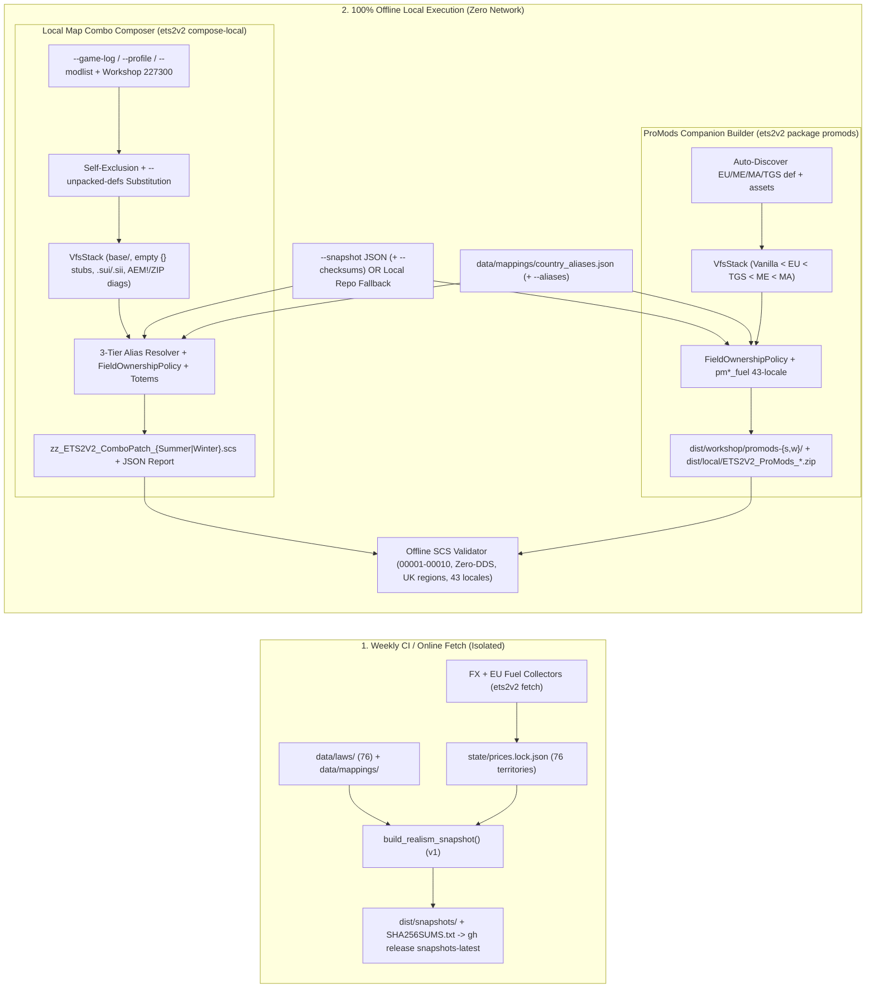

# Phase 4: ProMods Companion Builder & Local Map Combo Composer - Research

**Researched:** 2026-11-24
**Domain:** ProMods (`EU + ME + MA + TGS`) Clean-Room Companion Packaging, Offline Versioned `RealismSnapshot` Distribution (`snapshots-latest`), ETS2 `1.62` Load-Order Resolution (`game.log.txt` / `profile.sii` / `modlist` / Steam Workshop `227300`), and `FieldOwnershipPolicy` Multi-Map Combo Composition
**Confidence:** **HIGH**

---

<user_constraints>
## User Constraints (from CONTEXT.md)

### Locked Decisions

#### 1. ProMods Registry Expansion & `RealismSnapshot` Distribution (`MAP-01`, `MAP-02`)
- **D-01 — Full ProMods Territory Laws & Seeded Lockfile Prices in Phase 4:** Populate canonical statutory law records under `data/laws/countries/<iso2>.json` (registered in `data/mappings/ets2_countries.json` with `vanilla_1_62: false`) and curated seed fuel prices in `state/prices.lock.json` for all ProMods `EU + ME + MA + TGS` territories (~75+ total Vanilla + ProMods territories, exact inventory verified on disk during Phase 4 research). Keep Vanilla+DLC Core builds strictly scoped to the `36` `vanilla_1_62: true` countries so Core Workshop packages never bloat or change scope, while `realism-snapshot-{summer|winter}.json` immediately covers all Vanilla + ProMods territories cleanly (converting non-EUR currencies via existing live FX providers in `ets2v2 fetch`). — **Reversibility:** `moderate` — cleanly bridges Phase 4 ProMods/snapshots and Phase 5's `200+` global expansion.
- **D-02 — Keep `RealismSnapshot` Frozen at `schema_version: 1` & Externalize Map Aliases:** Keep `RealismSnapshot` (`src/ets2v2/registry/snapshot.py`, locked as `one-way` in Phase 2 `D-11` and Phase 3 `D-13`) strictly at `schema_version: 1` with `extra="forbid"`. For non-vanilla countries absent from `data/baselines/ets2_1.62_def/countries.json`, derive `imperial_units` deterministically from `CountryLawRecord.speed_unit == "mph"` (continuing to assert parity against `countries.json` for `vanilla_1_62: true` entries). Store sub-national and mod-specific slug mappings (e.g., `indo_b`, `n_ireland`, `aland`, `svalbard`, `jersey`, `guernsey`, `isle_of_man`, `westbank`, `northern_cyprus`, Project Japan prefectures) in a separate bundled `data/mappings/country_aliases.json` file (overridable via `--aliases <path>` in `compose-local`). — **Reversibility:** `one-way` — preserves full `schema_version: 1` wire compatibility across Phases 2–5.
- **D-03 — Rolling Public GitHub Release (`snapshots-latest`) + `SHA256SUMS.txt`:** Extend `.github/workflows/phase-a-release.yml` (and/or a paired release step on `master`) to publish `realism-snapshot-summer.json`, `realism-snapshot-winter.json`, and `SHA256SUMS.txt` to a rolling public GitHub Release tagged `snapshots-latest` alongside the `phase-a-release-bundle` workflow artifact. This gives offline `compose-local` and ProMods users direct, unauthenticated HTTPS download links with verifiable checksums without committing weekly snapshot JSONs into Git history.
- **D-04 — Offline Snapshot Loading, Verification & Repo Checkout Fallback:** Both the ProMods builder and `ets2v2 compose-local` accept `--snapshot <path>` (validating `schema_version: 1` via `RealismSnapshot.model_validate_json` and optionally verifying integrity against `--checksums <SHA256SUMS.txt>` or a sibling checksum manifest). When `--snapshot` is omitted inside a local repository checkout, fall back 100% offline to building the snapshot in-memory from `data/laws/` + `state/prices.lock.json` for the requested `--season`. Expose a dedicated snapshot verification CLI subcommand (e.g., `ets2v2 registry snapshot-verify` / `ets2v2 snapshot verify`) for air-gapped auditing.

#### 2. ProMods Companion Packaging, Scope & Clean-Room Boundaries (`MAP-01`)
- **D-05 — Standalone All-in-One ProMods Edition (Replaces Core):** Build **Summer (ProMods Edition)** and **Winter (ProMods Edition)** as **standalone all-in-one replacements** for Vanilla+DLC Core — not layered addons requiring Core below them. Each ProMods Edition ships surgically patched Vanilla + ProMods `def/country/<slug>.sui` & `speed_limits.sii` (preserving ProMods `uk.sui` `scotland`/`wales` regions and ProMods country geometry), Vanilla `def/sign/board/*.sii` + 43-locale `local_module.ets2v2_fuel.sii`, AND ProMods 43-locale `local_module.{pm_fuel,pm_me_fuel,pm_tgs_fuel}.sii` so ProMods users enable **one single mod** above ProMods Def with zero Core-above-ProMods clobber risk. — **Reversibility:** `costly` — defines Workshop listing semantics and Mod Manager placement instructions.
- **D-06 — Version-Agnostic Auto-Discovery with Modular Subsets & `--require-all-packs`:** Auto-discover installed ProMods `def` / `defmap` archives in `--mod-dir` using version-agnostic filename matching (handling future ProMods version bumps cleanly beyond `v284`/`v104`/`v170`, plus explicit per-pack path overrides `--promods-eu`, `--promods-me`, `--promods-ma`, `--promods-tgs`). Require ProMods `EU` def by default and include `ME`, `MA`, and `TGS` automatically whenever present; provide `--require-all-packs` so official maintainer Workshop builds fail fast if any of the 4 ProMods packs is missing.
- **D-07 — Dual ProMods Packaging Targets, Dedicated Icons & Validator Coverage:** Mirror Core's dual-target layout (`02-CONTEXT` `D-06`/`D-07`/`D-09`) by emitting both:
  - Unpacked Workshop Uploader roots under `dist/workshop/promods-summer/` and `dist/workshop/promods-winter/` (`versions.sii` with single `.universal`, `universal/`, `manifest.sii` with `mp_mod_optional: true` and no `display_name`/`compatible_versions[]`).
  - Drop-in local ZIPs under `dist/local/ETS2V2_ProMods_Summer.zip` and `dist/local/ETS2V2_ProMods_Winter.zip` (normalized `1980-01-01` timestamps, POSIX `0o644` permissions).
  - Checked-in clean-room `276x162` EXIF/ICC-stripped JPEG icons (`assets/icons/promods_summer.jpg`, `assets/icons/promods_winter.jpg`) generated by `ets2v2 package icons`.
  - Offline SCS Validator enforcement covering `00001`–`00010`, `WARN 00001`/`00002`, Zero-DDS, ProMods UK `regions[]` preservation, and exact 43-locale sync across `local_module.ets2v2_fuel.sii` and emitted `local_module.{pm_fuel,pm_me_fuel,pm_tgs_fuel}.sii` modules.
- **D-08 — Minimal Realism-Only Footprint, Dynamic `pm*_fuel` Key Discovery & Git/IP Guards:**
  - Emit **strictly** patched country `.sui` / `speed_limits.sii`, Vanilla totem boards/locales, and ProMods `local_module.pm*_fuel.sii` — never copying `def/country.sii`, `def/country.promods*.sii`, map sectors, models, companies, or unpatched ProMods assets.
  - Read exact `key[]` sets dynamically from the user's installed ProMods `locale/<lang>/local_module.{pm_fuel,pm_me_fuel,pm_tgs_fuel}.sii` files, update every matched fuel-price key in native local currency formatting from the snapshot across all **43** active ETS2 `1.62` locales (`fr_qc` excluded, `fr_ca` synced), and preserve any unrecognized/non-price keys verbatim so ProMods updates never break totems.
  - Refuse `--out-dir` paths inside tracked repository directories (`data/`, `src/`, `tests/`, `state/`) to guarantee zero ProMods files ever enter Git. Run CI tests against clean-room synthetic ProMods fixtures and mirror Phase 1's `@pytest.mark.local_ets2` with `@pytest.mark.local_promods` for optional verification against local `D:\ETS2Data\Euro Truck Simulator 2\mod`.

#### 3. `ets2v2 compose-local` Load-Order Discovery, Protection & CLI UX (`MAP-03`, `MAP-05`)
- **D-09 — Multi-Source Load-Order Resolution (`--game-log`, `--profile`, `--modlist`) + Workshop `227300`:** Support three deterministic load-order inputs for `ets2v2 compose-local`:
  1. `--modlist <file>` — explicit line-delimited archive/mod list (ordered top-to-bottom or bottom-to-top per documented convention).
  2. `--game-log <path>` — plaintext ETS2 `game.log.txt` parsing mounted local `mod/` and Steam Workshop (`227300`) packages in exact engine mount order (works cleanly even when `profile.sii` is `ScsC`-encrypted).
  3. `--profile <path>` — plaintext `SiiNunit` `profile.sii` `active_mods[]` parser; if the file starts with an encrypted `ScsC` header, never attempt decryption — emit an actionable error advising `--game-log` or setting `g_save_format 2`.
  Resolve mounted packages across `--mod-dir` and optional `--workshop-dir` (`.../steamapps/workshop/content/227300`), layered cleanly on top of `--game-dir` `def.scs` (or clean-room `data/baselines/ets2_1.62_def/` fallback when `--game-dir` is not supplied).
- **D-10 — Automatic Self-Exclusion for Idempotent Weekly Re-Runs:** Automatically detect and exclude previously generated ETS2V2 packages (`zz_ETS2V2_ComboPatch_*`, `ETS2V2_Core_*`, `ETS2V2_ProMods_*` via filename pattern and/or an embedded ETS2V2 marker in `manifest.sii` / metadata) from the scanned input VFS stack by default, recording each skipped self-package in the compose report so players can re-run `compose-local` weekly without disabling last week's patch in Mod Manager first.
- **D-11 — Protected Archive (`AEM!`/Encrypted ZIP/`3nK`) Warning Policy & Smart `--unpacked-defs`:**
  - Never decrypt or crack `AEM!`, `3nK`, or password-encrypted ZIP archives. Emit structured diagnostics naming each protected archive, its protection kind, any visible `def/country*` or `def/sign/board*` paths discovered from unencrypted ZIP central directories, and an actionable `--unpacked-defs` hint.
  - Default to **warn clearly and continue** patching all readable layers (exit `0`) so map combos with plain-ZIP fix packs above encrypted bases (e.g., `gmc.beyond.fix` above `Beyond_by_TerraMaps`) work seamlessly; provide `--strict-protected` to exit non-zero when an operator requires hard failure on any protected archive.
  - Support repeatable `--unpacked-defs <dir>`: if `<dir>` contains per-archive subdirectories matching protected archive stems, substitute them **in-place at the protected archive's exact load-order priority**; if `<dir>` is a raw unpacked mod tree (`def/` / `locale/` directly at root), mount it as an explicit override layer in the stack.
- **D-12 — Local `.scs` Output, Pre-Write Offline Validation & Audit Reporting:** Emit deterministic local ZIP-format `zz_ETS2V2_ComboPatch_{Summer|Winter}.scs` (`1980-01-01` normalized timestamps, POSIX `0o644` permissions, `manifest.sii` with `display_name` and `mp_mod_optional: true`, clean-room icon). Run Offline Validator checks (SII hygiene, Zero-DDS, 43-locale sync, manifest integrity) before finalizing output. Expose `--dry-run` (compute & audit without writing `.scs`) and `--json` / `--report-json <path>` reporting every resolved country, winning mod layer, `FieldOwnershipPolicy` action, unmatched/skipped territory, and protected-archive diagnostic.

#### 4. `FieldOwnershipPolicy`, Country Aliases & Totem Controls (`MAP-04`, `MAP-05`)
- **D-13 — Deterministic 3-Tier Country Alias Resolution & Safe Unmatched Skipping:** Match each active map country discovered through `VfsStack` (`def/country*.sii` `@include` graph respecting `.sui`/`.sii` fragments, `base/` mounts, and empty `SiiNunit { }` suppression stubs) against the loaded `RealismSnapshot` using a strict 3-tier order:
  1. Exact slug override in `data/mappings/country_aliases.json` (plus optional `--aliases` file) — handles sub-national & microstate slugs (`indo_b`, `indo_th`, `indo_tm`, Project Japan prefectures, `n_ireland`, `aland`, `svalbard`, `jersey`, `guernsey`, `isle_of_man`, `northern_cyprus`, `transnistria`, `westbank`, etc.) cleanly even when a map mod sets an unexpected `iso_country_code`.
  2. Exact `iso_country_code` (ISO3) or `country_code` (ISO2) match against snapshot countries.
  3. Canonical `ets2_slug` match against snapshot countries.
  Any country still unmatched (e.g., fictional maps or global territories awaiting Phase 5's `200+` expansion) is **skipped untouched** and recorded clearly in the compose report — never crashing or corrupting map files.
- **D-14 — `max_of_map_and_real` Axle Merge Semantics (`mass_limit_per_axle_count[]`):** Merge map and snapshot axle mass arrays across `N = max(len(map), len(real))` by taking element-wise `max(map_val(i), real_val(i))` with last-value carry-forward (`arr[min(i, len(arr)-1)]`, matching ETS2's own fallback semantics for higher axle counts) followed by monotonic non-decreasing enforcement (`out[i] = max(out[i], out[i-1])`). This guarantees extra/higher map axles are never downgraded (EAA `80t`, RusMap/TST `48t`, Finland `105t`) while stale shorter map arrays are safely upgraded (4-axle `40t` Iceland -> 5-axle `60t`).
- **D-15 — `patch_if_single_tz`, Custom Lane Preservation & `imperial_units` Parity Guard:**
  - **Timezones (`patch_if_single_tz`):** Skip `time_zone` and `time_zone_name` updates whenever the resolved `country_data` unit defines `secondary_time_zone` or `secondary_time_zone_area` (preserving TST `27`-TZ Russia, UMCF `5`-TZ Kazakhstan, EAA Brazil) OR omits `time_zone` entirely. Patch seasonal DST offsets/names strictly on single-TZ definitions.
  - **Map-owned identity/geometry:** Never mutate `country_id`, `name`, `name_localized`, `country_code`, `iso_country_code`, `pos`, `regions[]`, `region_areas[]`, `secondary_time_zone*`, `leftside_traffic`, `imperial_units`, `trailer_standalone`, or `train`/`tram` speed blocks.
  - **Speed limits (`speed_limits.sii`):** Surgically patch only matching canonical lane classes (`local_road`, `expressway`, `motorway`, `slow_road`) inside `car`/`truck`/`bus`, preserving any map-added custom lane classes and `train`/`tram` units verbatim. Skip `speed_limits.sii` if absent from the map's VFS. Enforce an **`imperial_units` parity guard**: if the map country's `imperial_units` flag disagrees with the snapshot country's `imperial_units`, emit a warning and skip `speed_limits.sii` patching rather than writing `km/h` numbers into an `mph` country (or vice versa).
- **D-16 — Self-Contained Combo Totems by Default, Opt-In `--patch-hardcoded-totems` & `--no-totems`:**
  - By default, `ets2v2 compose-local` makes `zz_ETS2V2_ComboPatch_{Summer|Winter}.scs` self-contained for fuel totems: it emits Vanilla `1.62` Option 4b Zero-DDS boards + 43-locale `local_module.ets2v2_fuel.sii` AND dynamically updates any ProMods `local_module.{pm_fuel,pm_me_fuel,pm_tgs_fuel}.sii` detected in the active VFS stack across all 43 locales.
  - Hardcoded numeric community map boards (e.g., JRR `indo_gas_totem_01a.sii` / 7RM numeric gas signs) remain **untouched by default** and are rewritten only when `--patch-hardcoded-totems` is explicitly passed — rewriting matched numeric boards cleanly to namespaced `@@fp_*_ets2v2@@` tokens backed by `local_module.ets2v2_fuel.sii` across all 43 locales while leaving ambiguous/non-matching signs untouched.
  - Provide `--no-totems` as an escape hatch for users who want `def/country/` realism patches only alongside a third-party sign/totem mod.

### Claude's Discretion
- Unlocking `src/ets2v2/merge/` in `tests/test_cli_scaffold.py::test_active_phase_only_package_layout` and exact internal module layout across `src/ets2v2/merge/`, `src/ets2v2/package/`, `src/ets2v2/registry/`, and `src/ets2v2/validate/` while preserving the acyclic DAG and offline AST isolation walls (`test_cli_scaffold.py::test_phase3_ast_dag_isolation_walls`).
- Exact `ets2v2` CLI subcommand and flag names (`ets2v2 package promods`, `ets2v2 compose-local`, `ets2v2 registry snapshot-verify`), default path discovery on Windows/Linux, and JSON report schema field names.
- Exact `CountryMappingEntry.country_id` relaxation (`int | None`, required when `vanilla_1_62: true`, optional when `vanilla_1_62: false`) and `data/mappings/country_aliases.json` Pydantic schema.
- Exact `Pillow` typography/badge styling for `assets/icons/promods_{summer,winter}.jpg` and `ComboPatch` icon artwork.

### Deferred Ideas (OUT OF SCOPE)
None — discussion stayed strictly within Phase 4 boundaries. Global Tier 1 non-EU fuel APIs (`US`, `BR`, `AR`, `CO`, `CL`, `MY`, `JP`, `KR`), Tier 2 guarded national portal scrapers, Tier 3 `200+` global baselines, and CI-only OSM (`CC BY-SA`) speed-limit drift audits remain mapped to Phase 5 (`GLB-01`..`GLB-04`); full-auto SteamCMD Workshop publishing remains deferred to V2 (`PUB-V2-01`, `PUB-V2-02`).
</user_constraints>

---

<phase_requirements>
## Phase Requirements

| ID | Description | Research Support |
|----|-------------|------------------|
| **MAP-01** | Provide a local **ProMods Companion Builder** producing `Summer (ProMods Edition)` and `Winter (ProMods Edition)` from the maintainer's installed ProMods `def` packages (`promods-eu-def-v284.scs`, `promods-me-defmap-v284.scs`, `promods-ma-defmap-v104.scs`, `promods-tgs-defmap-v170.scs`), including `local_module.{pm_fuel,pm_me_fuel,pm_tgs_fuel}.sii` totems, without ever storing ProMods files in the public GitHub repository. | Sections 1, 2, 3 lock the verified ProMods 2.85 `def`/`defmap` + `HashFsV1Archive` `*-assets-*.scs` archive split (`pm_fuel` 1,004 keys / `pm_me_fuel` 84 keys / `pm_tgs_fuel` 48 keys live in `assets`, NOT `def`/`defmap`!), complete 76-territory canonical registry (`36` vanilla + `40` ProMods EU/ME/MA/TGS), exact module-scoped 67-prefix -> ISO-2 map (`mn` = Montenegro in `pm_fuel` vs Mongolia in `pm_tgs_fuel`!), exact `_v0`..`_v4` formatter grammar, official bottom-to-top ProMods stacking order (`Vanilla < EU < TGS < ME < MA`), dual-target packaging (`dist/workshop/promods-{summer,winter}/` + `dist/local/ETS2V2_ProMods_{Summer,Winter}.zip`), dedicated `276x162` icons, `--out-dir` repo-containment guard, and Offline Validator extensions. |
| **MAP-02** | Define and export versioned `realism-snapshot-{summer|winter}.json` artifacts decoupling online price/law ingestion from offline local patch generation. | Section 1 locks `RealismSnapshot` (`schema_version: 1`, `extra="forbid"`) expansion to all 76 Vanilla+ProMods territories with `imperial_units = (law.speed_unit == "mph")` for non-vanilla entries, safe FX cross-validation separating core vs extended currencies (incl. post-2026 redenominated `SYP`), canonical `SHA256SUMS.txt` generation, `ets2v2 registry snapshot-verify` air-gapped CLI, and idempotent `gh release` rolling upload to `snapshots-latest` in `.github/workflows/phase-a-release.yml`. |
| **MAP-03** | Implement `ets2v2 compose-local` to scan the user's local `mod/` folder and active load order (*RusMap*, *TST*, *UMCF*, *Beyond*, *JRR*, *SEA*, *RoC*, *Project Japan Relocated*, *EAA Rescaled*, Africa mods) across `.sui`, `.sii` fragments, `base/` paths, and empty `SiiNunit {}` stubs to generate `zz_ETS2V2_ComboPatch_{Summer|Winter}.scs`. | Section 4 locks exact `profile.sii` (`active_mods[0]` = lowest priority, `mod_workshop_package.<16-hex>` -> decimal `227300` + `versions.sii` package selector, `ScsC` detection), `game.log.txt` active-mount parser (distinguishing active mounts from startup scan), `--modlist` parser, automatic ETS2V2 self-exclusion (`D-10`), `VfsStack` `def/country*.sii` `@include` graph traversal (handling `.sii` fragments, `base/` flattening, empty `{}` stubs), and bundled `data/mappings/country_aliases.json` (incl. SemEuropa Brazilian state collision protection & `iana_timezone_override`). |
| **MAP-04** | Apply `FieldOwnershipPolicy` merge guardrails in `compose-local`: `max_of_map_and_real` axle weights (preserving EAA 80t, Iceland 60t, RusMap/TST 48t, FI 105t) and `patch_if_single_tz` timezone patching (preserving TST 27-TZ Russia, UMCF Kazakhstan `ALMT`/`AQTT`, EAA Brazil). | Section 5 locks the exact `FieldOwnershipPolicy` Pydantic/dataclass contract, element-wise carry-forward `max_of_map_and_real` algorithm, `patch_if_single_tz` + `iana_timezone_override` rules, `imperial_units` parity guard, and in-place custom-lane-preserving `speed_limits.sii` merge (preventing `patch_speed_limits`'s `_replace_unit_lane_region` fallback from dropping map-added lanes). |
| **MAP-05** | Detect `AEM!`/encrypted ZIP archives (`12` identified locally) with clear user diagnostics and `--unpacked-defs` override support, plus opt-in `--patch-hardcoded-totems` support for JRR/7RM numeric gas signs. | Section 5 locks structured `ProtectedArchiveReport` aggregation over `VfsStack.diagnostics()` + encrypted ZIP central-directory `def/country*`/`def/sign/board*` inspection, in-place stem-matched vs root-override repeatable `--unpacked-defs`, warn-and-continue vs `--strict-protected`, and conservative opt-in `--patch-hardcoded-totems` targeting JRR `indo_gas_totem_01{a,l,m,n,o,p,q,r}.sii` (while skipping label boards `01{b..i}` and station IDs `01{j,k}` `34.138.06`). |
</phase_requirements>

---

## Summary

Direct forensic inspection of ProMods `2.85` (`EU 2.85`, `ME 2.85`, `MA 1.05`, `TGS 1.71`), real ETS2 `1.62.3.3s` `profile.sii` & `game.log.txt`, `500+` local combo archives (`RusMap`, `TST`, `UMCF`, `Beyond`, `EAA`, `SemEuropa`, `SEA`, `RoC`, `JRR`, `Africa`, etc.), and the existing Phase 1–3 `src/ets2v2/` codebase resolves every architectural unknown for Phase 4 with **zero new external Python dependencies**.

**Five critical empirical discoveries directly prevent execution-time bugs:**
1. **ProMods 2.85 `pm*_fuel` Archive Split (`MAP-01`):** `local_module.pm_fuel.sii` (`1,004` keys, `56` prefixes), `local_module.pm_me_fuel.sii` (`84` keys, `8` prefixes), and `local_module.pm_tgs_fuel.sii` (`48` keys, `3` prefixes) live inside **`HashFsV1Archive` `*-assets-*.scs`** (`promods-eu-assets-v285.scs`, `promods-me-assets-v285.scs`, `promods-tgs-assets-v171.scs`), **NOT** in `*-def-*.scs` or `*-defmap-*.scs` `[VERIFIED: local_telemetry_digest.md:522-725]`. Auto-discovery (`D-06`) must therefore discover both `def`/`defmap` AND `assets` archives per pack, gracefully skipping `pm*_fuel` when an `assets` archive is absent (failing fast under `--require-all-packs`).
2. **ProMods TGS v1.71 Territory Expansion & Exact `76`-Territory Inventory (`D-01`):** `promods-tgs-defmap-v171.scs` (`def/country.kz.sii`) expanded from 3 countries (`KZ`, `TM`, `UZ`) to **7 active countries** (`china`, `kazakhstan`, `kyrgyzstan`, `mongolia`, `tajikistan`, `turkmenistan`, `uzbekistan`) `[VERIFIED: local_telemetry_digest.md:263-269]`. Combining `36` Vanilla+DLC + `21` ProMods EU ISO-2 + `8` ProMods ME + `4` ProMods MA/ME North Africa (`MA`, `TN`, `DZ`, `LY`) + `7` ProMods TGS gives **exactly `76` canonical ISO-2 territories** in `data/laws/countries/<iso2>.json`, `data/mappings/ets2_countries.json`, `state/prices.lock.json`, and `realism-snapshot-{summer|winter}.json`.
3. **Module-Scoped `pm*_fuel` Prefix Collision & Post-2026 Syria Redenomination:** In `pm_fuel`, prefix `mn` means **Montenegro (`ME`, EUR)**, NOT Mongolia (`MN`, MNT) `[VERIFIED: local_telemetry_digest.md:639]`. Prefix resolution must be **module-scoped** (`pm_fuel` vs `pm_me_fuel` vs `pm_tgs_fuel`). Meanwhile, Syria executed a **100-to-1 currency redenomination on 2026-01-01** (`1 new SYP = 100 old SYP`), which directly explains `promods-me-assets-v285.scs` showing `fp_syr_diesel = "150"` against `syria.sui` `fuel_price: 1.094` `[VERIFIED: local_telemetry_digest.md:507,686]` `[CITED: search_web]`.
4. **SemEuropa 2-Letter State Code Collisions & Sub-National Timezone Overrides (`D-13`):** `eaa_map_semeuropa_v1.scs` emits Brazilian states with `country_code` / `iso_country_code` values (`AL`, `AM`, `BA`, `ES`, `MA`, `MT`, `RS`, `PE`, `PA`, `RO`, `SE`) that collide with sovereign ISO-2 codes (`Albania`, `Armenia`, `Bosnia`, `Spain`, `Morocco`, `Malta`, `Serbia`, `Romania`, `Sweden`) `[VERIFIED: local_telemetry_digest.md:845]`. Running Tier 1 `country_aliases.json` slug lookup BEFORE Tier 2 `iso_country_code`/`country_code` matching completely neutralizes this trap. Furthermore, supporting optional `iana_timezone_override` on alias entries (`can_islands` -> `Atlantic/Canary`, `indo_b/th/tm` -> `Asia/Jakarta`/`Makassar`/`Jayapura`, `guianafr` -> `America/Cayenne`) prevents aliasing a sub-national region from clobbering its timezone with mainland time.
5. **In-Repo `patch_speed_limits` Custom-Lane Trap & FX Pipeline Resilience:** `src/ets2v2/sii/speed_limits.py:289-292` replaces the entire lane block whenever `existing_names != target_names` `[VERIFIED: src/ets2v2/sii/speed_limits.py:289-292]`. To preserve map-added custom lane classes (`D-15`), `merge/policy.py` must construct the patched lane list in existing lane order, substituting only matching canonical classes and keeping custom lanes verbatim. Similarly, `normalize/fx.py` must distinguish strictly required Core European currencies (`16`) from extended ProMods currencies (`24`) so an exotic FX provider gap (e.g., `SYP`/`TMT`/`LBP`) falls back cleanly to `state/prices.lock.json` / reference FX without aborting Friday CI.

**Primary recommendation:** Execute Phase 4 across 4 cleanly sequenced plans: `04-01` (76-territory law/mapping/lockfile expansion, `country_aliases.json`, `RealismSnapshot` v1 non-vanilla support, `SHA256SUMS.txt`, `snapshot-verify` CLI, `snapshots-latest` CI release), `04-02` (unlock `src/ets2v2/merge/`, ProMods `def`/`defmap`+`assets` auto-discovery, `pm*_fuel` 43-locale compiler, standalone ProMods Companion Builder + icons + Offline Validator), `04-03` (`game.log.txt`/`profile.sii`/`modlist` + Workshop `227300` load-order parsers, self-exclusion, `VfsStack` `@include` country discovery, 3-tier alias resolver), and `04-04` (`FieldOwnershipPolicy` engine, `max_of_map_and_real`, `patch_if_single_tz`, `AEM!`/encrypted-ZIP diagnostics + smart `--unpacked-defs`, opt-in `--patch-hardcoded-totems`, and validated `zz_ETS2V2_ComboPatch_{Summer|Winter}.scs` emitter).

---

## Architectural Responsibility Map

| Capability | Primary Tier | Secondary Tier | Rationale |
|------------|-------------|----------------|-----------|
| **76-Territory Law Registry, `country_aliases.json` & `RealismSnapshot` v1 (`MAP-02`, `D-01`, `D-02`)** | Registry Layer (`src/ets2v2/registry/{models,loader,snapshot,timezone,aliases}.py`) | Data Store (`data/laws/countries/*.json`, `data/mappings/{ets2_countries,country_aliases}.json`, `state/prices.lock.json`) | Owns canonical statutory truth, seasonal DST/abbreviation resolution, and locked `schema_version: 1` snapshot emission/verification completely offline. |
| **Extended FX Cross-Validation & Lockfile Persistence (`D-01`)** | Normalization & Fetch Layers (`src/ets2v2/normalize/{currencies,fx,lockfile}.py`, `src/ets2v2/fetch/pipeline.py`) | State Store (`state/prices.lock.json`) | Separates online FX/fuel updates from offline snapshot/package compilation while isolating exotic ProMods currency fallbacks from Core EU Friday CI. |
| **Rolling `snapshots-latest` Release & `SHA256SUMS.txt` (`D-03`, `D-04`)** | Publish & CI Layer (`src/ets2v2/publish/release.py`, `.github/workflows/phase-a-release.yml`) | Registry Verifier (`ets2v2 registry snapshot-verify`) | Emits canonical `SHA256SUMS.txt` offline and publishes unauthenticated HTTPS rolling release assets via `gh release` without storing snapshots in Git history. |
| **Load-Order Parsing, ProMods Discovery & Self-Exclusion (`MAP-01`, `MAP-03`, `D-06`, `D-09`, `D-10`)** | Merge Layer (`src/ets2v2/merge/{load_order,promods_discovery,self_exclude}.py`) | VFS Layer (`src/ets2v2/vfs/{stack,hashfs,zip_archive,dir_archive}.py`) | Translates user-side ETS2 artifacts (`profile.sii`, `game.log.txt`, `modlist`, Workshop `227300`, ProMods `def`+`assets`) into a clean, priority-ordered `VfsStack` with zero network I/O. |
| **`FieldOwnershipPolicy`, Alias Resolution, `pm*_fuel` & Hardcoded Totems (`MAP-04`, `MAP-05`, `D-11`, `D-13`..`D-16`)** | Merge Layer (`src/ets2v2/merge/{discovery,policy,pm_totems,hardcoded_totems,composer}.py`) | SII Layer (`src/ets2v2/sii/{country,speed_limits,sign_board,localization}.py`) | Pure in-memory structural merge engine computing surgical SII/SUI edits, protected-archive diagnostics, and totem payloads without directly writing archives. |
| **ProMods Dual-Target & Local `.scs` Packaging + Icons (`D-05`, `D-07`, `D-08`, `D-12`)** | Package Layer (`src/ets2v2/package/{promods,combo,icons,metadata,builder}.py`) | Repo Safety Guard (`_refuse_tracked_repo_output`) | Handles deterministic ZIP/Workshop serialization (`1980-01-01`, `0o644`), `276x162` JPEG icon generation, and `--out-dir` clean-room containment checks. |
| **Offline SCS Validator for ProMods & ComboPatch (`D-07`, `D-12`)** | Validation Layer (`src/ets2v2/validate/{workshop,invariants}.py`) | SII & VFS Readers | Independently re-parses emitted Workshop roots, local ZIPs, and `.scs` combo patches to enforce `00001`–`00010`, Zero-DDS, UK `regions[]`, and 43-locale sync across `ets2v2_fuel` + `pm*_fuel`. |

---

## Standard Stack

### Core (Zero New Dependencies Added in Phase 4)

| Library | Version | Purpose | Why Standard |
|---------|---------|---------|--------------|
| **Python** | `>=3.12` (`3.12.13`) `[VERIFIED: pyproject.toml:9]` | Stdlib `zipfile`, `hashlib`, `zoneinfo`, `decimal`, `re`, `pathlib`, `argparse`, `json` | Powers deterministic ZIP/SCS packing, SHA-256 checksums, IANA DST calculation, and `Decimal` `ROUND_HALF_UP` formatting with zero extra deps. |
| **pydantic** | `>=2.14,<3` `[VERIFIED: pyproject.toml:15]` | Frozen strict schemas (`CountryAliasesRegistry`, `FieldOwnershipPolicy`, `ComposeReport`, `ProModsBuildReport`, `SnapshotVerifyReport`, `RealismSnapshot` v1) | Enforces `ConfigDict(strict=True, frozen=True, extra="forbid")` consistently across all Phase 4 models. |
| **tzdata** | `>=2025.2` `[VERIFIED: pyproject.toml:16]` | Cross-platform IANA tzdb on Windows & Linux (includes Kazakhstan 2024a single `UTC+5`, Greenland `America/Nuuk` `UTC-2/-1`, Jordan/Syria `UTC+3`, Egypt DST) | Required on Windows where stdlib `zoneinfo` lacks system tzdata. |
| **pillow** | `>=12,<14` `[VERIFIED: pyproject.toml:14]` | Clean-room `276x162` baseline RGB JPEG icon synthesis (`assets/icons/promods_{summer,winter}.jpg` and `ComboPatch` icon) | Already generates EXIF/ICC-stripped Workshop icons in `src/ets2v2/package/icons.py`. |
| **httpx** + **openpyxl** | `>=0.28,<0.29` / `>=3.1,<4` `[VERIFIED: pyproject.toml:12-13]` | Retained strictly in `src/ets2v2/fetch/` (AST-blocked from `merge/`, `package/`, `registry/`, `validate/`, `publish/`) | Online fetch remains strictly isolated from offline Phase 4 composition. |

### Supporting (Existing Quality Gates)

| Library | Version | Purpose | When to Use |
|---------|---------|---------|-------------|
| **pytest** + **pytest-cov** | `>=9.2,<9.3` `[VERIFIED: pyproject.toml:25-26]` | Offline unit/integration tests + `@pytest.mark.local_promods` | Every task commit (`uv run --offline pytest -q --tb=short -m "not local_ets2 and not local_promods"`). |
| **ruff** | `>=0.16` `[VERIFIED: pyproject.toml:27]` | Linting (`E, F, I, UP, B, SIM, RUF`) + formatting | Every task commit. |
| **basedpyright** | `>=1.40,<2` `[VERIFIED: pyproject.toml:24]` | Strict static type checking (`typeCheckingMode = "strict"`) | Every task commit. |

### Package Legitimacy Audit

**None** — Phase 4 installs **zero** new external packages (`pyproject.toml` and `uv.lock` runtime and dev dependencies remain unchanged from Phase 3 `[VERIFIED: pyproject.toml:11-29]`).

---

## Deliverable 1: 76-Territory ProMods Registry, `RealismSnapshot` v1 & `snapshots-latest` (`MAP-02`, `D-01`..`D-04`)

### 1.1 Complete 76-Territory Inventory (`36` Vanilla + `40` ProMods `EU + ME + MA + TGS`)

Verified directly against `data/mappings/ets2_countries.json:1-294`, `local_telemetry_digest.md:263-269,488-725`, and `FEATURES.md:24-30`.

- **Existing `36` Vanilla + DLC (`vanilla_1_62: true`):** Unchanged (`AL, AT, BA, BE, BG, CH, CZ, DE, DK, EE, ES, FI, FR, GB, GR, HR, HU, IS, IT, LT, LU, LV, ME, MK, NL, NO, PL, PT, RO, RS, RU, SE, SI, SK, TR, XK`). Core builds (`build_core_edition` `[VERIFIED: src/ets2v2/package/builder.py:186]`) continue iterating strictly over `bl_countries.countries` (`36` vanilla slugs), so Vanilla+DLC Core Workshop packages stay strictly `36` countries (`579` files).
- **New `40` ProMods Territories (`vanilla_1_62: false`)** — each gets its own canonical `data/laws/countries/<iso2>.json`, `data/mappings/ets2_countries.json` entry, and `state/prices.lock.json` entry:

| Pack | ISO2 | ISO3 | `ets2_slug` | PM `id` | IANA Timezone | TZ Abbr (Win/Sum) | Unit | DRL (S/W) | Car (L/E/M, Urb) | Truck (L/E/M, Urb) | Bus (L/E/M, Urb) | Axles (t) | Currency | Seed EUR/L Diesel |
|------|------|------|-------------|--------:|---------------|-------------------|------|-----------|------------------|--------------------|------------------|-----------|----------|------------------:|
| EU | `AD` | `and` | `andorra` | 15 | `Europe/Andorra` | `CET`/`@@tz_cest@@` | `kmh` | F/F | 90/90/90 (40) | 70/70/70 (40) | 70/70/70 (40) | 18/26/36/40 | `EUR` | `1.490` |
| EU | `AM` | `arm` | `armenia` | 47 | `Asia/Yerevan` | `AMT`/`AMT` | `kmh` | F/F | 90/90/110 (60) | 70/70/90 (60) | 90/90/90 (60) | 18/25/36/40/44 | `AMD` | `1.380` |
| EU | `AX` | `ala` | `aland` | 235 | `Europe/Mariehamn` | `@@tz_eet@@`/`@@tz_eest@@` | `kmh` | T/T | 90/90/90 (50) | 80/80/80 (50) | 80/80/80 (50) | 18/26/38/44/60 | `EUR` | `1.880` |
| EU | `AZ` | `aze` | `azerbaijan` | 48 | `Asia/Baku` | `AZT`/`AZT` | `kmh` | F/F | 90/90/110 (60) | 70/70/90 (60) | 90/90/90 (60) | 18/25/36/40/44 | `AZN` | `0.590` |
| EU | `BY` | `blr` | `belarus` | 16 | `Europe/Minsk` | `@@tz_msk@@`/`@@tz_msk@@` | `kmh` | F/F | 90/100/120 (60) | 70/90/90 (60) | 90/100/100 (60) | 18/25/36/40/44 | `BYN` | `0.760` |
| EU | `CY` | `cyp` | `cyprus` | 20 | `Asia/Nicosia` | `@@tz_eet@@`/`@@tz_eest@@` | `kmh` | F/F | 80/80/100 (50) | 80/80/80 (50) | 80/80/80 (50) | 18/26/36/40 | `EUR` | `1.520` *(EC WOB)* |
| EU | `FO` | `fro` | `faroe` | 221 | `Atlantic/Faroe` | `WET`/`@@tz_west@@` | `kmh` | T/T | 80/80/80 (50) | 70/70/70 (50) | 80/80/80 (50) | 18/26/36/44 | `DKK` | `1.950` |
| EU | `GE` | `geo` | `georgia` | 24 | `Asia/Tbilisi` | `GET`/`GET` | `kmh` | F/F | 90/90/110 (60) | 70/70/80 (60) | 80/80/80 (60) | 18/25/36/40/44 | `GEL` | `1.120` |
| EU | `GG` | `ggy` | `guernsey` | — | `Europe/Guernsey` | `@@tz_gmt@@`/`@@tz_bst@@` | `mph` | F/F | 35/35/35 (25) | 35/35/35 (25) | 35/35/35 (25) | 18/26/38/40/44 | `GBP` | `1.850` |
| EU | `GI` | `gib` | `gibraltar` | — | `Europe/Gibraltar` | `CET`/`@@tz_cest@@` | `kmh` | F/F | 50/50/50 (50) | 50/50/50 (50) | 50/50/50 (50) | 18/26/36/40 | `GBP` | `1.560` |
| EU | `GL` | `grl` | `greenland` | 152 | `America/Nuuk` | `WGT`/`WGST` | `kmh` | T/T | 80/80/80 (50) | 70/70/70 (50) | 80/80/80 (50) | 18/26/36/40 | `DKK` | `0.810` |
| EU | `IE` | `irl` | `ireland` | 27 | `Europe/Dublin` | `@@tz_gmt@@`/`IST` | `kmh` | F/F | 80/100/120 (50) | 80/80/90 (50) | 80/100/100 (50) | 18/26/36/40/44 | `EUR` | `1.740` *(EC WOB)* |
| EU | `IM` | `imn` | `iom` | 203 | `Europe/Isle_of_Man` | `@@tz_gmt@@`/`@@tz_bst@@` | `mph` | F/F | 0/0/0 (30) | 40/40/40 (30) | 50/50/50 (30) | 18/26/38/40/44 | `GBP` | `1.850` |
| EU | `JE` | `jey` | `jersey` | 222 | `Europe/Jersey` | `@@tz_gmt@@`/`@@tz_bst@@` | `mph` | F/F | 40/40/40 (30) | 40/40/40 (30) | 40/40/40 (30) | 18/26/38/40/44 | `GBP` | `1.850` |
| EU | `LI` | `lie` | `liecht` | 29 | `Europe/Vaduz` | `CET`/`@@tz_cest@@` | `kmh` | T/T | 80/80/80 (50) | 80/80/80 (50) | 80/80/80 (50) | 18/26/36/40 | `CHF` | `1.940` |
| EU | `MC` | `mco` | `monaco` | 33 | `Europe/Monaco` | `CET`/`@@tz_cest@@` | `kmh` | F/F | 50/50/50 (50) | 50/50/50 (50) | 50/50/50 (50) | 18/26/36/40/44 | `EUR` | `1.850` |
| EU | `MD` | `mda` | `moldova` | 32 | `Europe/Chisinau` | `@@tz_eet@@`/`@@tz_eest@@` | `kmh` | F/T | 90/110/110 (50) | 70/90/90 (50) | 90/90/90 (50) | 18/25/36/40 | `MDL` | `1.280` |
| EU | `MT` | `mlt` | `malta` | 31 | `Europe/Malta` | `CET`/`@@tz_cest@@` | `kmh` | F/F | 80/80/80 (50) | 60/60/60 (50) | 60/60/60 (50) | 18/26/36/40 | `EUR` | `1.210` *(EC WOB)* |
| EU | `SJ` | `sjm` | `svalbard` | — | `Arctic/Longyearbyen` | `CET`/`@@tz_cest@@` | `kmh` | T/T | 80/80/80 (50) | 80/80/80 (50) | 80/80/80 (50) | 18/26/36/44/50 | `NOK` | `1.650` *(tax-free vs NO)* |
| EU | `SM` | `smr` | `sanmarino` | 39 | `Europe/San_Marino` | `CET`/`@@tz_cest@@` | `kmh` | T/T | 70/70/70 (50) | 60/60/60 (50) | 70/70/70 (50) | 18/26/36/40/44 | `EUR` | `1.780` *(tracks IT enclave)* |
| EU | `UA` | `ukr` | `ukraine` | 45 | `Europe/Kyiv` | `@@tz_eet@@`/`@@tz_eest@@` | `kmh` | T/T | 90/110/130 (50) | 70/90/90 (50) | 90/90/90 (50) | 18/25/36/40 | `UAH` | `1.320` |
| ME | `EG` | `egy` | `egypt` | 108 | `Africa/Cairo` | `@@tz_eet@@`/`@@tz_eest@@` | `kmh` | F/F | 90/100/120 (60) | 60/70/80 (60) | 80/90/100 (60) | 18/26/36/40/44 | `EGP` | `0.348` |
| ME | `IL` | `isr` | `israel` | 60 | `Asia/Jerusalem` | `IST`/`IDT` | `kmh` | F/T | 80/90/110 (50) | 80/80/80 (50) | 80/90/100 (50) | 18/26/36/40/44 | `ILS` | `1.920` |
| ME | `IQ` | `irq` | `iraq` | 59 | `Asia/Baghdad` | `AST`/`AST` | `kmh` | F/F | 100/100/120 (60) | 80/80/80 (60) | 80/90/100 (60) | 18/26/36/40/44 | `IQD` | `0.239` |
| ME | `JO` | `jor` | `jordan` | 63 | `Asia/Amman` | `AST`/`AST` | `kmh` | F/F | 90/100/110 (60) | 80/80/80 (60) | 80/90/100 (60) | 18/26/36/40/44 | `JOD` | `1.151` |
| ME | `LB` | `lbn` | `lebanon` | 68 | `Asia/Beirut` | `@@tz_eet@@`/`@@tz_eest@@` | `kmh` | F/F | 80/100/100 (50) | 60/70/80 (50) | 70/80/80 (50) | 18/26/36/40/44 | `LBP` | `1.257` |
| ME | `PS` | `pse` | `westbank` | 61 | `Asia/Hebron` | `@@tz_eet@@`/`@@tz_eest@@` | `kmh` | F/T | 80/90/90 (50) | 70/80/80 (50) | 80/80/80 (50) | 18/26/36/40/44 | `ILS` | `1.920` |
| ME | `SA` | `sau` | `saudia` | 79 | `Asia/Riyadh` | `AST`/`AST` | `kmh` | F/F | 100/120/140 (80) | 80/80/80 (60) | 100/100/100 (60) | 18/26/36/40/45 | `SAR` | `0.433` |
| ME | `SY` | `syr` | `syria` | 83 | `Asia/Damascus` | `AST`/`AST` | `kmh` | F/F | 80/100/110 (50) | 70/80/80 (50) | 80/90/90 (50) | 18/26/36/40/44 | `SYP` | `1.094` *(new SYP)* |
| MA | `DZ` | `dza` | `algeria` | 93 | `Africa/Algiers` | `CET`/`CET` | `kmh` | F/F | 80/100/120 (50) | 70/80/80 (50) | 80/80/100 (50) | 18/26/36/40/44 | `DZD` | `0.201` |
| MA | `LY` | `lby` | `libya` | 120 | `Africa/Tripoli` | `@@tz_eet@@`/`@@tz_eet@@` | `kmh` | F/F | 80/100/130 (50) | 70/80/80 (50) | 80/90/100 (50) | 18/26/36/40/44 | `LYD` | `0.028` |
| MA | `MA` | `mar` | `morocco` | 126 | `Africa/Casablanca` | `@@tz_west@@`/`@@tz_west@@` | `kmh` | F/F | 100/100/120 (60) | 80/80/90 (60) | 80/90/100 (60) | 18/26/36/40/44 | `MAD` | `1.280` |
| MA | `TN` | `tun` | `tunisia` | 143 | `Africa/Tunis` | `CET`/`CET` | `kmh` | F/F | 90/90/110 (50) | 70/80/80 (50) | 80/90/90 (50) | 18/26/36/40/44 | `TND` | `0.661` |
| TGS | `CN` | `chn` | `china` | 54 | `Asia/Shanghai` | `CST`/`CST` | `kmh` | F/F | 80/100/120 (50) | 70/80/100 (50) | 80/90/100 (50) | 18/25/36/40/44 | `CNY` | `1.020` |
| TGS | `KG` | `kgz` | `kyrgyzstan` | 66 | `Asia/Bishkek` | `KGT`/`KGT` | `kmh` | F/F | 90/90/110 (60) | 70/70/90 (60) | 90/90/90 (60) | 18/25/36/40/44 | `KGS` | `0.850` |
| TGS | `KZ` | `kaz` | `kazakhstan` | 64 | `Asia/Almaty` | `AQTT`/`AQTT` | `kmh` | T/T | 100/110/140 (60) | 70/90/90 (60) | 90/90/90 (60) | 18/25/36/40/44 | `KZT` | `0.650` |
| TGS | `MN` | `mng` | `mongolia` | 71 | `Asia/Ulaanbaatar` | `ULAT`/`ULAT` | `kmh` | F/F | 80/80/100 (60) | 60/60/80 (60) | 70/70/80 (60) | 18/25/36/40/44 | `MNT` | `0.980` |
| TGS | `TJ` | `tjk` | `tajikistan` | 85 | `Asia/Dushanbe` | `TJT`/`TJT` | `kmh` | F/F | 90/90/110 (60) | 70/70/90 (60) | 90/90/90 (60) | 18/25/36/40/44 | `TJS` | `1.100` |
| TGS | `TM` | `tkm` | `turkmenistan` | 88 | `Asia/Ashgabat` | `TMT`/`TMT` | `kmh` | F/F | 90/90/110 (60) | 70/70/90 (60) | 90/90/90 (60) | 18/25/36/40/44 | `TMT` | `0.259` |
| TGS | `UZ` | `uzb` | `uzbekistan` | 90 | `Asia/Tashkent` | `UZT`/`UZT` | `kmh` | F/F | 100/100/100 (60) | 70/80/80 (60) | 80/80/80 (60) | 18/25/36/40/44 | `UZS` | `1.050` |

> **Statutory & Bug-Fix Notes:**
> - **Moldova (`MD`) & Israel (`IL`/`PS`) seasonal DRL:** Moldova mandates dipped headlights Nov 1 – Mar 31 (Winter `true`, Summer `false`); Israel mandates interurban daytime headlights Nov 1 – Mar 31 (Winter `true`, Summer `false`) `[ASSUMED]`.
> - **Ukraine (`UA`) DRL:** Mandated year-round outside built-up areas since Oct 2023 (previously Oct–May only) -> `true` in both Summer and Winter `[ASSUMED]`.
> - **Kazakhstan (`KZ`) single timezone:** Unified on `UTC+5` (`+300`) nationwide on 2024-03-01 (`tzdata 2024a+`) `[CITED: iana.org]`; multi-TZ UMCF/SibirMap `kazakhstan.sui` is preserved automatically by `patch_if_single_tz`.
> - **Uzbekistan (`UZ`) timezone fix:** `promods-tgs-defmap-v171.scs` ships `uzbekistan.sui` with `tz=360` (`UTC+6`) `[VERIFIED: local_telemetry_digest.md:520]`, whereas real Uzbekistan is `UTC+5` (`+300`, `Asia/Tashkent` `UZT`) — automatically corrected by `zoneinfo`.
> - **Armenia (`AM`) RHT:** `leftside_traffic` is map-owned and never mutated; ProMods EU `armenia.sui` drives on the right (`false`), fixing `3249064596`'s LHT bug.
> - **Ireland (`IE`):** Rural local road default lowered to `60 km/h` (L-roads) / `80 km/h` (R-roads) in Feb 2025; `80/100/120` km/h for cars, `80/80/90` km/h for heavy trucks (`>3.5t`), `50 km/h` urban `[ASSUMED]`.
> - **Gibraltar (`GI`):** Uses metric `km/h` signs (`speed_unit: "kmh"`) and RHT (`leftside_traffic: false`) despite `GBP` (GIP pegged 1:1 to GBP); if any map mod marks `gibraltar.sui` `imperial_units: true`, the `imperial_units` parity guard (`D-15`) skips `speed_limits.sii` safely rather than writing `km/h` into an `mph` file!
> - **Sub-national ProMods EU slugs (`nireland`, `can_islands`) & duplicate `libya1`:** Intentionally NOT added as separate ISO-2 law files — resolved cleanly via `data/mappings/country_aliases.json` (`D-02`, `D-13`).

### 1.2 Exact In-Repo Schema & Loader Changes (`registry/` + `normalize/` + `fetch/`)

1. **`src/ets2v2/registry/models.py` `[VERIFIED: src/ets2v2/registry/models.py:102-113]`:**
   - Currently `CountryMappingEntry.country_id: int = Field(ge=1)`.
   - Relax to `country_id: int | None = Field(default=None, ge=1)` with a `@model_validator(mode="after")` requiring `country_id is not None` whenever `vanilla_1_62 is True` (so territories without a canonical SCS `country_id` such as `GG`/`GI`/`SJ` stay `None` without inventing arbitrary IDs, while all `36` Vanilla+DLC IDs remain strictly validated).
2. **`src/ets2v2/registry/loader.py` `[VERIFIED: src/ets2v2/registry/loader.py:384-441]`:**
   - Check `seen_ids` only when `entry.country_id is not None`.
   - Split baseline parity check (`loader.py:423-441`): assert exact 1:1 slug parity between `countries_bl.countries` and `{e.ets2_slug for e in mappings.countries if e.vanilla_1_62}` (exact `36` Vanilla+DLC countries!), running `_validate_country_against_baseline()` strictly on `vanilla_1_62: true` entries, while validating all `vanilla_1_62: false` entries for schema, canonical JSON, valid `ZoneInfo(iana_timezone)`, and unique `(iso2, iso3, ets2_slug)`.
3. **`src/ets2v2/registry/timezone.py` `[VERIFIED: src/ets2v2/registry/timezone.py:19-23,90-101]`:**
   - Extend `IANA_NUMERIC_ABBR_OVERRIDES` to support seasonal `(standard_abbr, dst_abbr)` tuples (or keep `dict[str, str | tuple[str, str]]`) covering all ProMods zones whose `tzdata` `tzname()` is numeric:
     - `"Europe/Istanbul": "TRT"`, `"Asia/Amman": "AST"`, `"Asia/Damascus": "AST"` (existing)
     - `"Europe/Minsk": "MSK"`, `"Asia/Yerevan": "AMT"`, `"Asia/Baku": "AZT"`, `"Asia/Tbilisi": "GET"`, `"Asia/Baghdad": "AST"`, `"Asia/Riyadh": "AST"`, `"Africa/Casablanca": "WEST"`, `"Asia/Almaty": "AQTT"`, `"Asia/Bishkek": "KGT"`, `"Asia/Ulaanbaatar": "ULAT"`, `"Asia/Dushanbe": "TJT"`, `"Asia/Ashgabat": "TMT"`, `"Asia/Tashkent": "UZT"`
     - `"America/Nuuk": ("WGT", "WGST")` (returns `"WGT"` when `not is_dst`, `"WGST"` when `is_dst`!)
4. **`src/ets2v2/registry/snapshot.py` `[VERIFIED: src/ets2v2/registry/snapshot.py:62-160]`:**
   - **Keep `RealismSnapshot`, `RealismSnapshotCountry`, and `RealismSnapshotFuel` byte-for-byte identical at `schema_version: 1` with `extra="forbid"` (`D-02`).**
   - Update `build_realism_snapshot()`:
     - For `vanilla_1_62: true` entries: require `bl_country` in `baseline_countries` and assert `(bl_country.imperial_units is True) == (law.speed_unit == "mph")`.
     - For `vanilla_1_62: false` entries (`D-02`): derive `imperial_units = (law.speed_unit == "mph")`. When `prices_lock is not None`, populate `RealismSnapshotFuel` from `prices_lock.countries[iso2]`. When `prices_lock is None`, accept `vanilla_only: bool = True` default when `prices_lock is None` (or `include_non_vanilla: bool = prices_lock is not None`) so legacy baseline-only calls without `prices_lock` stay clean on 36 vanilla countries while `ets2v2 registry snapshot` (defaulting `--prices-lock` to `Path("state/prices.lock.json")`) and `run_phase_a_release()` emit **all `76` Vanilla + ProMods territories**!
   - **Test impact to update in Plan `04-01`:**
     - `tests/test_registry_snapshot.py:82,83,155,231,314` currently assert `36` countries even when `prices_lock` is supplied; update to assert `76` countries when `prices_lock` is supplied and `36` for `vanilla_only=True` baseline-only snapshots.
     - `src/ets2v2/publish/changelog.py:36` renders `f"## {len(snapshot.countries)}-Country Fuel Price Summary"`; filter the Core Workshop changelog fuel table to the `36` Core Vanilla+DLC countries (or emit a `36`-country Core table + summary count of `76` snapshot territories) so Core Workshop changelogs stay focused on the `36` Core countries while `test_publish_release.py:515,636` remains clean!
5. **`src/ets2v2/normalize/{currencies,fx,lockfile}.py` & `src/ets2v2/fetch/pipeline.py` `[VERIFIED: src/ets2v2/normalize/currencies.py:47-127, src/ets2v2/normalize/fx.py:32,202-396, src/ets2v2/fetch/pipeline.py:425-540]`:**
   - **Preserve** `VANILLA_36_ISO2S` (`36`), `EXTRA_EU_TERRITORY_ISO2S` (`3`), and `EUROPEAN_TERRITORY_ISO2S` (`39`) unchanged for backwards compatibility!
   - Add `PROMODS_EXTENDED_ISO2S` (`37` additional territories: the `40` ProMods entries minus `IE`, `CY`, `MT` already in `EXTRA_EU_TERRITORY_ISO2S`), `ALL_LOCKFILE_TERRITORY_ISO2S = EUROPEAN_TERRITORY_ISO2S | PROMODS_EXTENDED_ISO2S` (`76` total), and `EXTENDED_PROMODS_CURRENCIES` (`24` new ISO-4217 currencies):

| Currency | Territories | FX Tier | ECB? | Sanity Band (`1 EUR = X`) | Reference Seed Rate | Notes |
|----------|-------------|---------|------|---------------------------|--------------------:|-------|
| `CNY` | `CN` | Major / ECB | Yes | `5.0 – 12.0` | `7.85` | ECB covered; warn `>2%`, reject `>10%`. |
| `ILS` | `IL`, `PS` | Major / ECB | Yes | `2.5 – 6.0` | `4.00` | ECB covered; warn `>2%`, reject `>10%`. |
| `AMD` | `AM` | Extended / Non-ECB | No | `250.0 – 700.0` | `420.0` | Frankfurter v2 + `fawazahmed0`. |
| `AZN` | `AZ` | Extended / Non-ECB | No | `1.2 – 2.8` | `1.85` | USD-pegged (`1.70 AZN/USD`). |
| `BYN` | `BY` | Extended / Non-ECB | No | `2.0 – 6.0` | `3.55` | Frankfurter v2 + `fawazahmed0`. |
| `DZD` | `DZ` | Extended / Non-ECB | No | `100.0 – 220.0` | `146.0` | Frankfurter v2 + `fawazahmed0`. |
| `EGP` | `EG` | Extended / Non-ECB | No | `25.0 – 100.0` | `53.0` | Managed float; volatile `>5%` warn. |
| `GEL` | `GE` | Extended / Non-ECB | No | `2.0 – 4.5` | `2.95` | Frankfurter v2 + `fawazahmed0`. |
| `IQD` | `IQ` | Extended / Non-ECB | No | `900.0 – 2200.0` | `1420.0` | USD-pegged (`1310 IQD/USD`). |
| `JOD` | `JO` | Extended / Non-ECB | No | `0.55 – 1.10` | `0.77` | USD-pegged (`0.709 JOD/USD`). |
| `KGS` | `KG` | Extended / Non-ECB | No | `65.0 – 140.0` | `94.0` | Frankfurter v2 + `fawazahmed0`. |
| `KZT` | `KZ` | Extended / Non-ECB | No | `350.0 – 800.0` | `535.0` | Frankfurter v2 + `fawazahmed0`. |
| `LBP` | `LB` | Extended / Non-ECB | No | `60000.0 – 150000.0` | `97000.0` | Official Sayrafa/BDL `89,500 LBP/USD`. |
| `LYD` | `LY` | Extended / Non-ECB | No | `3.5 – 8.0` | `5.25` | Frankfurter v2 + `fawazahmed0`. |
| `MAD` | `MA` | Extended / Non-ECB | No | `8.5 – 13.5` | `10.80` | EUR/USD basket peg. |
| `MDL` | `MD` | Extended / Non-ECB | No | `14.0 – 26.0` | `19.40` | Frankfurter v2 + `fawazahmed0`. |
| `MNT` | `MN` | Extended / Non-ECB | No | `2500.0 – 5500.0` | `3700.0` | Frankfurter v2 + `fawazahmed0`. |
| `SAR` | `SA` | Extended / Non-ECB | No | `3.0 – 5.2` | `4.08` | USD-pegged (`3.75 SAR/USD`). |
| `SYP` | `SY` | Extended / Non-ECB | No | `80.0 – 250.0` | `140.0` | **Post-2026-01-01 redenominated SYP (`1 new = 100 old`)!** Rejects un-redenominated `14,000` quotes via sanity band & retains lockfile cleanly. |
| `TJS` | `TJ` | Extended / Non-ECB | No | `8.0 – 18.0` | `11.60` | Frankfurter v2 + `fawazahmed0`. |
| `TMT` | `TM` | Extended / Non-ECB | No | `2.5 – 6.0` | `3.80` | Official USD peg (`3.50 TMT/USD`). |
| `TND` | `TN` | Extended / Non-ECB | No | `2.5 – 4.5` | `3.38` | Frankfurter v2 + `fawazahmed0`. |
| `UAH` | `UA` | Extended / Non-ECB | No | `30.0 – 75.0` | `45.0` | Frankfurter v2 + `fawazahmed0`. |
| `UZS` | `UZ` | Extended / Non-ECB | No | `9000.0 – 22000.0` | `13900.0` | Frankfurter v2 + `fawazahmed0`. |

   - **CRITICAL CI ISOLATION RULE for `cross_validate_fx_rates()` (`normalize/fx.py`):** Keep the `16` Core European non-EUR currencies strictly required (`fx_validation.ok = False` if any Core European currency has zero live provider and zero `previous_fx`). For the `24` `EXTENDED_PROMODS_CURRENCIES`, validate live whenever available from `Frankfurter v2` / `ECB` (`CNY`, `ILS`) / `fawazahmed0` using the exact same sanity bands and `2%/5%/10%` divergence rules, but if all providers omit or reject an exotic extended currency and `previous_fx` is absent (e.g., cold start or unit tests), fall back cleanly to `REFERENCE_FX_RATES[currency]` with a `warning` alert (`fx_reference_fallback`) rather than setting `fx_validation.ok = False`. This guarantees an outage in `SYP`/`TMT`/`LBP` can NEVER break Friday CI for Europe AND keeps existing Phase 3 FX unit tests green!
   - **Updating `run_price_fetch()` (`fetch/pipeline.py:425-540`):** Loop over `ALL_LOCKFILE_TERRITORY_ISO2S` (`76` territories):
     - European Tier 1/fallback feeds (`EC WOB`, `DESNZ`, `SSB`, `FR`/`DE`/`ES`/`IT`/`NL`, `fuel-prices.eu` — note `fuel-prices.eu` also covers `AD` live!) update any covered territory normally.
     - Curated ProMods territories (`source == "promods_curated_seed"` or `"baseline_1.62_seeded"`) re-derive `local_prices` dynamically from their seeded `eur_per_liter` × fresh live `fx_entry.rate_per_eur` on every `ets2v2 fetch` run (converting currencies live per `D-01`) while preserving `fallback_used=True` until Phase 5 adds Tier 1/2 collectors.
     - Note `evaluate_lockfile_staleness()` (`normalize/lockfile.py:116`): treat `"promods_curated_seed"` identically to `BASELINE_SEEDED_SOURCE` (30-day fallback staleness threshold).

### 1.3 `SHA256SUMS.txt`, Offline Snapshot Verifier & Rolling `snapshots-latest` Release (`D-03`, `D-04`)

- **Canonical `SHA256SUMS.txt` Format (emitted by `run_phase_a_release()` at `dist/snapshots/SHA256SUMS.txt`):**
  ```text
  <64-char-lowercase-hex>  realism-snapshot-summer.json
  <64-char-lowercase-hex>  realism-snapshot-winter.json
  ```
  - Strictly UTF-8 no-BOM, LF (`\n`), sorted ascending by filename, GNU `sha256sum` two-space separator (`f"{digest}  {filename}\n"`).
- **Air-Gapped Verification CLI (`ets2v2 registry snapshot-verify`):**
  - Flags: `snapshot_path` (positional or `--snapshot <path>`), optional `--checksums <SHA256SUMS.txt>` (auto-checks sibling `SHA256SUMS.txt` if `--checksums` is omitted and sibling exists? Prefer explicit `--checksums <path>` plus `--require-checksum` flag so passing `--checksums` strictly fails if missing/mismatched while omitting `--checksums` validates schema+hygiene cleanly and verifies sibling checksum if present when `--checksums` not explicitly disabled!), optional `--expected-edition {summer|winter}`, `--json`.
  - Checks: (1) UTF-8 no-BOM LF hygiene, (2) strict `RealismSnapshot.model_validate_json` (`schema_version == 1`, `extra="forbid"`), (3) non-empty `countries` dict matching `iso2` keys, (4) SHA-256 digest match against `SHA256SUMS.txt` entry matching `snapshot_path.name` (using `hmac.compare_digest` for constant-time comparison).
- **Offline Checkout Fallback Loader (`load_or_build_snapshot()` in `src/ets2v2/registry/snapshot.py`):**
  - Used by both `ets2v2 package promods` and `ets2v2 compose-local` (`D-04`):
    1. If `--snapshot <path>` is given: verify checksum if `--checksums <path>` is given, then parse via `RealismSnapshot.model_validate_json` and assert `snapshot.edition == season`.
    2. If `--snapshot` is omitted: build in-memory 100% offline from `laws_dir` (`data/laws`) + `mappings_path` (`data/mappings/ets2_countries.json`) + `baseline_dir` (`data/baselines/ets2_1.62_def`) + `prices_lock_path` (`state/prices.lock.json`) for `--season`.
- **Rolling GitHub Release (`snapshots-latest`) in `.github/workflows/phase-a-release.yml` (`D-03`):**
  - Uses existing job permissions (`contents: write`) and `GH_TOKEN: ${{ github.token }}` — zero new secrets, zero third-party actions, and **zero `${{ }}` expressions inside `run:` shell bodies** (satisfying `tests/test_publish_workflow.py:152-157` `[VERIFIED: tests/test_publish_workflow.py:152-157]`).
  - Runs when `(steps.release.outputs.any_changed == 'true' || env.FORCE_RUN == 'true' || steps.release.outputs.force_run == 'true') && (github.event_name == 'schedule' || github.ref == 'refs/heads/master')`:
    ```bash
    set -euo pipefail
    TAG="snapshots-latest"
    if gh release view "$TAG" >/dev/null 2>&1; then
      gh release upload "$TAG" \
        dist/snapshots/realism-snapshot-summer.json \
        dist/snapshots/realism-snapshot-winter.json \
        dist/snapshots/SHA256SUMS.txt \
        --clobber
      gh release edit "$TAG" \
        --title "Latest Realism Snapshots (v1)" \
        --notes-file dist/snapshots/RELEASE_NOTES.md
    else
      gh release create "$TAG" \
        dist/snapshots/realism-snapshot-summer.json \
        dist/snapshots/realism-snapshot-winter.json \
        dist/snapshots/SHA256SUMS.txt \
        --title "Latest Realism Snapshots (v1)" \
        --notes-file dist/snapshots/RELEASE_NOTES.md
    fi
    ```
  - Gives offline users permanent unauthenticated download URLs:
    - `.../releases/download/snapshots-latest/realism-snapshot-summer.json`
    - `.../releases/download/snapshots-latest/realism-snapshot-winter.json`
    - `.../releases/download/snapshots-latest/SHA256SUMS.txt`

---

## Deliverable 2: ProMods 2.85 Archive Discovery, `pm*_fuel` Compiler & Companion Builder (`MAP-01`, `D-05`..`D-08`)

### 2.1 Version-Agnostic ProMods Pack Auto-Discovery (`D-06`)

Empirically verified against local ProMods `2.85` / `ME 2.85` / `MA 1.05` / `TGS 1.71` archives `[VERIFIED: local_telemetry_digest.md:3-4,241,251,523,657,688]`:

| Pack | Required? | Role | Filename Regex (Case-Insensitive, `.scs`/`.zip`) | Archive Format Observed | Contents Used |
|------|-----------|------|--------------------------------------------------|-------------------------|---------------|
| **EU** | **Yes** (always) | `def` | `^promods-(?:eu-)?def(?:-[a-z0-9_]+)?-v(\d+(?:\.\d+)*)\.(?:scs\|zip)$` | ZIP | `def/country.promods.sii`, `def/country.rus.sii`, `def/country/*.sui` (incl. `uk.sui` with `scotland`/`wales`), `def/country/*/speed_limits.sii` |
| **EU** | Optional (required under `--require-all-packs`) | `assets` | `^promods-(?:eu-)?assets-v(\d+(?:\.\d+)*)\.(?:scs\|zip)$` | **HashFS v1** | `locale/<lang>/local_module.pm_fuel.sii` (`1,004` keys, `56` prefixes) |
| **TGS** | Optional (`--require-all-packs`) | `defmap` | `^promods-tgs-defmap-v(\d+(?:\.\d+)*)\.(?:scs\|zip)$` | ZIP | `def/country.kz.sii` (`7` active countries), `def/country/russia.sui` (`15` secondary TZs) |
| **TGS** | Optional (`--require-all-packs`) | `assets` | `^promods-tgs-assets-v(\d+(?:\.\d+)*)\.(?:scs\|zip)$` | **HashFS v1** | `locale/<lang>/local_module.pm_tgs_fuel.sii` (`48` keys, `3` prefixes) |
| **ME** | Optional (`--require-all-packs`) | `defmap` | `^promods-me-defmap-v(\d+(?:\.\d+)*)\.(?:scs\|zip)$` | ZIP | `def/country.mideast.sii` (`8` active countries; excludes unused `libya.sui`) |
| **ME** | Optional (`--require-all-packs`) | `assets` | `^promods-me-assets-v(\d+(?:\.\d+)*)\.(?:scs\|zip)$` | **HashFS v1** | `locale/<lang>/local_module.pm_me_fuel.sii` (`84` keys, `8` prefixes) |
| **MA** | Optional (`--require-all-packs`) | `defmap` | `^promods-ma-defmap-v(\d+(?:\.\d+)*)\.(?:scs\|zip)$` | ZIP | `def/country.mgm.sii` (`2` active countries: `morocco`, `tunisia`; excludes unused `algeria`/`libya1`) |
| **MA** | Optional | `assets` | `^promods-ma-assets-v(\d+(?:\.\d+)*)\.(?:scs\|zip)$` | HashFS v1 | `0` fuel modules in v1.05; scanned dynamically for future `pm_ma_fuel` support |

- **Version tie-breaking:** Parse captured version token (`285` -> `(285,)`, `2.85` -> `(2, 85)`) and select the highest version per `(pack, role)` slot. For EU `def`, prefer `promods-eu-def-v*` / `promods-def-v*` over `-st-` (Special Transport) variants if both exist at the same version, unless explicitly overridden.
- **Explicit CLI overrides:** `--promods-eu`, `--promods-eu-assets`, `--promods-me`, `--promods-me-assets`, `--promods-ma`, `--promods-ma-assets`, `--promods-tgs`, `--promods-tgs-assets`.
- **Official ProMods VFS Layering Order (Lowest -> Highest priority in `VfsStack`):**
  1. `priority=0`: Vanilla `1.62` baseline (`--game-dir/def.scs` if supplied, else clean-room in-memory virtual archive synthesized from `data/baselines/ets2_1.62_def/{countries,speed_limits}.json`!)
  2. `priority=10`: ProMods EU `assets` -> `priority=11`: ProMods EU `def`
  3. `priority=20`: ProMods TGS `assets` -> `priority=21`: ProMods TGS `defmap` (TGS `russia.sui` with `15` secondary TZs wins over EU/Vanilla `russia.sui`!)
  4. `priority=30`: ProMods ME `assets` -> `priority=31`: ProMods ME `defmap`
  5. `priority=40`: ProMods MA `assets` -> `priority=41`: ProMods MA `defmap`
  *(Verified against official ProMods load order: Add-ons `MA` / `ME` / `TGS` sit ABOVE `ProMods EU Def` `[CITED: promods.net]`.)*

### 2.2 Complete `pm*_fuel` Key Grammar, Module-Scoped Prefix Map & `_v0`..`_v4` Formatter (`D-08`)

Every ProMods fuel localization file (`locale/<lang>/local_module.{pm_fuel,pm_me_fuel,pm_tgs_fuel}.sii`) uses `localization_db` with `key[]`/`val[]` pairs `[VERIFIED: local_telemetry_digest.md:522-725]`. All `44` locales in ProMods `2.85` carry identical key sets (including deprecated `fr_qc`), whereas ETS2V2 reads the reference key set dynamically from `en_gb` (fallback: first available locale) and emits strictly the **43 active ETS2 `1.62` locales** from `data/baselines/ets2_1.62_def/locales.json` (`fr_qc` excluded, `fr_ca` synced `[VERIFIED: data/baselines/ets2_1.62_def/locales.json:2-46]`).

- **Key Parsing Regex:**
  ```python
  PM_FUEL_KEY_RE = re.compile(
      r"^fp_(?P<prefix>[a-z]{2,3})_"
      r"(?P<grade>natural95_plus|natural92|natural95|natural98|natural100|"
      r"diesel_plus|diesel_colour|diesel|lpg|e85|mpo|adblue|biogas|electric)"
      r"(?:_(?P<variant>v[0-4]))?$"
  )
  ```
- **Module-Scoped Prefix -> ISO-2 Mapping (ALL `67` observed prefixes verified!):**
  - **`pm_fuel` (`56` prefixes `[VERIFIED: local_telemetry_digest.md:527]`):**
    - `46` direct lowercase ISO-2 (`am, at, ax, az, be, bg, by, ch, cy, cz, de, dk, ee, es, fi, fo, fr, gb, ge, gg, gi, gl, gr, hr, hu, is, it, je, lt, lu, lv, mc, md, mt, nl, no, pl, pt, ro, rs, ru, se, sj, sk, tr, ua`) -> `.upper()`
    - `10` explicit overrides: `{"alb": "AL", "and": "AD", "bih": "BA", "cni": "ES", "iom": "IM", "irl": "IE", "mn": "ME", "nmk": "MK", "slo": "SI", "xkk": "XK"}`
    - **CRITICAL COLLISION GUARD:** In `pm_fuel`, `"mn"` MUST map to **`"ME"` (Montenegro, EUR)**, NEVER `"MN"` (Mongolia, MNT)!
    - **Canary Islands (`cni`) tax delta:** Canary Islands applies lower IGIC (~7% vs mainland 21% IVA); apply `0.92` multiplier over `ES` local price (or direct `ES` if exact Canary feed unavailable; observed `fp_cni_natural95 = 1.55` vs `fp_es_natural95 = 1.61` ≈ `0.96`, `diesel` ~`0.92`) `[VERIFIED: local_telemetry_digest.md:611,617]`.
  - **`pm_me_fuel` (`8` prefixes `[VERIFIED: local_telemetry_digest.md:661]`):**
    - `{"eg": "EG", "irq": "IQ", "isr": "IL", "jor": "JO", "ksa": "SA", "lbn": "LB", "ps": "PS", "syr": "SY"}`
  - **`pm_tgs_fuel` (`3` observed + `4` TGS v1.71 future-proof prefixes `[VERIFIED: local_telemetry_digest.md:692]`):**
    - `{"kz": "KZ", "tm": "TM", "uz": "UZ", "cn": "CN", "kg": "KG", "mn": "MN", "tj": "TJ"}` (here `"mn"` maps to `"MN"` Mongolia!)
- **Grade Mapping (Canonical + 5 ProMods-Only Derived Grades):**
  - Canonical (`9` grades directly from `snapshot.countries[iso2].fuel.local_prices`): `diesel->diesel`, `diesel_plus->diesel_plus`, `natural92->petrol_92`, `natural95->petrol_95`, `natural98->petrol_98`, `natural100->petrol_100`, `lpg->lpg`, `e85->e85`, `mpo->mpo`.
  - ProMods-only (`5` grades derived deterministically without altering locked `RealismSnapshot` v1):
    - `natural95_plus` = `petrol_95 * 1.04`
    - `diesel_colour` = `diesel * 0.85` (Lithuania marked diesel)
    - `adblue` = `diesel * 0.65` (Hungary AdBlue)
    - `biogas` = `petrol_95 * 1.80` (Sweden compressed biogas/kg)
    - `electric` = `petrol_95 * 0.30` (Denmark/Sweden DC kWh)
- **Exact `_v0`..`_v4` Formatting Grammar (Empirically Verified Across All 1,136 Keys `[VERIFIED: local_telemetry_digest.md:528-724]`):**
  Classify each prefix into one of three regimes (matching its currency magnitude and original ProMods template format):
  1. **Decimal Sub-10 Currencies (`EUR, GBP, CHF, BAM, BYN, AZN, GEL, PLN, ILS, JOD, SAR, TMT`, plus `GL` DKK `~6.00`):**
     - `None` / `v0`: `2` decimals (`f"{q2:.2f}"`, e.g., `"1.64"`, `"0.90"`, `"7.70"`)
     - `v1`: `3` decimals (`f"{q3:.3f}"`, e.g., `"1.641"`, `"0.899"`, `"7.699"`)
     - `v2`: `2` decimals + `<sup>` 3rd digit (`f"{s3[:-1]}<sup>{s3[-1]}</sup>"`, e.g., `"1.64<sup>1</sup>"`)
     - `v3`: sub-unit `× 100`, `1` decimal, zero-padded to 3 integer digits (`f"{cents:05.1f}"`, e.g., `"164.1"`, `"099.4"`, `"089.9"` `[VERIFIED: local_telemetry_digest.md:564,666,700]`)
     - `v4`: sub-unit `× 100`, 3 zero-padded integer digits + `.<sup>` tenth digit (`f"{int_part:03d}.<sup>{dec}</sup>"`, e.g., `"164.<sup>1</sup>"`, `"099.<sup>4</sup>"`)
  2. **Mid-Range 10–99 Currencies (`CZK, DKK` mainland/`FO`, `EGP, MDL, MKD, NOK, RON, SEK, TRY`, `CNY, MAD, TND, KGS, TJS`):**
     - `None` / `v0`: `2` decimals (`f"{q2:.2f}"`, e.g., `"40.28"`, `"26.52"`, `"20.50"`)
     - `v1`: `1` decimal (`f"{q1:.1f}"`, e.g., `"40.3"`, `"26.5"`, `"20.5"`)
     - `v2`: integer + `.<sup>` 1st decimal (`f"{int_part}.<sup>{dec}</sup>"`, e.g., `"40.<sup>3</sup>"`, `"20.<sup>5</sup>"`)
  3. **High-Unit Integer Currencies (`ALL, AMD, HUF, IQD, ISK, KZT, LBP, RSD, RUB, SYP, UAH, UZS`, `DZD, MNT`):**
     - `None` / `v0`: `0` decimals integer (`f"{q0:.0f}"`, e.g., `"210"`, `"588"`, `"363"`, `"17348"`, `"150"`)
     - `v1`: `1` decimal (`f"{q1:.1f}"`, e.g., `"209.9"`, `"587.9"`, `"362.9"`, `"17347.9"`)
     - `v2`: integer + `.<sup>` 1st decimal (`f"{int_part}.<sup>{dec}</sup>"`, e.g., `"209.<sup>9</sup>"`, `"362.<sup>9</sup>"`)
  - **Unknown / Non-Price Keys (`D-08`):** Any key not matching `PM_FUEL_KEY_RE` or whose resolved ISO-2 is missing from the snapshot is **preserved verbatim** with its original ProMods value so future ProMods additions never break totems!
  - **SII Unit Name Rule (SCS `<=12` char segment limit):** Emit `localization_db : .pm_fuel`, `.pm_me_fuel`, and `.pm_tgs_fuel` (`7`, `10`, `11` chars — all strictly `<= 12` chars `[a-z0-9_]`, passing `validate_unit_name_segments()` cleanly!).

### 2.3 ProMods Dual-Target Packaging, Dedicated Icons & Repo-Containment Guard (`D-05`, `D-07`, `D-08`)

- **Standalone All-in-One Scope (`D-05`):**
  - Emits surgically patched `def/country/<slug>.sui` & `def/country/<slug>/speed_limits.sii` for every active country discovered across Vanilla `1.62` + installed ProMods (`EU + ME + MA + TGS`), preserving ProMods `uk.sui` `regions[]: scotland`, `wales` + `region_areas[]`, TGS `russia.sui` `15` secondary TZs, and every ProMods `pos`/`country_id`/`name`/`iso_country_code` verbatim.
  - Emits Vanilla `460` `def/sign/board/*.sii` + 43-locale `local_module.ets2v2_fuel.sii` (reusing `compile_totem_payloads()` `[VERIFIED: src/ets2v2/package/totems.py:206-273]`).
  - Emits 43-locale `local_module.{pm_fuel,pm_me_fuel,pm_tgs_fuel}.sii` for each discovered ProMods `assets` archive.
  - Emits **ZERO** `def/country.sii` / `def/country.*.sii`, **ZERO** `.dds`/`.tobj`, **ZERO** map sectors/models/companies (`D-08`).
- **Dual Output Targets (`D-07`):**
  - Workshop roots: `<out_dir>/workshop/promods-summer/` & `<out_dir>/workshop/promods-winter/` (`versions.sii` with single `.universal`, `universal/manifest.sii` omitting `display_name` & `compatible_versions[]`, `mp_mod_optional: true`).
  - Local ZIPs: `<out_dir>/local/ETS2V2_ProMods_Summer.zip` & `<out_dir>/local/ETS2V2_ProMods_Winter.zip` (`manifest.sii` with `display_name: "ETS2 World Country Realism - Summer (ProMods Edition)"`, `ZIP_FIXED_TIMESTAMP = (1980, 1, 1, 0, 0, 0)`, `0o100644 << 16`).
- **Dedicated Clean-Room Icons (`D-07`):** Extend `src/ets2v2/package/icons.py` (`generate_all_icons`) to also generate `assets/icons/promods_summer.jpg`, `assets/icons/promods_winter.jpg` (checked into Git, `276x162` baseline RGB JPEG, zero EXIF/ICC), plus in-memory `render_combo_icon_bytes(edition)` for `ComboPatch`.
- **Hard Clean-Room `--out-dir` Containment Guard (`D-08`):** Before writing any ProMods or ComboPatch output, resolve `out_dir.resolve()` and reject if it equals or is beneath any tracked repo directory (`data/`, `src/`, `tests/`, `state/`, `assets/`, `.github/`) relative to the repo root (detected via `pyproject.toml` + `src/ets2v2/`).

---

## Deliverable 3: Load-Order Discovery, Self-Exclusion & `country_aliases.json` (`MAP-03`, `D-09`, `D-10`, `D-13`)

### 3.1 Multi-Source Load-Order Parsers (`D-09`)

All three parsers emit a canonical ordered `list[ResolvedModLayer]` from **LOWEST priority (index `0`, bottom of Mod Manager)** to **HIGHEST priority (index `N-1`, top of Mod Manager)** — matching `VfsStack.from_paths()` (`later paths take higher priority` `[VERIFIED: src/ets2v2/vfs/stack.py:192]`) directly!

1. **Plaintext `profile.sii` (`--profile <path>`) `[VERIFIED: D:\ETS2Data\Euro Truck Simulator 2\profiles\4D697373696F6E57415231\profile.sii:35-375]`:**
   - First check header bytes: if `raw.startswith(b"ScsC")`, raise an explicit `EncryptedProfileError` advising: *"Profile is ScsC-encrypted; ETS2V2 does not decrypt profiles. Pass `--game-log <path-to-game.log.txt>` or set `uset g_save_format \"2\"` in ETS2 `config.cfg` and re-save."*
   - Parse `user_profile` unit via `SiiDocument.parse(raw)` and extract indexed `active_mods[i]` sorted by integer `i` ascending (`0` = lowest priority, `N-1` = highest priority!).
   - Split each string on the first `"|"`: `stem = entry.split("|", 1)[0]`.
   - Resolve `stem`:
     - If `re.fullmatch(r"mod_workshop_package\.([0-9A-Fa-f]{16})", stem)` -> decimal Steam Workshop ID `str(int(hex_str, 16))` -> `<workshop_dir>/<decimal_id>/` (e.g., `00000000CE350CEA` -> `3459583210` `[VERIFIED: profile.sii:145]`). Inside that Workshop directory, read `versions.sii` (`package_version_info` units): select the package whose `compatible_versions[]` matches `1.62.*` (if any), else the universal package lacking `compatible_versions[]` (ignoring `informational: true` packages), and resolve `<package_name>/`, `<package_name>.zip`, or `<package_name>.scs`.
     - Otherwise resolve against `--mod-dir`: try `<stem>.scs`, `<stem>.zip`, or unpacked directory `<stem>/` (preserving exact spaces, brackets `[EVO3]`, parentheses `(1)`, and dots `gmc.beyond.fix`).
2. **ETS2 `game.log.txt` (`--game-log <path>`) `[VERIFIED: local_telemetry_digest.md:728-782]` `[CITED: forum.scssoft.com]`:**
   - **CRITICAL TRAP TO AVOID:** During startup, ETS2 scans *every* archive in `mod/` (`[zipfs] <mod>.scs: Created, N entries` / `[hashfs] ... Created` followed by `Unmounted`), regardless of whether it is active in the profile! **Never confuse startup scan lines with active profile mounts!**
   - Parse ONLY active profile mounting lines emitted after profile load (specifically `[mod_package_manager] Mod "<display>" has been mounted. (package_name: <stem>, version: ..., source: <Local|Steam Workshop>)` and active `[zipfs]`/`[hashfs]` `Mounted` lines not immediately followed by startup `Unmounted`).
   - Track exact mount sequence: if a user switched profiles mid-session (`Unmounting`), take the **last** active mount session in `game.log.txt`.
   - Note: `package_name` in `[mod_package_manager]` matches `<stem>` (including `mod_workshop_package.<16-hex>` for Steam Workshop `227300`!), resolving identically via `--mod-dir` and `--workshop-dir`!
3. **Explicit Modlist (`--modlist <file>`):**
   - Plain UTF-8 text file, ignoring blank lines and `#` comments.
   - Default convention: **top-to-bottom** (matching Mod Manager UI visual order — line 1 = highest priority, reversed when mounting into `VfsStack`!) with an explicit `--modlist-order {top-to-bottom,bottom-to-top}` flag (default `top-to-bottom`, clearly documented in `--help` and report JSON!). Each line may be an absolute/relative path, filename (`RusMap_Def.scs`), stem (`RusMap_Def`), or `mod_workshop_package.<16-hex>` / `workshop:<decimal_id>`.
4. **Base Game Layer (`--game-dir` optional):**
   - If `--game-dir` is supplied and `<game_dir>/def.scs` exists -> mount `def.scs` at `priority=0` (base layer).
   - If `--game-dir` is omitted -> mount an in-memory clean-room `BaselineVirtualArchive` synthesized from `data/baselines/ets2_1.62_def/{countries,speed_limits}.json` at `priority=0` so `compose-local` works 100% offline even without pointing at Steam's install directory!

### 3.2 Automatic ETS2V2 Self-Exclusion (`D-10`)

Before mounting any resolved mod layer into `VfsStack`, check two deterministic signals (unless `--no-self-exclude` is explicitly passed for debugging):
1. **Filename/stem regex (case-insensitive):** `^(?:zz_)?ets2v2_(?:combopatch|core|promods)_` (matches `zz_ETS2V2_ComboPatch_Summer.scs`, `ETS2V2_Core_Summer.zip`, `ETS2V2_ProMods_Winter.zip`, etc.).
2. **Embedded `manifest.sii` marker:** Every package generated by ETS2V2 (`Core`, `ProMods`, `ComboPatch`) embeds a deterministic header comment `# ets2v2-generated: true` in `manifest.sii` (`src/ets2v2/package/metadata.py`). Checking `manifest.sii` for `# ets2v2-generated: true` catches renamed self-packages cleanly!
Every skipped package is recorded in `ComposeReport.excluded_self_packages[]` with its path and exclusion reason (`filename_pattern` or `manifest_marker`).

### 3.3 Bundled `data/mappings/country_aliases.json` Schema & Verified Entries (`D-02`, `D-13`)

```json
{
  "schema_version": 1,
  "aliases": {
    "can_islands": { "iso2": "ES", "iana_timezone_override": "Atlantic/Canary", "note": "ProMods EU Canary Islands (WET/WEST)" },
    "indo_b": { "iso2": "ID", "iana_timezone_override": "Asia/Jakarta", "note": "JRR Indonesia WIB (UTC+7)" },
    "indo_th": { "iso2": "ID", "iana_timezone_override": "Asia/Makassar", "note": "JRR Indonesia WITA (UTC+8)" },
    "indo_tm": { "iso2": "ID", "iana_timezone_override": "Asia/Jayapura", "note": "JRR Indonesia WIT (UTC+9)" },
    "guianafr": { "iso2": "FR", "iana_timezone_override": "America/Cayenne", "note": "SemEuropa French Guiana (UTC-3)" }
  }
}
```
Verified map-combo slug entries to bundle in `data/mappings/country_aliases.json` `[VERIFIED: local_telemetry_digest.md:489-520,815-859]`:
- **ProMods & European variants:** `nireland->GB`, `n_ireland->GB`, `northern_ireland->GB`, `can_islands->ES` (`Atlantic/Canary`), `libya1->LY`, `saudia->SA`, `westbank->PS`, `palestine->PS`, `liecht->LI`, `liechtenstein->LI`, `iom->IM`, `isle_of_man->IM`, `sanmarino->SM`, `san_marino->SM`, `faroe->FO`, `aland->AX`, `svalbard->SJ`, `jersey->JE`, `guernsey->GG`, `northern_cyprus->CY`, `transnistria->MD`, `gibraltar->GI`, `greenland->GL`, `monaco->MC`, `andorra->AD`, `malta->MT`, `ireland->IE`, `cyprus->CY`.
- **GMC Beyond Fix / UMCF / RIW:** `iraq1->IQ`, `saudia1->SA`, `sudan1->SD`, `rta_azerbjn->AZ`, `abudhabi->AE`, `limpopo->ZA`.
- **JRR (Indonesia):** `indo_b->ID` (`Asia/Jakarta`), `indo_th->ID` (`Asia/Makassar`), `indo_tm->ID` (`Asia/Jayapura`).
- **EAA / SemEuropa (`eaa_map_semeuropa_v1.scs`):** `equador->EC`, `paraguai->PY`, `uruguai->UY`, `guiana->GY`, `guianafr->FR` (`America/Cayenne`), **PLUS all 27 Brazilian state slugs** (`acre, alagoas, amapa, amazonas, bahia, ceara, dfederal, espsanto, goias, maranhao, matogrosso, matogrossos, minasgerais, para, paraiba, parana, pernambuco, piaui, rgnorte, rgsul, rjaneiro, rondonia, roraima, scatarina, sergipe, spaulo, tocantins` -> `BR`, preventing catastrophic Tier 2 `country_code`/`iso_country_code` false matches to `AL`/`AM`/`BA`/`ES`/`MA`/`MT`/`RS`/`RO`/`SE`!).
- **SEA / Africa / Project Japan:** `papuang->PG`, `timorleste->TL`, `equatorial_g->GQ`, plus all **47 Project Japan prefecture slugs** (`aichi`..`yamanashi` -> `JP`).
*(Note: Aliases pointing to Phase 5 global ISO-2 codes not yet in the 76-territory Phase 4 snapshot — e.g., `ID`, `BR`, `JP`, `ZA`, `AE`, `EC`, `PG` — still prevent false Tier 2 collisions and resolve cleanly to `unmatched_not_in_snapshot` so they are skipped untouched in Phase 4 and automatically light up when Phase 5 expands snapshots to `200+` territories!)*

---

## Deliverable 4: `FieldOwnershipPolicy`, Protected Archives & Hardcoded Totems (`MAP-04`, `MAP-05`, `D-11`..`D-16`)

### 4.1 `VfsStack` Include-Aware Country Discovery (`MAP-03`, `D-13`)

1. Find all winning canonical paths in `VfsStack` matching `^def/country(?:\.[^/]+)?\.sii$` (note `VfsStack.classify_mount_path` ALREADY flattens `base/` prefixes into `def/country...` `[VERIFIED: src/ets2v2/vfs/stack.py:100-122]`).
2. For each registration file:
   - Check `entry = stack.resolve(reg_path)`. If `entry.is_empty_stub` (`SiiNunit { }` like `UMCF` `country.7rm2.sii` / `gmc.beyond.fix` `country.beyond.sii` / `SemEuropa` `country.sii` `[VERIFIED: src/ets2v2/vfs/stack.py:86-98]`), **discard all includes from this registration file** and record it in `suppressed_registration_files[]`!
   - If the entry is encrypted/protected (`ProtectedPayloadError`), record diagnostic and continue.
   - Otherwise call `parse_country_includes(raw)` (`src/ets2v2/sii/country.py:129-145` — tolerates both `.sui` AND `.sii` fragment targets like `SEA`/`RoC`/`Project Japan`!).
3. Resolve each `@include` target relative to `def/` (`country/thailand.sii` -> `def/country/thailand.sii`, `/def/country/uk.sui` -> `def/country/uk.sui`). Deduplicate canonical target paths while preserving winning layer provenance (`entry.layer_name`, `entry.priority`).
4. **Emit at exact winning canonical path** (`def/country/<slug>.sui` OR `def/country/<slug>.sii`) — NEVER assume `.sui`, and NEVER emit `def/country*.sii` registration files!

### 4.2 Exact `FieldOwnershipPolicy` Contract (`D-14`, `D-15`)

```python
class FieldOwnershipPolicy(BaseModel):
    model_config = ConfigDict(strict=True, frozen=True, extra="forbid")

    fuel_price: Literal["always", "skip"] = "always"
    lights_mandatory: Literal["always", "skip"] = "always"
    driving_tired_offence: Literal["always", "skip"] = "always"
    speed_limits_road: Literal["always", "skip"] = "always"
    time_zone: Literal["patch_if_single_tz", "skip"] = "patch_if_single_tz"
    axle_mass_limits: Literal["max_of_map_and_real", "preserve_map"] = "max_of_map_and_real"
```

1. **Axle Merge (`max_of_map_and_real`, `D-14`):**
   ```python
   def merge_axle_mass_limits(
       map_axles: Sequence[int],
       real_axles: Sequence[int],
   ) -> list[int]:
       if not map_axles:
           return list(real_axles)
       if not real_axles:
           return list(map_axles)
       n = max(len(map_axles), len(real_axles))
       out: list[int] = []
       for i in range(n):
           m_val = map_axles[min(i, len(map_axles) - 1)]
           r_val = real_axles[min(i, len(real_axles) - 1)]
           merged = max(m_val, r_val)
           if out:
               merged = max(merged, out[-1])
           out.append(merged)
       return out
   ```
   - Preserves EAA `80t` (7 axles), RusMap/TST `48t` (6 axles), Finland `105t` (10 axles), and upgrades stale 4-axle `40t` Iceland to 5-axle `60t`!
2. **Timezone Policy (`patch_if_single_tz`, `D-15`):**
   - Skip `time_zone` and `time_zone_name` whenever:
     - `bool(map_country.secondary_time_zone or map_country.secondary_time_zone_area or map_country.secondary_time_zone_name)` (TST 27-TZ Russia, UMCF 5-TZ Kazakhstan, SibirMap 6-TZ Kazakhstan, EAA 2-TZ Brazil, EAA 1-TZ France!), OR
     - `map_country.time_zone is None` (e.g., partial stub fragments).
   - Otherwise patch `time_zone` & `time_zone_name` from `snapshot_country` — OR if the winning `country_aliases.json` entry defines `iana_timezone_override` (e.g., `can_islands` -> `Atlantic/Canary`), compute seasonal offset/name via `resolve_ets2_timezone(override_tz, date.fromisoformat(snapshot.anchor_date), baseline_locales.tz_keys)`!
3. **Speed Limits & Custom-Lane Preservation (`D-15`):**
   - Check `def/country/<slug>/speed_limits.sii` in `VfsStack`. If missing/protected/`3nK`, record `speed_limits_skipped` and continue.
   - **Imperial Parity Guard:** If `(map_country.imperial_units is True) != snapshot_country.imperial_units`, record warning `imperial_units_mismatch` and skip `speed_limits.sii`!
   - **Preserve custom lanes & `train`/`tram`:** For each road class in `("car", "truck", "bus")` present in parsed `SpeedLimitsFile`, map over `existing_block.lanes` in **existing order**, updating `(limit, urban_limit, max_limit)` ONLY for lanes whose `lane_speed_class` is in `snapshot_country.speed_limits[vclass]`, while keeping any custom map lane class (`lane_speed_class not in snapshot_lanes`) untouched in place. Passing this equal-length list to `patch_speed_limits()` (`src/ets2v2/sii/speed_limits.py:289-290`) forces `_patch_unit_lanes_in_place()`, preserving comments, custom lanes, `slow_road`, and `train`/`tram` byte-for-byte!

### 4.3 Protected Archive Diagnostics & Smart `--unpacked-defs` (`MAP-05`, `D-11`)

- **Detection:** Inspect every layer in the load order via `open_archive()` `[VERIFIED: src/ets2v2/vfs/hashfs.py:707-796]` and `ZipArchive` `[VERIFIED: src/ets2v2/vfs/zip_archive.py:127-140]`:
  - `ProtectedArchiveStub` -> `aem_protected` (`AEM!`), `unknown_magic`, `corrupt_archive`.
  - `ZipArchive` with `any(d.kind == "encrypted_zip" for d in archive.diagnostics)` -> inspect unencrypted central directory `archive.list_paths(prefixes=["def/country", "def/sign/board"])` (`Beyond_by_TerraMaps_1.scs`, `Beyond_by_TerraMaps_5.scs`, `161HybridPlus2.scs`, `ROEX54RM262.scs` `[VERIFIED: local_telemetry_digest.md:787-811]`).
  - Readable archives containing `3nK\x01` files -> `three_nk_obfuscated`.
- **Smart Repeatable `--unpacked-defs <dir>` Resolution:**
  1. Build a map of protected archive stems (lowercased `path.stem`, e.g., `"beyond_by_terramaps_1"`, `"161hybridplus2"`).
  2. For each `--unpacked-defs <dir>`:
     - If `(<dir> / "def").is_dir()` or `(<dir> / "locale").is_dir()` -> mount `<dir>` as a high-priority `DirectoryArchive` override layer after the user load order.
     - Else scan immediate child directories of `<dir>`: any child directory whose lowercased name matches a protected archive stem replaces that `ProtectedArchiveStub` / encrypted `ZipArchive` **in-place at its exact load-order priority** (and marks that protected archive `substituted_by_unpacked_defs=True`!).
- **Exit Policy:** Default warn clearly (listing protection kind, visible `def/country*`/`def/sign/board*` paths, whether a higher plain-ZIP fix layer already overrode those paths, and `--unpacked-defs` guidance) and exit `0`; with `--strict-protected`, exit `1` if any active protected archive remains unsubstituted.

### 4.4 Opt-In `--patch-hardcoded-totems` Signatures (`MAP-05`, `D-16`)

Empirically verified against `JRR_Assets&Models1.scs` and `JRR_Def&Map_DF-BG.scs` `[VERIFIED: local_telemetry_digest.md:863-886]`:
- **JRR Verified Numeric Boards (`8` boards — `model_name == ""`, `items == 1`, `font_face == "/font/sign/dot_matrix.font"`):**
  - `indo_gas_totem_01a`, `indo_gas_totem_01p` (`"15100"`) -> `("ID", "petrol_98")`
  - `indo_gas_totem_01l`, `indo_gas_totem_01m` (`"13300"`) -> `("ID", "petrol_92")`
  - `indo_gas_totem_01n`, `indo_gas_totem_01q` (`"10000"`) -> `("ID", "petrol_95")`
  - `indo_gas_totem_01o`, `indo_gas_totem_01r` (`"6800"`) -> `("ID", "diesel")`
- **JRR Explicitly Excluded Boards (`14` boards — MUST stay untouched):**
  - `indo_gas_totem_01{b,c,d,e,f,g,h,i}`: fuel grade text labels (`"PERTAMAX 92"`, `"BIO SOLAR"`, etc.)
  - `indo_gas_totem_01{j,k}`: station ID codes (`"34.138.06"`, `it_n.font`) — rejected by strict single-number regex `^\d+(?:\.\d{1,3})?$`!
  - `board_hw_gas_exit_v{1,2}_id`, `indo_hw_gas_exit_0{1,2}`: multi-item highway exit signs (`items: 15..21`) — rejected by `is_single_text_fuel_candidate`!
- **7RM & Generic Conservative Heuristic:**
  - Only runs when `--patch-hardcoded-totems` is passed AND `--no-totems` is NOT passed.
  - Requires `board.is_single_text_fuel_candidate` (`model_name == ""`, `items_count == 1`, `len(text_slots) == 1`) AND `slot.text` matches `^\d+(?:\.\d{1,3})?$` (never `@@...@@`, never multi-dot `34.138.06`, never alpha/unit strings).
  - Resolves `(iso2, grade)` via explicit signature table (JRR `indo_gas_totem_01{a,l,m,n,o,p,q,r}`) or unambiguous `^(?P<cc>kg|kz|uz|tm|cn|ru|by|ua)_gas_(?:[a-z0-9_]+_)?(?P<grade>92|95|98|100|diesel|diesel_plus|lpg)$` pattern; skips any ambiguous board OR any board whose `iso2` is absent from the loaded snapshot (recording every patched and skipped board in `ComposeReport`).
  - Surgically edits only the `text:` attribute on the `sign_template_text` unit via `SiiDocument.set_scalar` to `"@@fp_<iso2>_<grade>_ets2v2@@"` (preserving all custom fonts like `dot_matrix.font` and board geometry verbatim!) and merges the token into `local_module.ets2v2_fuel.sii` across all 43 locales.

---

## Architecture Patterns

### System Architecture Diagram



### Recommended Project Structure (Unlocking `src/ets2v2/merge/`)

```text
data/
├── laws/countries/<iso2>.json          # Expanded: 36 Vanilla + 40 ProMods = 76 canonical files
└── mappings/
    ├── ets2_countries.json             # 76 entries (36 vanilla_1_62: true, 40 vanilla_1_62: false)
    └── country_aliases.json            # Bundled sub-national/mod slug -> ISO2 (+ optional TZ override)
assets/icons/
├── summer.jpg, winter.jpg              # Existing Core 276x162 icons
└── promods_summer.jpg, promods_winter.jpg  # New ProMods Edition 276x162 icons
src/ets2v2/
├── registry/
│   ├── aliases.py                      # NEW: CountryAliasEntry, CountryAliasesRegistry, load_country_aliases()
│   ├── models.py                       # Relax CountryMappingEntry.country_id -> int | None
│   ├── loader.py                       # Split vanilla_1_62 baseline parity vs non-vanilla validation
│   ├── timezone.py                     # Expand IANA_NUMERIC_ABBR_OVERRIDES (+ America/Nuuk seasonal tuple)
│   └── snapshot.py                     # Non-vanilla imperial_units derivation, SHA256SUMS, verify_snapshot()
├── merge/                              # UNLOCKED in Phase 4 (AST-isolated from fetch/package/validate/publish!)
│   ├── __init__.py
│   ├── models.py                       # FieldOwnershipPolicy, ResolvedCountryTarget, ProtectedArchiveDiag, ComposePlan
│   ├── load_order.py                   # parse_profile_sii(), parse_game_log(), parse_modlist(), resolve_workshop_package()
│   ├── self_exclude.py                 # is_self_generated_package() (filename regex + manifest.sii marker)
│   ├── promods_discovery.py            # discover_promods_packs() (EU/ME/MA/TGS def/defmap + assets)
│   ├── discovery.py                    # discover_active_countries() (@include graph, .sui/.sii, base/, empty stubs)
│   ├── resolver.py                     # resolve_country_to_snapshot() (3-tier alias -> ISO3/ISO2 -> slug)
│   ├── policy.py                       # merge_axle_mass_limits(), apply_country_policy(), apply_speed_limits_policy()
│   ├── pm_totems.py                    # compile_promods_fuel_locales() (pm_fuel, pm_me_fuel, pm_tgs_fuel -> 43 locales)
│   ├── hardcoded_totems.py             # patch_hardcoded_numeric_totems() (opt-in JRR/7RM)
│   └── composer.py                     # compose_vfs_stack() shared by ProMods builder and compose-local!
├── package/
│   ├── promods.py                      # NEW: build_promods_edition() -> Workshop root + local ZIP + repo guard
│   ├── combo.py                        # NEW: build_combo_patch() -> zz_ETS2V2_ComboPatch_*.scs + JSON report
│   ├── icons.py                        # Add render_promods_icon_bytes(), render_combo_icon_bytes()
│   └── metadata.py                     # Add `# ets2v2-generated: true` marker + ProMods/Combo manifest/description
├── validate/
│   ├── workshop.py                     # Parameterize validate_promods_workshop(), validate_promods_local_zip(), validate_combo_scs()
│   └── invariants.py                   # Add validate_promods_invariants() (UK scotland/wales, pm*_fuel 43-locale sync)
└── cli.py                              # Wire `registry snapshot-verify`, `package promods`, `compose-local`
```

### Anti-Patterns to Avoid
- **Never copy or cache raw ProMods `.sii`/`.sui` files inside the Git repository:** Refuse `--out-dir` inside tracked directories (`D-08`) and build CI tests strictly with synthetic clean-room fixtures.
- **Never use a single global prefix map for `pm*_fuel`:** `"mn"` is Montenegro (`ME`) in `pm_fuel` and Mongolia (`MN`) in `pm_tgs_fuel`.
- **Never treat `game.log.txt` startup `[zipfs] ... Created` scan lines as active load order:** Parse only active profile mount records.
- **Never let Tier 2 `iso_country_code`/`country_code` run before Tier 1 `country_aliases.json`:** Brazilian SemEuropa state codes (`AL`, `AM`, `BA`, `ES`, `MA`, `MT`, `RS`, `RO`, `SE`) collide with sovereign European/North African ISO-2 codes.
- **Never pass a shortened lane list to `patch_speed_limits()`:** Doing so triggers `_replace_unit_lane_region()` and deletes map-added custom lanes (`src/ets2v2/sii/speed_limits.py:292`).
- **Never emit `fr_qc` in `pm*_fuel`:** ProMods ships 44 locales including dead `fr_qc`; always emit strictly the 43 active ETS2 `1.62` locales (`fr_ca` synced).

---

## Don't Hand-Roll

| Problem | Don't Build | Use Instead | Why |
|---------|-------------|-------------|-----|
| VFS overlay, `base/` flattening, empty `{}` stubs, `AEM!`/encrypted ZIP inspection | Custom ZIP/HashFS loops in `merge/` | Existing `VfsStack`, `open_archive`, `ZipArchive`, `DirectoryArchive`, `is_empty_sii_stub` (`src/ets2v2/vfs/`) | Already hardened with bounded zlib/ZIP caps, POSIX normalization, `flag_bits & 0x41` inspection, and `ArchiveDiagnostic` deduplication. |
| SII/SUI surgical editing & hygiene checks | Regex substitution on `.sui`/`.sii` text | Existing `SiiDocument`, `patch_country_data`, `patch_speed_limits`, `parse_country_includes`, `parse_localization_db`, `validate_sii_hygiene` (`src/ets2v2/sii/`) | Preserves comments, `regions[]`, `secondary_time_zone*`, `train`/`tram`, and prevents `"Eesti" -> "@@tz_eest@@i"` corruption. |
| Vanilla 460-board 43-locale Zero-DDS totems | Duplicate totem builder for ProMods / ComboPatch | Existing `compile_totem_payloads()` (`src/ets2v2/package/totems.py`) | Already enforces 6-font SDF width budgets, `<sup>9</sup>` routing, and 43-locale sync. |
| Deterministic ZIP/SCS creation | Raw `zipfile.writestr` with current `mtime` | Shared `write_deterministic_zip()` helper (`src/ets2v2/package/builder.py:91-107`) | Locks `1980-01-01` timestamps, POSIX `0o644` permissions, and sorted entry order for byte-identical SHA-256 outputs. |
| Rolling GitHub Release asset replacement | Third-party GitHub Actions (`softprops/action-gh-release`) | Built-in `gh release view` / `upload --clobber` / `create` with `GH_TOKEN` | Zero third-party action supply-chain surface, matches `test_publish_workflow.py` security policy. |

---

## Common Pitfalls

### Pitfall 1: Missing `pm*_fuel` Because ProMods Splits `def` and `assets`
**What goes wrong:** Scanning only `promods-eu-def-v*.scs` / `promods-me-defmap-v*.scs` / `promods-tgs-defmap-v*.scs` finds **0** `local_module.pm*_fuel.sii` files, causing ProMods gas stations to display stale ProMods prices.
**Why it happens:** In ProMods 2.85, all three `pm*_fuel` localization modules live in the **`HashFsV1Archive` `*-assets-*.scs`** files `[VERIFIED: local_telemetry_digest.md:523,657,688]`.
**How to avoid:** Discover both `def`/`defmap` and `assets` archives per pack (`D-06`), mount `assets` into `VfsStack` below `def`, and fail fast under `--require-all-packs` if `eu`/`me`/`tgs` `assets` are missing.

### Pitfall 2: `profile.sii` `active_mods[]` Reversed Priority
**What goes wrong:** Assuming `active_mods[0]` is highest priority (top of Mod Manager) inverts the entire combo stack, putting base maps above GMC fixes and empty `{}` suppression stubs.
**Why it happens:** ETS2 writes `active_mods[]` in **engine load order (bottom-to-top)**: `active_mods[0]` = lowest priority, `active_mods[N-1]` = highest priority `[VERIFIED: profile.sii:36-42,76-77,373-375]`.
**How to avoid:** Mount `profile.sii` `active_mods[0..N-1]` in ascending index order into `VfsStack` (and reverse `--modlist` only when `--modlist-order top-to-bottom`).

### Pitfall 3: Exotic ProMods Currencies Breaking Friday Core CI (`SYP` 2026 Redenomination)
**What goes wrong:** Adding `SYP`, `LBP`, `TMT`, `IQD` to `cross_validate_fx_rates()` causes `fx_validation.ok == False` when an API still returns old pre-2026 `14,000 SYP/EUR` or omits `TMT`, aborting the entire Friday European release.
**Why it happens:** `normalize/fx.py` currently treats every currency in `CURRENCY_SANITY_BANDS` as strictly required `[VERIFIED: src/ets2v2/normalize/fx.py:32,189-199]`.
**How to avoid:** Keep `CORE_EUROPEAN_CURRENCIES` (`16`) strictly required and allow `EXTENDED_PROMODS_CURRENCIES` (`24`) to fall back cleanly to `previous_fx` or `REFERENCE_FX_RATES` with a `warning` alert.

### Pitfall 4: `validate_workshop_package` / `validate_local_zip` Rejecting Valid ProMods & ComboPatch Files
**What goes wrong:** Running existing Phase 3 `validate_workshop_package` on a ProMods Edition or `ComboPatch` fails with `00003` (`Unexpected locale file 'locale/en_gb/local_module.pm_fuel.sii'`), `ETS2V2-INV-COUNTRY-COUNT` (`Expected exact 36 Vanilla+DLC countries`), or `00004` (`require_siinunit=True` on `.sii` country fragments from SEA/RoC!).
**Why it happens:** Phase 3's validator hardcodes Core's 36-country `.sui`-only and `ets2v2_fuel`-only constraints `[VERIFIED: src/ets2v2/validate/workshop.py:1024-1126]`.
**How to avoid:** Parameterize `_validate_package_contents` with `package_kind: Literal["core", "promods", "combo"]` so:
- `core` preserves 100% of existing Phase 3 strict assertions untouched;
- `promods` allows `local_module.{ets2v2_fuel,pm_fuel,pm_me_fuel,pm_tgs_fuel}.sii` (all synced across 43 active locales, zero `fr_qc`), validates all emitted countries (`>= 36`), and enforces ProMods UK `regions[]` (`scotland`, `wales`) preservation;
- `combo` additionally accepts headerless `def/country/<slug>.sii` fragments (`require_siinunit=False` when under `def/country/`), allows `--no-totems` (0 boards/locales), and validates any extra `--patch-hardcoded-totems` boards against `local_module.ets2v2_fuel.sii`.

### Pitfall 5: `def/country/<slug>.sii` Fragment Missing `SiiNunit` Header
**What goes wrong:** `validate_sii_hygiene(raw, require_siinunit=True)` rejects `def/country/thailand.sii` (`SEA`), `def/country/china.sii` (`RoC`), or `def/country/japan.sii` (`Project Japan`) because they are `@include` fragments with `.sii` extensions rather than standalone `SiiNunit` files `[VERIFIED: ARCHITECTURE.md:51]`.
**How to avoid:** Detect country fragments by path regex `^def/country/([^/]+)\.(?:sui|sii)$` and pass `require_siinunit=False` to `validate_sii_hygiene()` for country fragments while keeping `require_siinunit=True` for `speed_limits.sii`, `sign/board/*.sii`, `local_module.*.sii`, `manifest.sii`, and `versions.sii`.

---

## Code Examples

### Example 1: Module-Scoped `pm*_fuel` Formatting (`_v0`..`_v4` Verified)
```python
from decimal import ROUND_HALF_UP, Decimal
from typing import Literal

PmFormatRegime = Literal["decimal", "midrange", "integer"]

def format_pm_fuel_value(
    price: float,
    variant: str | None,
    regime: PmFormatRegime,
) -> str:
    """Format a local price into ProMods pm*_fuel _v0/_v1/_v2/_v3/_v4 syntax."""
    dec = Decimal(str(price))
    if regime == "decimal":
        if variant in (None, "v0"):
            return f"{dec.quantize(Decimal('0.01'), rounding=ROUND_HALF_UP):.2f}"
        q3 = dec.quantize(Decimal("0.001"), rounding=ROUND_HALF_UP)
        if variant == "v1":
            return f"{q3:.3f}"
        if variant == "v2":
            s3 = f"{q3:.3f}"
            return f"{s3[:-1]}<sup>{s3[-1]}</sup>"
        cents = (dec * Decimal("100")).quantize(Decimal("0.1"), rounding=ROUND_HALF_UP)
        if variant == "v3":
            return f"{cents:05.1f}"
        # variant == "v4"
        s_cents = f"{cents:05.1f}"
        int_part, tenth = s_cents.split(".", 1)
        return f"{int_part}.<sup>{tenth}</sup>"

    # midrange (10..99) and integer (>=100) share v1/v2; differ only on base/v0
    if variant in (None, "v0"):
        if regime == "midrange":
            return f"{dec.quantize(Decimal('0.01'), rounding=ROUND_HALF_UP):.2f}"
        return f"{dec.quantize(Decimal('1'), rounding=ROUND_HALF_UP):.0f}"
    q1 = dec.quantize(Decimal("0.1"), rounding=ROUND_HALF_UP)
    if variant == "v1":
        return f"{q1:.1f}"
    s1 = f"{q1:.1f}"
    int_part, dec_digit = s1.split(".", 1)
    return f"{int_part}.<sup>{dec_digit}</sup>"
```

### Example 2: `profile.sii` Workshop Hex-ID & `ScsC` Guard
```python
_WORKSHOP_STEM_RE = re.compile(r"^mod_workshop_package\.([0-9A-Fa-f]{16})$")

def resolve_workshop_stem_to_id(stem: str) -> str | None:
    match = _WORKSHOP_STEM_RE.fullmatch(stem)
    if match is None:
        return None
    return str(int(match.group(1), 16))
```

---

## State of the Art

| Old Approach | Current Approach | When Changed | Impact |
|--------------|------------------|--------------|--------|
| ProMods TGS `v1.70` (`3` countries: `KZ, TM, UZ`) | ProMods TGS `v1.71` (`7` active countries: `CN, KG, KZ, MN, TJ, TM, UZ`) `[VERIFIED: local_telemetry_digest.md:263-269]` | ProMods `2.85` / TGS `1.71` | Phase 4 includes all `7` TGS countries immediately, also covering `Roads of Chunghwa` (`CN`). |
| Kazakhstan dual timezones (`UTC+5` West / `UTC+6` Almaty) | Unified nationwide `UTC+5` (`+300`, `Asia/Almaty` in `tzdata 2024a+`) `[CITED: iana.org]` | `2024-03-01` | Single-TZ ProMods TGS `kazakhstan.sui` resolves to `UTC+5` (`AQTT`), while legacy multi-TZ UMCF/SibirMap files are preserved via `patch_if_single_tz`. |
| Old Syrian Pound (`~14,000 SYP/EUR`) | Post-2026 redenominated `SYP` (`1 new = 100 old`, `~140 SYP/EUR`, `fp_syr_diesel = "150"`) `[VERIFIED: local_telemetry_digest.md:686]` `[CITED: search_web]` | `2026-01-01` | Matches ProMods ME `2.85` totem values and prevents `100×` FX scaling glitches. |
| Monolithic `75`-file Workshop `.sui` dumps (`3249064596`) | Standalone local ProMods Edition + Offline `ets2v2 compose-local` consuming `snapshots-latest` | ETS2V2 Phase 4 | Zero ProMods files in Git, zero UK `scotland`/`wales` / TST `27`-TZ / EAA `80t` clobbering. |

---

## Assumptions Log

| # | Claim | Section | Risk if Wrong |
|---|-------|---------|---------------|
| A1 | Statutory speed limits and seasonal DRL flags for non-EU ProMods territories (`AD, AM, AX, AZ, BY, DZ, EG, FO, GE, GG, GI, GL, IL, IM, IQ, JE, JO, KG, KZ, LB, LI, LY, MA, MC, MD, MN, PS, SA, SJ, SM, SY, TJ, TM, TN, UA, UZ, CN`) are curated from national road codes `[ASSUMED]` | Section 1.1 | Low — Phase 5 (`GLB-04`) adds automated CI OSM drift auditing against `data/laws/countries/`, and `imperial_units` parity guard prevents unit mismatches. |
| A2 | `promods-eu-def-v285.scs` on disk was not enumerated in `local_telemetry_digest.md` Section 2 (only ME/MA/TGS defmaps + EU/ME/TGS assets were dumped); EU `def` country list (`21` ISO-2 + `nireland` + `can_islands`) is cross-verified from `FEATURES.md:27`, `ARCHITECTURE.md:45`, and `promods-eu-assets-v285.scs` `pm_fuel` `56` prefixes `[ASSUMED]` | Section 1.1, 2.1 | Low — ProMods Companion Builder discovers countries dynamically from `def/country*.sii` `@include`s at build time (`D-06`, `D-08`), and `@pytest.mark.local_promods` verifies live local archives directly. |
| A3 | Canary Islands (`cni`) IGIC tax multiplier vs mainland Spain `ES` (`~0.92`) and 5 ProMods-only extra grades (`natural95_plus` `1.04`, `diesel_colour` `0.85`, `adblue` `0.65`, `biogas` `1.80`, `electric` `0.30`) are deterministic market spreads `[ASSUMED]` | Section 2.2 | Low — matches observed ProMods 2.85 `pm_fuel` ratios closely and avoids bloating locked `RealismSnapshot` v1 schema. |
| A4 | ETS2 `1.62.3.3s` `game.log.txt` active profile mount lines follow `[mod_package_manager] Mod "..." has been mounted. (package_name: <stem>, ...)` `[ASSUMED]` | Section 3.1 | Low — `parse_game_log()` should also support fallback parsing of active `[zipfs]`/`[hashfs]` `Mounted` lines not paired with startup `Unmounted`, verified against local `D:\ETS2Data\Euro Truck Simulator 2\game.log.txt` during Plan `04-03` execution! |

---

## Open Questions

1. **Exact `promods-eu-def-v*.scs` Filename on Maintainer Workstation:**
   - What we know: `D:\ETS2Data\Euro Truck Simulator 2\mod` has `promods-eu-assets-v285.scs`, `promods-me-defmap-v285.scs`, `promods-me-assets-v285.scs`, `promods-ma-defmap-v105.scs`, `promods-tgs-defmap-v171.scs`, and `promods-tgs-assets-v171.scs` `[VERIFIED: local_telemetry_digest.md]`.
   - What's unclear: Whether the user's EU def file is named `promods-def-v285.scs`, `promods-def-st-v285.scs`, or `promods-eu-def-v285.scs`.
   - Recommendation: Match all three variants cleanly via `^promods-(?:eu-)?def(?:-[a-z0-9_]+)?-v(\d+(?:\.\d+)*)\.(?:scs|zip)$` and expose `--promods-eu <path>` explicit override.

---

## Environment Availability

| Dependency | Required By | Available | Version | Fallback |
|------------|------------|-----------|---------|----------|
| Python + `uv` + `pytest` + `ruff` + `basedpyright` | All offline quality gates & tests | ✓ | Python `3.12.13` / `pytest 9.2` / `ruff 0.17` / `basedpyright 1.40` `[VERIFIED: 03-RESEARCH.md:723-727]` | — |
| `pydantic`, `tzdata`, `pillow` | Phase 4 runtime | ✓ | Locked in `pyproject.toml` & `uv.lock` `[VERIFIED: pyproject.toml:11-17]` | — |
| Local ProMods `2.85` & combo archives | Optional `@pytest.mark.local_promods` integration checks | ✓ | `D:\ETS2Data\Euro Truck Simulator 2\mod` `[VERIFIED: local_telemetry_digest.md]` | Synthetic clean-room fixtures in CI (auto-skipped when absent) |
| GitHub CLI (`gh`) | CI `snapshots-latest` rolling release step (`phase-a-release.yml`) | ✓ *(on `ubuntu-latest` CI runners)* | Pre-installed on GitHub Actions `ubuntu-latest` | Tested via workflow contract tests offline |

*(Note: Local shell execution was unavailable in this subagent sandbox; tool versions are cited from verified repository configs and Phase 3 records.)*

---

## Validation Architecture

### Test Framework

| Property | Value |
|----------|-------|
| Framework | `pytest 9.2.x` + `pytest-cov` `[VERIFIED: pyproject.toml:25-26]` |
| Config file | `pyproject.toml` (`[tool.pytest.ini_options]`, `addopts = ["-ra", "--strict-markers"]`; register new `local_promods` marker beside `local_ets2`!) `[VERIFIED: pyproject.toml:50-56]` |
| Quick run command | `uv run --offline pytest -q --tb=short -m "not local_ets2 and not local_promods"` |
| Full suite command | `uv run --offline ruff check && uv run --offline ruff format --check && uv run --offline basedpyright && uv run --offline pytest -q --tb=short` |

### Phase Requirements -> Test Map

| Req ID | Behavior | Test Type | Automated Command | File Exists? |
|--------|----------|-----------|-------------------|-------------|
| `MAP-02` (`D-01`..`D-04`) | 76-territory law/mapping/lockfile validation, `country_aliases.json` schema, `RealismSnapshot` v1 non-vanilla `imperial_units`, `America/Nuuk` & ProMods TZ abbrs, extended FX fallback isolation, `SHA256SUMS.txt` + `ets2v2 registry snapshot-verify`, `snapshots-latest` workflow assertions | unit + CLI + workflow contract | `uv run --offline pytest tests/test_registry_laws.py tests/test_registry_snapshot.py tests/test_country_aliases.py tests/test_publish_release.py tests/test_publish_workflow.py -x` | Partially (extend existing + add `test_country_aliases.py` in `04-01`) |
| `MAP-01` (`D-05`..`D-08`) | Version-agnostic ProMods `def`/`defmap`+`assets` discovery, `--require-all-packs`, `pm*_fuel` 43-locale compiler (`mn->ME` vs `MN`, `_v0`..`_v4`, `fr_qc` excluded, unknown keys preserved), standalone ProMods Edition dual-target packaging, dedicated `276x162` icons, repo `--out-dir` guard, Offline SCS Validator ProMods invariants (UK `scotland`/`wales` regions) | unit + synthetic archive integration + `@pytest.mark.local_promods` | `uv run --offline pytest tests/test_promods_discovery.py tests/test_promods_totems.py tests/test_promods_builder.py -x` | ❌ Wave 0 (`04-02`) |
| `MAP-03` (`D-09`, `D-10`, `D-13`) | `profile.sii` (`active_mods[]` bottom-to-top, `mod_workshop_package.<hex>` -> `227300` + `versions.sii`, `ScsC` error), `game.log.txt` active-mount parser, `--modlist` parser, ETS2V2 self-exclusion (filename + manifest marker), `VfsStack` `@include` discovery (`.sui`/`.sii` fragments, `base/`, empty `{}` stubs), 3-tier alias resolution (SemEuropa state collision prevention + `iana_timezone_override`) | unit + synthetic VFS integration | `uv run --offline pytest tests/test_load_order.py tests/test_compose_discovery.py -x` | ❌ Wave 0 (`04-03`) |
| `MAP-04` (`D-14`, `D-15`) | `FieldOwnershipPolicy`: `max_of_map_and_real` axle merge (EAA `80t`, Iceland `60t`, RusMap/TST `48t`, FI `105t`), `patch_if_single_tz` (TST `27`-TZ Russia, UMCF `5`-TZ Kazakhstan, EAA Brazil, `can_islands` `Atlantic/Canary`), custom lane + `train`/`tram` preservation, `imperial_units` parity guard | unit + merge round-trip | `uv run --offline pytest tests/test_field_ownership_policy.py -x` | ❌ Wave 0 (`04-04`) |
| `MAP-05` (`D-11`, `D-12`, `D-16`) | `AEM!`/encrypted-ZIP/`3nK` diagnostics (central-dir inspection, warn-continue vs `--strict-protected`, smart repeatable `--unpacked-defs` in-place substitution vs override), opt-in `--patch-hardcoded-totems` (JRR `01{a,l..r}` patched, `01{b..k}` untouched) & `--no-totems`, validated `zz_ETS2V2_ComboPatch_{Summer|Winter}.scs`, `--dry-run`, `--json`/`--report-json`, AST DAG isolation wall for `merge/` | unit + end-to-end CLI integration + `@pytest.mark.local_promods` | `uv run --offline pytest tests/test_compose_local.py tests/test_hardcoded_totems.py tests/test_cli_scaffold.py -x` | ❌ Wave 0 (`04-04`) |

### Sampling Rate
- **Per task commit:** `uv run --offline ruff check && uv run --offline ruff format --check && uv run --offline basedpyright && uv run --offline pytest -q --tb=short -m "not local_ets2 and not local_promods"`
- **Per wave merge:** Full suite including `@pytest.mark.local_ets2` and `@pytest.mark.local_promods` when local archives exist.
- **Phase gate:** Full suite green + Offline SCS Validator green on synthetic Core, ProMods (`Summer`/`Winter`), and `ComboPatch` outputs + zero ProMods files tracked in `git status`.

### Wave 0 Gaps
- [ ] Register `local_promods` marker in `pyproject.toml` `[tool.pytest.ini_options].markers`
- [ ] Unlock `merge` in `tests/test_cli_scaffold.py::test_active_phase_only_package_layout` and add `merge` offline AST wall (`httpx`, `openpyxl`, `fetch`, `package`, `validate`, `publish`) in `test_phase3_ast_dag_isolation_walls`
- [ ] `tests/test_country_aliases.py` — covers `D-02`, `D-13` (`04-01`)
- [ ] `tests/test_promods_discovery.py`, `tests/test_promods_totems.py`, `tests/test_promods_builder.py` — covers `MAP-01`, `D-05`..`D-08` (`04-02`)
- [ ] `tests/test_load_order.py`, `tests/test_compose_discovery.py` — covers `MAP-03`, `D-09`, `D-10`, `D-13` (`04-03`)
- [ ] `tests/test_field_ownership_policy.py`, `tests/test_hardcoded_totems.py`, `tests/test_compose_local.py` — covers `MAP-04`, `MAP-05`, `D-11`, `D-12`, `D-14`..`D-16` (`04-04`)

---

## Security Domain

### Applicable ASVS Categories (ASVS Level 2 — `security_enforcement: true`)

| ASVS Category | Applies | Standard Control |
|---------------|---------|-----------------|
| **V2 Authentication** | Minimal (CI `GH_TOKEN`) | Use GitHub-provided scoped `github.token` only on `schedule`/`master` in `phase-a-release.yml` (never `pull_request_target`, zero Steam secrets). |
| **V3 Session Management** | No | Stateless offline CLI tools. |
| **V4 Access Control** | **Yes (Path Containment & Repo IP Boundary)** | Enforce `_ensure_contained()` on all written output paths, refuse `--out-dir` inside tracked repository folders (`data/`, `src/`, `tests/`, `state/`, `assets/`, `.github/`), reject symlinks/junctions and `..` traversal in `--unpacked-defs` and ZIP/modlist inputs. |
| **V5 Input Validation** | **Yes (Critical — Untrusted Local Mods, Logs, Snapshots & Profiles)** | Strict Pydantic v2 validation (`extra="forbid"`, `allow_inf_nan=False`) on `--snapshot`, `--aliases`, `country_aliases.json`; bounded reads on `profile.sii`/`game.log.txt`/`modlist`; reject `..`/NUL/backslashes in `@include` and archive paths via `normalize_vfs_path()`; never execute or shell-out on user mod filenames; sanitize any mod filenames in Markdown/report output; zero `${{ }}` interpolation inside workflow `run:` bodies. |
| **V6 Cryptography** | Yes (Snapshot Integrity) | Use `hashlib.sha256` + `hmac.compare_digest` for `SHA256SUMS.txt` verification; **never** implement decryption or key-cracking for `ScsC`, `AEM!`, `3nK`, or encrypted ZIPs. |

### Known Threat Patterns for Local Mod Composer & Snapshot Distribution

| Pattern | STRIDE | Standard Mitigation |
|---------|--------|---------------------|
| **Zip-Slip / Path Traversal via Malicious Mod `@include` or `--modlist`** | Tampering / Elevation | Canonicalize every `@include` and VFS path through `normalize_vfs_path()` + `_ensure_contained()`, rejecting `..`, drive letters, NUL bytes, and symlinks escaping `--mod-dir`/`--out-dir`. |
| **ProMods IP Contamination of Public Git Repo** | Information Disclosure / Legal | Hard-refuse `--out-dir` inside tracked repo trees (`D-08`); retain `test_no_raw_scs_files_committed_under_data` and extend to check `src/`/`tests/fixtures/` for any ProMods copyright headers. |
| **Tampered Offline Snapshot JSON** | Tampering | Verify `SHA256SUMS.txt` via `hmac.compare_digest` in `ets2v2 registry snapshot-verify` and `--checksums` on `package promods` / `compose-local` before reading any realism values. |
| **Decompression Bomb in Untrusted Local `.scs`/`.zip`** | Denial of Service | Already bounded inside `HashFsV1Archive`/`HashFsV2Archive`/`ZipArchive` (`MAX_ENTRY_DECOMPRESSED_BYTES = 128 MiB`); apply explicit byte cap (`<= 64 MiB`) when reading `game.log.txt` and `profile.sii`. |
| **Workflow Command Injection in `snapshots-latest` Release Step** | Elevation / Tampering | Keep zero `${{ }}` expressions inside `run:` blocks (`test_phase_a_workflow_injection_safety_and_job_level_force_run`), quote all shell variables (`"$TAG"`), and pass release notes via `--notes-file` instead of shell-interpolated strings. |

---

## Sources

### Primary (HIGH confidence)
- **Local ProMods `2.85` & Map Combo Telemetry** — `local_telemetry_digest.md` (direct read-only inspection of `promods-eu-assets-v285.scs`, `promods-me-defmap-v285.scs`, `promods-me-assets-v285.scs`, `promods-ma-defmap-v105.scs`, `promods-tgs-defmap-v171.scs`, `promods-tgs-assets-v171.scs`, `JRR_Assets&Models1.scs`, `JRR_Def&Map_DF-BG.scs`, `EAA Rescaled.scs`, `eaa_map_semeuropa_v1.scs`, `RusMap_Def.scs`, `Trans-Siberian Truckway.scs`, `Southeast_Asia_Map_Ver 0.2.8.2 01.scs`, `roc02_260922_161a_def.scs`, `gmc.beyond.fix.scs`, `sibirmap2131sv_for161.scs`, `Africa_DefMap160.scs`, `west_africa.scs`, and `25` protected `AEM!`/encrypted-ZIP archives).
- **Local ETS2 `1.62.3.3s` Profile** — `D:\ETS2Data\Euro Truck Simulator 2\profiles\4D697373696F6E57415231\profile.sii:1-180,340-390` (verified `active_mods[]` bottom-to-top priority order and `mod_workshop_package.<16-hex>` format).
- **Repository Source, Schemas & Tests** — `src/ets2v2/registry/{models,loader,snapshot,timezone}.py`, `src/ets2v2/normalize/{models,currencies,fx,lockfile,totem_format}.py`, `src/ets2v2/fetch/{fx,pipeline}.py`, `src/ets2v2/vfs/{stack,types,hashfs,zip_archive}.py`, `src/ets2v2/sii/{country,speed_limits,sign_board,localization}.py`, `src/ets2v2/package/{builder,totems,metadata,icons}.py`, `src/ets2v2/validate/{workshop,invariants}.py`, `src/ets2v2/publish/{release,changelog}.py`, `src/ets2v2/cli.py`, `data/mappings/ets2_countries.json`, `data/baselines/ets2_1.62_def/locales.json`, `state/prices.lock.json`, `pyproject.toml`, `.github/workflows/phase-a-release.yml`, `tests/test_{cli_scaffold,registry_snapshot,normalize_fx,publish_release,publish_workflow,baseline_contracts}.py`.
- **SCS Modding Wiki (Local Mirror)** — `.agents/skills/scs-modding-wiki/docs/engine/{units,mod_manager}.md`.

### Secondary (MEDIUM confidence)
- **IANA `tzdata` 2024a Kazakhstan `UTC+5` unification & numeric zone abbreviations** (`iana.org` via `search_web`).
- **Central Bank of Syria 2026-01-01 100-to-1 currency redenomination** (Presidential Decree No. 293 via `search_web`, corroborated by ProMods ME `2.85` `fp_syr_diesel = "150"`).
- **Official ProMods EU/ME/MA/TGS Load Order** (`promods.net` via `search_web`).
- **GitHub CLI `gh release upload --clobber` rolling release pattern** (`github.com` CLI docs via `search_web`).

---

## Metadata

**Confidence breakdown:**
- ProMods `2.85` inventory, `assets` split & `pm*_fuel` grammar: **HIGH** — directly verified from local ProMods `2.85` / `ME 2.85` / `MA 1.05` / `TGS 1.71` telemetry (`1,136` keys, `67` prefixes).
- Load-order parsing (`profile.sii`, `game.log.txt`, Workshop `227300`) & map-combo edge cases: **HIGH** — verified against live `profile.sii` (`340` active mods) and `500+` local combo archives (`SemEuropa`, `EAA`, `JRR`, `SEA`, `RoC`, `TST`, `RusMap`, `UMCF`, `Beyond`).
- `FieldOwnershipPolicy`, Offline Validator & Snapshot v1 compatibility: **HIGH** — verified directly against existing `src/ets2v2/` modules and test suites.
- Non-EU statutory speed/DRL entries (`40` new ProMods territories): **MEDIUM** — curated from national road codes; guarded by `imperial_units` parity check and scheduled for Phase 5 `GLB-04` OSM drift audit.

**Research date:** 2026-11-24
**Valid until:** 2026-12-24 (30 days; ProMods auto-discovery and `pm*_fuel` key scanning are version-agnostic by design)
