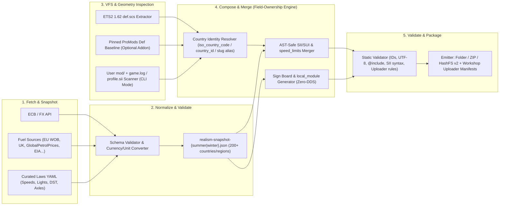

# Architecture Patterns: ETS2 1.62 Map Combo & Generator Architecture

**Domain:** Euro Truck Simulator 2 (ETS2 `1.62.3.3s`) Map Combo Country Definitions, Realism Overlays & Automated Mod Generator  
**Researched:** 2026-11-15  
**Overall Confidence:** **HIGH** (empirically verified against ETS2 `1.62.3.3s` game archives, Workshop mods `3249064596` & `3668352310`, `86` country-touching map mods in `D:\ETS2Data\Euro Truck Simulator 2\mod`, local `scs-modding-wiki` docs, and official SCS Software forum documentation)

---

## Executive Recommendation

**Do NOT build 50 hardcoded map-combo presets, and do NOT ship a monolithic 75-to-200 country `.sui` dump like Workshop `3249064596`.**

Adopt **Option C: Modular Field-Ownership Registry + Dual-Track Build Architecture**:
1. **Strict Field-Ownership Separation (`RealismOverlay` vs `MapGeometryAndIdentity`):** Treat `fuel_price`, seasonal `time_zone`/`time_zone_name`, seasonal `lights_mandatory`, `driving_tired_offence`, and `speed_limits` (`car`/`truck`/`bus`) as realism-owned overlays, while treating `country_id`, `country_code`, `iso_country_code`, `name*`, `pos`, `imperial_units`, `leftside_traffic`, `secondary_time_zone*`, `regions[]`, `region_areas[]`, rail/tram speed classes, and map-higher `mass_limit_per_axle_count[]` as map-owned geometry/identity state that must be **preserved, never invented**.
2. **Track 1 — Steam Workshop Core Editions (`Summer` & `Winter`) + Single Optional ProMods Addon:**
   - **Core (`ETS2 V2 Realism - Summer` / `Winter`):** Targets Vanilla ETS2 `1.62+` + all official SCS DLCs cleanly (`36` vanilla countries sourced fresh from `def.scs`, `def/sign/board/*.sii` referencing untouched base textures via `local_module.ets2v2_fuel.sii`, `mp_mod_optional: true`, `base/`/`dlc_*` ready if future DLC overrides diverge). Zero ProMods/map-mod files leak into Core.
   - **Optional ProMods Addon (or thin ProMods EU+ME+TGS+MA patch):** Built cleanly from pinned ProMods def baselines (`pm_fuel`, `pm_me_fuel`, `pm_tgs_fuel` + ProMods-only countries + merged UK/Finland/Russia/etc.), preserving `scotland`/`wales` regions and ProMods localizations.
3. **Track 2 — Open-Source Local Auto-Merger CLI (`ets2v2 compose`):** Ships the same VFS + SII/SUI merge engine used in CI, consuming the project's versioned global `realism-snapshot-{summer|winter}.json` (~200+ world countries/territories) to scan a user's *own* `mod/` folder and active load order, extract their exact winning country/speed-limit definitions (`ProMods + RusMap + RoEx + UMCF + TST + Beyond + JRR + SE Asia + RoC + EAA + Africa`), patch only realism-owned fields, and emit a single personalized `zz_ETS2V2_ComboPatch_{Summer|Winter}.scs` placed at the top of Mod Manager.

---

## 1. How ETS2 `1.62.3.3s` & Map Mods Define and Load Countries (Verified Facts)

### 1.1 Vanilla Game Baseline (`def.scs` + `dlc_*.scs`)
Empirically inspected in `D:\SteamLibrary\steamapps\common\Euro Truck Simulator 2` (build `1.62.3.3`):

- **`def.scs` (`HashFS v2`, 66,066 entries)** contains:
  - `def/country.sii`: Master country storage file containing `@include "country/<name>.sui"` for **36 countries**, including `iceland.sui` (`country_id: 26`, `country_code: "IS"`, `mass_limit_per_axle_count` up to `60000` kg / 5 axles).
  - `def/country.custom.sii`: Legacy backward-compatibility stub (`@include "/custom/country.sii"`) carrying an explicit SCS deprecation warning; mods must never rely on it.
  - **Regional sub-boxes in 1.62 Vanilla (`regions[]` + `region_areas[]`):** Four vanilla countries in `def.scs` already declare regional bounding boxes (`left, right, top, bottom`):
    - `bosnia.sui`: 6× `regions[]: rep_srpska` + `region_areas[]`
    - `finland.sui`: `regions[]: the_north` + `region_areas[]` (consumed by `def/country/finland/traffic_density.sii` to halve AI density via `spawn_frequency_modifier: 0.5`)
    - `norway.sui`: `regions[]: rc_train` and `regions[]: the_north` + `region_areas[]`
    - `spain.sui`: `regions[]: catalonia`, `navarre`, and 2× `basque` + `region_areas[]`
  - **Per-country subfolders (`def/country/<country>/`):** `speed_limits.sii`, `license_plates.sii`, `traffic.sii`, `bus_data.sii`, and optionally `traffic_density.sii`. Inside `speed_limits.sii`, SCS defines dot-prefixed unit names `.speed_limit.car`, `.speed_limit.truck`, `.speed_limit.bus`, `.speed_limit.train`, and `.speed_limit.tram`.
  - **Fuel price totems:** `def.scs` contains `12,956` `def/sign/board/*.sii` templates, of which `555` are gas/fuel price signs (`es_95_01.sii`, `gas_de_big_95.sii`, `gas_gb_big_95.sii`, etc.) using `model_name: ""` and localization placeholders like `@@fp_es_natural95@@`. Those `@@fp_*@@` keys resolve against SCS's stripped-directory `locale.scs` database.
- **`dlc_*.scs` country footprint:** Inspecting all official map DLCs in `1.62.3.3s` confirms **zero** DLC archives define `def/country.*.sii` or `def/country/*.sui`. Only five DLCs carry `def/country/` overrides at all, exclusively `traffic.dlc_<id>.sii`:
  - `dlc_balt.scs` (4), `dlc_fr.scs` (1), `dlc_iberia.scs` (2), `dlc_it.scs` (9), `dlc_north.scs` (3). `dlc_greece`, `dlc_iceland`, `dlc_balkan_e`, `dlc_balkan_w`, and `dlc_east` carry `0` `def/country*` files.

### 1.2 Real-World Map Mod Ecosystem Patterns (Census of 503 User Mods)
Scanning all `503` packages in `D:\ETS2Data\Euro Truck Simulator 2\mod` found **`86` mods** modifying `def/country*`, `speed_limits.sii`, or fuel boards, revealing **six structural variations** that break naive generators:

| Map Mod / Fix | Archive Type | Registration File(s) (`def/country*.sii`) | Fragment Format & Location | Special Complexity Discovered |
| :--- | :--- | :--- | :--- | :--- |
| **ProMods EU v2.84** | ZIP | `country.promods.sii` (19 includes), `country.rus.sii` (`belarus`) | 59 `.sui`, 58 `speed_limits.sii` in `def/country/` | Adds `regions[]: scotland`, `wales` in `uk.sui` (used by `uk/traffic.promods.sii` & `mb_sprinter_amb/{scotland,wales}.sii`); changes `belgium`/`czech`/`greece`/`finland` attrs; `450` `sign/board/*.sii` in `promods-eu-map` read `@@fp_*@@` from `promods-eu-assets/.../local_module.pm_fuel.sii`. |
| **ProMods ME v2.84 / MA v1.04 / TGS v1.70** | ZIP | `country.mideast.sii` (8), `country.mgm.sii` (2), `country.kz.sii` (3) | `.sui` (9 ME, 4 MA, 4 TGS) | Ships unused un-included `.sui`s (`libya.sui` in ME; `algeria`/`libya1` in MA); TGS `russia.sui` has `16` secondary TZs + `cc="RUS"`; ME/TGS totems read `local_module.pm_me_fuel.sii` & `pm_tgs_fuel.sii`. |
| **RusMap Def** | HashFS v1 | `country.rus.sii` (`belarus`) | 2 `.sui` (`belarus`, `russia`) | `russia.sui` has `9` secondary TZs, `pos=(100000,0,-44500)`, and **6-axle `48000` kg**. |
| **Trans-Siberian Truckway (TST)** | ZIP | `country.tsibir.sii` (`japan`) | 2 `.sui` (`japan.sui`, `russia.sui`) | `russia.sui` has **`27` secondary TZs** and **6-axle `48000` kg**. |
| **ROEX 5.4 / SibirMap / Baikal / Far East / RussiaEast / WesternYakutia** | HashFS v1 & ZIP | `country.roext.sii` (ROEX), `country.kzsum.sii` (Sibir), none (regional addons) | Mostly `russia.sui` / `kazakhstan.sui` / `belarus.sui` | `WesternYakutia-B3.scs` ships malformed un-included `def/country/russia.a331.sii`. Multiple eastern addons ship competing full `russia.sui` copies. |
| **GMC Map Combo Fixes (`UMCF`, `gmc.beyond.fix`, `UMCF PM Patch`)** | ZIP | `country.7rm2.sii` (**empty `{}`**), `country.kz.rtc.sii` (**empty `{}`**), `country.kz.sii`, `country.beyond.sii` (**empty `{}`**), `country.byd*.sii` | Mixed `.sui` & `.sii` (`chad.sii`, `thailand.sii`, `kazakhstan.sii`, `iraq1.sui`, `saudia1.sui`, `sudan1.sui`, `rta_azerbjn.sui`) | **Combo suppression idiom:** Disables duplicate `country.*.sii` declarations from lower-priority maps by shadowing their exact `.sii` path with an empty `SiiNunit { }` stub! `UMCF` `kazakhstan.sui` uses `time_zone: 360` (`ALMT`), Cyrillic name, + `5` active (`7` declared) secondary TZ rects. |
| **Southeast Asia Map / Roads of Chunghwa (RoC) / Project Japan Relocated** | ZIP | `country.sea.sii` (11), `country.taiwan.sii` (1–2), `country.tsibir.sii` (`japan.sii`) | **`.sii` extension** instead of `.sui` (`thailand.sii`, `taiwan.sii`, `china.sii`, `japan.sii`) | Fragments inside `def/country/` omit `SiiNunit` (included via `@include`), yet use `.sii` filenames! PJ Relocated ships 38 prefecture `.sii` files (`aichi.sii`, `id=229`, `#\material\ui\flags`) alongside `japan.sii`. |
| **JRR (Indonesia)** | ZIP | `country.indo.sii` | 3 sub-country `.sui` (`indo_b` id=57, `indo_th` id=495, `indo_tm` id=496) | Sub-national IDs share `cc="ID"`. Gas totems hardcode numeric strings (`text: 15100` in `indo_gas_totem_01a.sii`) instead of `@@fp_*@@`. |
| **EAA Rescaled & `eaa_map_semeuropa_v1`** | ZIP / HashFS v1 | `base/def/country.{eaa,mod_polar_circle,}.sii` vs `def/country.sii` (**empty `{}`**) | **1.48+ `base/` mount prefix** (`EAA Rescaled`); 39 state `.sui`s (`acre`..`tocantins`) in SemEuropa | `EAA Rescaled` overrides `base/def/country.sii` and raises axle limit up to **`80000` kg** (7 axles). `SemEuropa` removes Europe completely via empty `def/country.sii`! |
| **Protected / Encrypted Archives (`12` total: `9` non-standard + `3` ZIP-encrypted)** | `AEM!` (`6` confirmed), `Bad magic` (`3`: PJ model2 + 2 rain mods), & encrypted ZIP (`3`) | Encrypted ZIPs: `Beyond_by_TerraMaps_1.scs`, `Beyond_by_TerraMaps_5.scs`, `161HybridPlus2.scs`; `AEM!`: `2.projectjapan-161-model1.scs`, `ProjectRussia5.7.1a.scs`, `Altai_Map 1.7.2.scs`, `M12_vostok_V.3.0.scs`, `nnmap130.scs`, `rfex.scs` | Unreadable directly with standard `zipfile` / `HashFS` readers | Central directory paths in encrypted ZIPs remain visible (`Beyond_1` lists 27 `.sui`s; `Beyond_5` lists 3), and GMC fix packs above them are plain ZIPs, while `AEM!` headers require external extraction tools (`sk-zk/Extractor` / `SXC Extractor`) or explicit fallback registries. |

### 1.3 Engine Rules & Failure Mechanics (Verified)
1. **Un-included `.sui` / `speed_limits.sii` files are inert:** Any file inside `def/country/<x>.sui` or `def/country/<x>/speed_limits.sii` is **not parsed by ETS2** unless an active `def/country(.infix).sii` storage file explicitly `@include`s it (`Documentation/Engine/Units` & `Game_data`). Evidence: `3249064596` ships `39` extra ProMods `.sui`s with zero `def/country.*.sii` files; ProMods EU ships `58` `speed_limits.sii` folders even though `country.promods.sii` + `country.rus.sii` register only `20` extra countries.
2. **Duplicate `country_data` unit registration fails loudly:** All `def/country*.sii` files across all mounted archives are loaded into a single unit namespace. If our mod ships a *new* `def/country.realism.sii` that `@include`s a country already loaded by ProMods/RusMap/Beyond/etc., ETS2 fails with:
   `<ERROR> [unit] The unit name 'country.data.<name>' is already taken by an existing unit (of type 'country_data').`
   Conversely, overwriting a map mod's own `def/country.promods.sii` breaks combo overrides (`161HybridPlus2.scs` or `gmc.beyond.fix.scs`) and silently registers phantom countries with missing `/material/ui/flags/<iso>.mat` icons when the map mod is disabled.
3. **Whole-file VFS shadowing with no partial attribute patching:** In ETS2 SII units, defining a second `country_data : country.data.uk` block to override only `fuel_price` causes the exact same duplicate-unit error. A realism mod **must** emit a complete `country_data` block for the overridden path.
4. **Why `base/` vs `dlc_*` does NOT solve map mods:** Confirmed via SCS Wiki (`mod_manager.md`, `validation_errors_and_solutions_for_them.md`) and SCS Forums (`t=342966`, Aug 2025): `dlc_<id>/` mounts conditionally **only for official SCS DLCs** (where `dlc_` overrides `base/`), and **there is no `mod_<id>/` conditional directory feature**.
5. **`speed_limits.sii` must override the exact file path, not use `.infix.sii`:** Because base/map `speed_limits.sii` files use file-scoped anonymous units (`.speed_limit.car`, `.speed_limit.truck`, `.speed_limit.bus`), adding `speed_limits.realism.sii` creates competing speed units where the engine uses the first encountered unit (`Games/ETS2/Modding_guides/1.19`). Direct replacement of `def/country/<c>/speed_limits.sii` is mandatory.
6. **Steam Workshop & Convoy constraints (`1.62`):** Workshop Uploader requires `versions.sii` / `manifest.sii`, `mp_mod_optional: true`, valid UTF-8 (no BOM recommended, Unix `/` paths, no `..`), `mod_icon.jpg` (`276×162`), ZIP/folder or HashFS v2 (HashFS v1 prohibited for new uploads since 1.50). Each `base/` and `dlc_*` subdir must validate independently.

### 1.4 Forensics of Existing Reference Mods (`3249064596` & `3668352310`)
- **Why `3249064596` (*Real life fuel prices*) works across Vanilla + ProMods:** It ships **0 `def/country.*.sii`** files, **75 `def/country/*.sui`** files (`36` vanilla + `39` ProMods EU/ME/TGS/MA), **375 `def/sign/board/*.sii`** (`370` rewriting vanilla hardcoded/vanilla-`locale.scs` `@@fp_*@@` placeholders to `@@fp_*_kwo@@`, all with `model_name: ""`, paired with `locale/*/local_module.kworey_fuel_ets.sii`), plus direct overrides of ProMods' isolated totem files `locale/*/local_module.{pm_fuel,pm_me_fuel,pm_tgs_fuel}.sii`. When ProMods is absent, unused `.sui`s and `local_module.pm_*` keys are harmlessly ignored; when ProMods is active, ProMods' own `country.*.sii` includes `3249064596`'s `.sui`s and ProMods' `sign/board/*.sii` totems look up `3249064596`'s updated `local_module.pm_*` strings.
- **Exact reasons `3249064596` broke Map Combos & ETS2 `1.62`:** Because its 75 `.sui` files are stale monolithic copies rather than field-level merges:
  1. **ProMods UK (`uk.sui`):** Reverts `country_code` `"GB"` → `"UK"`, resets `pos` to `(-42290, 0, -14150)`, and **deletes `regions[]: scotland` & `regions[]: wales` + `region_areas[]`**, breaking ProMods' regional Scottish/Welsh AI ambulance spawns (`uk/traffic.promods.sii`).
  2. **RusMap & Trans-Siberian Russia (`russia.sui`):** Freezes `15` ProMods TGS secondary timezones & max `44t` axle weight — deleting **12 eastern Siberian timezones** from TST (`27` secondary TZs) and stripping `48t` 6-axle limits from both RusMap (`9` TZs, `48t`) and TST (`48t`). Placing `3249064596` below them breaks fuel prices instead.
  3. **UMCF Kazakhstan (`kazakhstan.sui`):** Reverts `time_zone: 360` (`ALMT`) → `300`, `"Казахстан"` → `"Kazakhstan"`, and wipes all `5` active `secondary_time_zone_area[]` rectangles (`AQTT`).
  4. **ETS2 `1.62` regressions & authoring bugs:** Ships `iceland.sui` with old `40t` max (nerfing Vanilla `1.62` Iceland's `60t` limit), `greece.sui` with `40t` (vs `1.62` `44t`), `armenia.sui` with `leftside_traffic: true` (wrong side of the road!), and `estonia.sui` with `name: "@@tz_eest@@i"` (botched regex replace of `"Eesti"`).
- **Exact pitfall in `3668352310` (*Updated WINTER speed limits*):** Injects `@include "_vtd/<country>.sui"` at the bottom of `36` `.sui` files (plus `3nK`-encoded `speed_limits.sii`), which **drops** vanilla `1.62` `regions[]`/`region_areas[]` (`bosnia` `rep_srpska`, `finland` `the_north`, `norway` `rc_train`/`the_north`, `spain` `catalonia`/`navarre`/`basque`) and hardcodes `_worldmap`/`_helsinki` third-party traffic-density regions. V2 must **preserve** base `regions[]`/`region_areas[]` cleanly.

---

## 2. Map Combo Architecture Comparison

| Criterion | Option A: Static Combo Presets (Monolithic / 50+ Packs) | Option B: Pure Local CLI Auto-Merger Only | Option C (**Recommended**): Field-Ownership Registry + Clean Workshop Core/PM + Local Auto-Merger CLI |
| :--- | :--- | :--- | :--- |
| **Casual Workshop UX** | Good only for exact Vanilla or 1 PM snapshot | Poor (requires running local CLI + repacking mod) | **Best** — 1-click Subscribe for Vanilla+DLC Core (`Summer`/`Winter`) + 1 optional ProMods Addon |
| **Arbitrary Map Combos** (`50–150+` map mods, beyond/JRR/SEA/RoC/EAA/Africa/TST/HybridPlus) | **Broken** — requires N×2 presets; silently breaks when any map updates | **Perfect** — builds directly against user's exact installed files | **Best** — CLI uses same generator engine + global `realism-snapshot.json` to emit a single tailored `zz_ETS2V2_ComboPatch.scs` |
| **Convoy / MP (`mp_mod_optional: true`)** | Works on Workshop; impossible per-combo without spam | Harder (friends must share generated `.scs` or run same CLI) | **Optimal** — Core & PM Addon stay canonical on Steam Workshop; heavy combo users already share custom load orders |
| **Zero-Clobber Field Safety** | Fragile (manual `build_country_merge.py` drifts per update) | High (reads user's live map defs) | **Enforced by schema** — generator refuses to overwrite map-owned geometry/region/TZ fields |
| **Encrypted / `AEM!` Map Mods** | Fails unless author manually extracts every update | Partial (needs fallback or user-extracted defs) | **Handled cleanly** — reads unencrypted GMC fix packs above encrypted base mods + `realism-snapshot` geometry fallback + clear error report |
| **CI/CD & Maintenance Burden** | Unmaintainable (`50+ × 2` builds) | Low CI cost, high user friction | **Low** — CI publishes 1 Summer + 1 Winter Core (+ optional PM Addon) + `realism-snapshot-{season}.json` artifact |

**Why Option C wins:** Trying to maintain Workshop compatibility packs for every combination of ProMods, RusMap, ROEX, HybridPlus, UMCF, Beyond, SibirMap, Altai, TST, JRR, SE Asia, RoC, Project Japan, EAA, and RIW creates an unmaintainable $O(2^k)$ combinatorial matrix and permanently lags map releases. Conversely, dropping Steam Workshop support in favor of a CLI-only tool alienates 90%+ of subscribers and Convoy players. Separating **data collection + realism rules** (`realism-snapshot-{season}.json`) from **target geometry acquisition** lets the **exact same `compose/merge` core** power both automated CI builds (Workshop Core + ProMods Addon) and zero-guesswork local combo patching (`ets2v2 compose`).

---

## 3. Recommended System Architecture

### 3.1 System & Data-Flow Pipeline



### 3.2 Component Boundaries

| Component / Package | Responsibility | Inputs | Outputs | Must NOT Do |
| :--- | :--- | :--- | :--- | :--- |
| `src/ets2v2/fetch/` | Fetch live FX rates & international fuel prices with retry, caching, staleness thresholds (`max_age_hours`) | Public fuel APIs/pages, ECB rates, fallback overrides | Raw fetched records + provenance metadata | Hardcode game paths or write `.sui` directly |
| `src/ets2v2/normalize/` | Convert national currencies → EUR/L, reconcile diesel/gasoline grades (`95`/`98`/`diesel`/`lpg` for totems), validate laws YAML (`summer`/`winter` DST, lights, speed limits) | Raw fuel records, `data/laws/*.yaml`, `data/country_aliases.yaml` | `realism-snapshot-{summer\|winter}.json` (schema-validated) | Guess missing `country_id` or map coordinates |
| `src/ets2v2/vfs/` | Read `def.scs`, `dlc_*.scs`, and local `mod/` archives (`zip`, `HashFS v1`, `HashFS v2`, unpacked dirs); simulate ETS2 load order including `base/`, `dlc_*/`, `.sui`/`.sii` resolution, and empty `country.*.sii` suppressors | Archive paths + ordered mod list | `EffectiveVfsSnapshot` (winning raw files + origin provenance + unreadable `AEM!`/encrypted list) | Silently ignore unreadable encrypted archives |
| `src/ets2v2/sii/` | Tokenize/parse/edit `country_data`, `country_speed_limit`, `sign_board_template`, `localization_db` while preserving comments, formatting, `secondary_time_zone*`, `regions[]`, `region_areas[]`, rail/tram blocks | Raw `.sii`/`.sui` bytes | Typed `CountryDef`, `SpeedLimitsDef`, diagnostic lints | Regex-replace raw substrings (`"est"` → `"@@tz_eest@@i"` bug) |
| `src/ets2v2/merge/` | Enforce **Field-Ownership Contract**; map target `CountryDef` (e.g. `indo_b`→`IDN`, `aichi`→`JPN`, `westbank`→`PSE`, `nireland`→`GBR`) to `RealismSnapshot`; apply seasonal patches | `EffectiveVfsSnapshot` + `RealismSnapshot` + merge policy | Merged virtual file map (`def/country/*`, `def/sign/board/*`, `locale/*`) | Emit `def/country.*.sii` registration files or overwrite `pos`/`country_id`/`regions[]` |
| `src/ets2v2/validate/` | Static verification: balanced braces, unique `country_id` & unit names across VFS, valid `@@tz_*@@` / `@@fp_*@@` keys, no `model_name` leaks, UTF-8 validity, Workshop `versions.sii` / `manifest.sii` / `276×162` JPG checks | Output mod tree + target `EffectiveVfsSnapshot` | Pass/fail validation report + exit code | Pass a build if any generated country fails parse or duplicates a unit |
| `src/ets2v2/package/` | Write clean build directories, uncompressed ZIP-`.scs` (Workshop-ready), or local `HashFS v2`; preserve `base/` / `dlc_*` layout if needed | Validated mod tree + edition metadata | Ready-to-upload Workshop stage or `zz_ETS2V2_ComboPatch_*.scs` | Emit legacy HashFS v1 for Steam Workshop |
| `src/ets2v2/cli.py` | Orchestrate `fetch`, `build-snapshot`, `build-workshop`, `build-promods`, and `compose-local` commands | CLI args, config paths | Exit codes + concise diff/conflict summaries | Mix network scraping directly inside `compose-local` |

---

## 4. Critical Architectural Patterns to Follow

### Pattern 1: Strict Field-Ownership Contract (Map Identity vs Realism Overlay)
Never store whole `.sui` blobs in source control or static templates. Model field ownership explicitly in code:

```python
from dataclasses import dataclass
from typing import Literal

@dataclass(frozen=True)
class FieldOwnershipPolicy:
    # REALISM-OWNED (safe to patch from RealismSnapshot when enabled)
    fuel_price: Literal["always"] = "always"
    lights_mandatory: Literal["always"] = "always"
    driving_tired_offence: Literal["always"] = "always"
    speed_limits_road: Literal["always"] = "always"  # car, truck, bus only; NEVER overwrite train/tram

    # CONDITIONAL / GUARDED REALISM FIELDS
    time_zone: Literal["patch_if_single_tz", "always_dst_shift"] = "patch_if_single_tz"
    axle_mass_limits: Literal["max_of_map_and_real", "always", "preserve_map"] = "max_of_map_and_real"

    # MAP-OWNED IDENTITY & GEOMETRY (NEVER overwrite from RealismSnapshot)
    # country_id, name, name_localized, country_code, iso_country_code, pos,
    # imperial_units, leftside_traffic, trailer_standalone,
    # secondary_time_zone_area[], secondary_time_zone[], secondary_time_zone_name[],
    # regions[], region_areas[]
```

**Why `patch_if_single_tz` and `max_of_map_and_real` prevent Map Combo disasters:**
- Multi-timezone countries (`russia.sui` with 1–27 `secondary_time_zone_area[]` rects; `kazakhstan.sui` in UMCF with `ALMT` + 5 `AQTT` rects; `brazil.sui` in EAA with 2 rects) retain their primary/secondary TZ geometry untouched unless the TZ engine verifies no regional secondary zone collision occurs.
- Axle limit updates never downgrade a map's higher regional standard (preserving ETS2 `1.62` Vanilla Iceland `60t`, Finland `105t`, RusMap/TST Russia `48t`, and EAA South America `80t`).
- Base `regions[]` / `region_areas[]` (`rep_srpska`, `the_north`, `rc_train`, `catalonia`, `navarre`, `basque`, `scotland`, `wales`) are **always preserved verbatim**, avoiding both `3249064596`'s ProMods UK breakage and `3668352310`'s `_vtd` breakage.

### Pattern 2: Include-Aware Target Discovery (`.sui`, `.sii`, `base/`, Empty Stubs)
In `compose-local` (and when building the ProMods Addon), **never assume** country definitions are named `def/country/*.sui`. Always parse active `def/country(.infix).sii` files from the simulated VFS:
1. Collect all mounted files matching `^(?:base/|dlc_[^/]+/)?def/country(?:\.[^/]+)?\.sii$` (respecting load-order winner per relative VFS path after normalizing `base/`/`dlc_*/` mount rules).
2. Extract `@include "..."` directives (ignoring `#`/`//` comments; tolerating BOM and both `.sui` and `.sii` targets — solving **Southeast Asia**, **Roads of Chunghwa**, **Project Japan**, and **GMC Beyond Fix** automatically!).
3. If a higher-priority compatibility fix ships an **empty** `def/country.<mod>.sii` (`SiiNunit { }` like `UMCF`'s `country.7rm2.sii` or `eaa_map_semeuropa_v1`'s `country.sii`), the lower-priority mod's includes are automatically discarded!
4. Emit merged outputs at the exact winning relative path (`def/country/<slug>.sui` OR `def/country/<slug>.sii`), **without** emitting `def/country.*.sii` unless needed, and normalize output mount layout consistently (`def/country/...` at top priority overrides `base/def/country/...` cleanly in VFS, or mirror `base/` if generating a replacement package).

### Pattern 3: Zero-DDS Dual-Tier Fuel Totem Architecture
Confirmed by V1's `DDS-SPIKE-VERDICT.md` (custom Pillow DDS textures fail due to missing mipmaps/DXGI sRGB rejection in DX11) and `def.scs` + `3249064596` inspection:
- **Vanilla totems (`def.scs` `555` gas boards, `370+` active price slots):** Rewrite only `def/sign/board/*.sii` `sign_template_text.text` placeholders from `@@fp_<c>_<grade>@@` to mod-namespaced keys `@@fp_<c>_<grade>_ets2v2@@`, preserving every `font_face`, `coords_*`, and `model_name: ""`, backed by `locale/*/local_module.ets2v2_fuel.sii`.
- **ProMods totems (`promods-eu-map`, `promods-tgs-defmap`):** Leave ProMods' `def/sign/board/*.sii` untouched and override only `locale/*/local_module.{pm_fuel,pm_me_fuel,pm_tgs_fuel}.sii` inside the ProMods Addon (or `compose-local` output when ProMods assets are detected), updating all 450+ ProMods boards without asset duplication.
- **Community map hardcoded totems (`JRR`, `7RM`):** In `compose-local`, optionally scan `def/sign/board/*.sii` for numeric-literal boards matching known map totem naming patterns (`kg_gas_*`, `indo_gas_totem_*`), or keep scope opt-in via `--patch-hardcoded-totems`.

### Pattern 4: Safe SII Field Rewriter (Zero Naive Global String Substitution)
Instead of global regex replacement on raw text (which turned `"Eesti"` into `"@@tz_eest@@i"` in `3249064596` when substituting `est`!), parse SII blocks into structural attribute spans (`key`, `value`, `inline_comment`, line span) and rewrite only targeted scalar/array attributes (`fuel_price`, `lights_mandatory`, `time_zone`, `time_zone_name`, `driving_tired_offence`, `mass_limit_per_axle_count[]`) while leaving surrounding comments, `regions[]`, `region_areas[]`, and `secondary_time_zone*` byte-for-byte intact.

---

## 5. Anti-Patterns to Avoid

1. **Shipping a global `def/country.ets2v2.sii` containing map-mod `@include`s:** Guaranteed `<ERROR> [unit] The unit name 'country.data.<x>' is already taken` whenever any map mod is enabled, and orphan country UI entries when disabled.
2. **Bundling non-vanilla `.sui` files inside Core Vanilla+DLC Workshop mods:** Even though un-included `.sui` files don't crash vanilla, bundling stale ProMods/map `.sui` files into the Core Workshop edition creates the exact silent combo-breaking hazard `3249064596` suffers from. Keep Core strictly `def.scs`-scoped (`36` countries).
3. **Editing or shipping `def/country.custom.sii`:** Explicitly deprecated by SCS in `def.scs` (`# will be removed in some future patch`).
4. **Assuming `.sui` extension or root `def/` path:** Breaks Southeast Asia (`.sii`), Roads of Chunghwa (`.sii`), Project Japan (`.sii`), GMC Beyond Fix (mixed `.sui`/`.sii` + renamed files like `iraq1.sui`), and EAA Rescaled (`base/def/...`).
5. **Silently skipping `AEM!` or encrypted ZIP archives in `compose-local`:** If a user's load order contains an encrypted def archive with no unencrypted GMC fix above it (`161HybridPlus2.scs`, `ProjectRussia5.7.1a.scs`), silently omitting it or overwriting with Vanilla defaults causes wrong TZs or duplicate-unit bugs. Always emit a clear actionable diagnostic listing unreadable archives and whether an unencrypted fix above them resolved the country.
6. **Overwriting `speed_limits.sii` by dropping `train` / `tram` units or adding `speed_limits.realism.sii`:** Breaking `.sii` unit rules leaves stale base limits active or breaks city trams/trains. Always merge `car`/`truck`/`bus` into the target country's existing `speed_limits.sii` preserving all other `vehicle_speed_class` blocks.

---

## 6. Proposed Repository Layout (`d:\CODE\Ets2 Mod V2`)

```text
d:\CODE\Ets2 Mod V2\
├── pyproject.toml                     # Python 3.12+ package, CLI entrypoint `ets2v2`, ruff/pytest config
├── data/
│   ├── laws/
│   │   ├── speed_limits.yaml          # Canonical seasonal car/truck/bus speed rules by ISO3 + subregions
│   │   ├── lighting_and_tz.yaml       # Seasonal summer/winter DST timezones & DRL rules (200+ countries)
│   │   └── weights_and_rules.yaml     # Optional axle caps + preserve_if_higher flags
│   ├── mappings/
│   │   ├── country_aliases.yaml       # Slug/ID -> ISO3 resolver (indo_b->IDN, aichi->JPN, westbank->PSE, etc.)
│   │   ├── fuel_sign_boards.yaml      # Vanilla def/sign/board -> fp_<cc>_<grade> mapping
│   │   └── pm_totem_keys.yaml         # ProMods pm_fuel / pm_me_fuel / pm_tgs_fuel key schema
│   ├── baselines/
│   │   └── ets2_1.62_def/             # Tracked metadata / schema manifest extracted from def.scs (or CI cache)
│   └── sources.yaml                   # Live fuel endpoints, FX rate URLs, fallback/manual price overrides
├── src/ets2v2/
│   ├── cli.py                         # `fetch`, `snapshot`, `build`, `compose-local`, `validate`
│   ├── fetch/                         # Live fuel scrapers/APIs + ECB FX + staleness checks
│   ├── normalize/                     # Unit/currency conversion -> `realism-snapshot-{season}.json`
│   ├── vfs/                           # HashFS v1/v2 + ZIP + unpacked reader, load-order & base/dlc_ resolver
│   ├── sii/                           # Comment/region-preserving SII/SUI & speed_limits parser/editor
│   ├── merge/                         # FieldOwnershipPolicy engine + identity resolver + totem generator
│   ├── validate/                      # Brace/unit/UTF-8/ID-uniqueness/Workshop compliance checks
│   └── package/                       # Folder / ZIP-.scs / HashFS v2 packager + manifest/versions/icon prep
├── tests/
│   ├── fixtures/                      # Minimal synthetic .sui, .sii, speed_limits, empty-stub Combo fixes
│   ├── test_vfs_overlay.py            # base/, empty country.*.sii suppression, .sui vs .sii includes
│   ├── test_merge_ownership.py        # Preserves UK regions, RusMap/TST TZs, EAA axles, no est->@@tz@@ bug
│   └── test_validate_uploader.py      # Workshop Uploader rule conformance
├── .github/workflows/
│   ├── build-and-validate.yml         # PR/push lint + pytest + snapshot/mod generation check
│   └── release-and-publish.yml        # Scheduled/manual refresh -> GitHub Release + Workshop deploy
└── build/                             # Gitignored generated snapshots, staging dirs, .scs outputs
```

---

## 7. Scalability & Evolution Path

| Stage / Scope | Target Countries | Build & Distribution Mechanism | How Map Combos Are Handled |
| :--- | :--- | :--- | :--- |
| **Milestone 1 (Core V2)** | 36 Vanilla + Official DLCs | Automated CI builds `Summer` & `Winter` Workshop mods (`mp_mod_optional: true`) + `realism-snapshot-{season}.json` (~200 countries) | Clean isolation: Core touches **only** the 36 `def.scs` countries — 0 combo corruption |
| **Milestone 2 (ProMods & Major Defs)** | 36 Vanilla + ~39–45 ProMods EU/ME/TGS/MA + ProMods fuel totems | Separate optional **ProMods Realism Addon (`Summer`/`Winter`)** generated cleanly against pinned ProMods defs | Preserves UK `scotland`/`wales`, Finland `the_north`, ProMods `local_module.pm_*` |
| **Milestone 3 (Arbitrary Global Combos)** | 150–250+ (RusMap, TST, UMCF, Beyond, ROEX, JRR, SE Asia, RoC, PJ, EAA, Africa) | **`ets2v2 compose-local`** CLI command reads user's local `mod/` + load order + `realism-snapshot-{season}.json` | Generates bespoke `zz_ETS2V2_ComboPatch_{Summer\|Winter}.scs` preserving 100% of user's exact combo geometry & timezones |

---

## 8. User Checkpoint Brief: Concrete Decisions Needed

Before moving to `REQUIREMENTS.md` and roadmap phasing, the user checkpoint on **Map Combos** can be decided cleanly with three yes/no architectural confirmations:

1. **Confirm Core Workshop Split (Vanilla+DLC vs ProMods Addon):**
   - *Recommendation:* Keep the two primary Workshop items (`Summer` and `Winter`) **strictly Vanilla + Official DLC (36 countries)** so they never corrupt ProMods/RusMap/1.62 `regions[]` or `iceland` 60t, and ship **ProMods (`EU+ME+TGS+MA` + `pm_*_fuel` totems)** as an optional companion Workshop addon (2 items or combined? → recommend 2 seasonal addons *or* one small addon per season matching Summer/Winter!).
2. **Confirm Arbitrary Map Combos via Local Auto-Merger CLI (`ets2v2 compose-local`) instead of 50 static presets:**
   - *Recommendation:* Do **not** maintain static Workshop packs for RusMap/Beyond/EAA/Asia/Africa/HybridPlus combos. Instead, publish `realism-snapshot-{summer|winter}.json` (covering ~200+ world countries) in the repo/GitHub Releases and provide `ets2v2 compose-local` to inspect a user's `mod/` folder + load order (`game.log.txt` / `profile.sii` / manual preset) and emit a personalized single top-priority `.scs` patch.
3. **Confirm Optional Policy Defaults for `compose-local` & Locked Archives (`AEM!` / Encrypted ZIPs):**
   - *Recommendation:* Default to **`max_of_map_and_real`** for axle mass limits (preserving 48t Russia, 60t Iceland, 80t Brazil, 105t Finland), **`patch_if_single_tz`** for countries with `secondary_time_zone_area[]` (preserving TST 27-TZ Russia & UMCF 5-TZ Kazakhstan while still updating their `fuel_price` and `speed_limits.sii`), and **explicitly warn + allow `--unpacked-defs` or external `Extractor` hook** whenever `AEM!` / encrypted ZIP mods lack an unencrypted GMC fix above them.

---

## Sources & Verification Confidence

| Source | Type | Confidence | Verified Facts |
| :--- | :--- | :--- | :--- |
| ETS2 `1.62.3.3s` `def.scs`, `dlc_*.scs`, `game.log.txt` | Direct local binary/archive inspection | **HIGH** | 36 vanilla `.sui`s, `iceland.sui` 60t, `regions[]`/`region_areas[]` on 4 countries, `traffic_density.sii`, `555` gas `sign/board`s using `@@fp_*@@`, `dlc_*` `traffic.dlc_*.sii`-only footprint |
| `3249064596` & `3668352310` Workshop `.scs` archives | Direct local archive inspection | **HIGH** | Exact `0` `country.*.sii` + `75` `.sui` + `375` `sign/board` + `4` `local_module` pattern; exact UK/Russia/KZ/Estonia/Armenia/Iceland regressions; `_vtd` dropping vanilla `regions[]` |
| `86` country-touching mods in `D:\ETS2Data\Euro Truck Simulator 2\mod` | Direct local census across 503 archives | **HIGH** | ProMods, RusMap, TST, UMCF, GMC Beyond Fix, JRR, SE Asia (`.sii`), RoC (`.sii`), PJ Relocated, EAA (`base/` & empty `country.sii`), `6` `AEM!` + `3` other `Bad magic` + `3` encrypted ZIP archives |
| Local `scs-modding-wiki` (`mod_manager.md`, `formats.md`, `units.md`, `game_data.md`, `validation*.md`) | Official SCS wiki mirrored locally (`2026-06-29`) | **HIGH** | `base/` & `dlc_` rules, `@include` col-0 rules, Workshop Uploader constraints & HashFS v2 requirements |
| SCS Forums (`t=342966`, `t=347407`, `t=246228`, `t=276948`) & `sk-zk/Extractor`, `Switch-Bros/easy-scsmodmanager` | Primary forum threads & OSS tooling docs | **HIGH** | `dlc_` overrides `base/`, no `mod_` folder exists, `<ERROR> [unit] ... already taken`, `SXC`/`Extractor` handling of stripped `locale.scs` & `3nK` / `AEM!` |
| `D:\CODE\Ets2 Mod\docs\DDS-SPIKE-VERDICT.md` | Prior empirical DX11 spike in V1 repo | **HIGH** | Pillow DDS baking is NO-GO; `sign/board/*.sii` + `local_module` `@@fp_*@@` zero-DDS pattern works cleanly |
