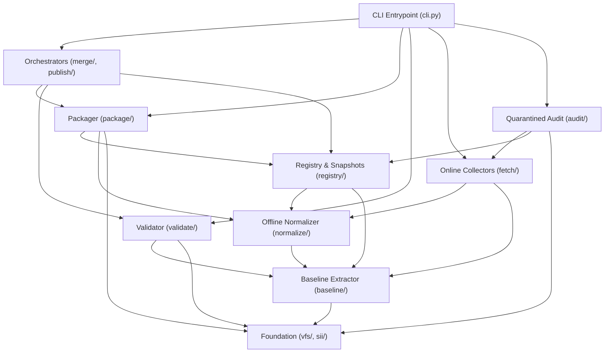

<!-- generated-by: gsd-doc-writer -->

# Architecture

## System Overview

**ETS2 Country Realism** (`ets2-country-realism`) is a clean-room Python 3.12+ data pipeline, mod compiler, offline validator, and local map-combo composer for **Euro Truck Simulator 2 (`1.62+`)**. It ingests clean-room SCS baseline snapshots (`data/baselines/ets2_1.62_def/`), statutory national traffic laws (`data/laws/countries/`), and multi-tier live FX and fuel price feeds (`state/prices.lock.json`) to deterministically emit three families of conflict-free ETS2 packages: Steam Workshop & local ZIP **Core Editions** (`Summer` and `Winter`), locally built **ProMods Companion Editions**, and offline **Local Map-Combo Patches** (`zz_ETS2_Realism_ComboPatch_{Summer|Winter}.scs`). The codebase follows a strictly layered, acyclic package architecture with AST-enforced isolation walls separating offline compilation/validation from online HTTP collectors and quarantined license-audit tooling.

## Component Diagram & Layered Dependency DAG

The package is organized into 11 domain subpackages beneath `src/ets2_realism/` coordinated by a single CLI entrypoint (`src/ets2_realism/cli.py`). Every internal dependency flows strictly downward with zero cycles.



### Enforced AST DAG & Quarantine Walls

`tests/test_cli_scaffold.py` (`test_phase5_ast_dag_isolation_walls`) parses every `.py` file across all 11 subpackages under `src/ets2_realism/` via Python's `ast` module on every CI run to enforce three classes of compile-time isolation walls:

| Subpackage | Forbidden Third-Party Roots | Forbidden `ets2_realism.*` Imports | Architectural Purpose |
| :--- | :--- | :--- | :--- |
| `vfs/`, `sii/` | *(none; leaf layers)* | `audit` | Zero internal dependencies; pure binary/text primitives. |
| `baseline/` | *(none AST-enforced; offline in practice)* | `audit` | Clean-room extraction from local ETS2 archives via `vfs/` + `sii/`. |
| `fetch/` | *(none; online network boundary)* | `audit` | Multi-tier FX & fuel HTTP ingestion; isolated from `audit/`. |
| `normalize/` | `httpx`, `openpyxl` | `fetch`, `registry`, `package`, `validate`, `merge`, `publish`, `audit` | Pure deterministic FX, fuel bounds, lockfile, and totem formatting math. |
| `registry/` | `httpx`, `openpyxl` | `fetch`, `package`, `validate`, `merge`, `publish`, `audit` | Offline canonical law loading, seasonal DST math, and `RealismSnapshot` v1. |
| `package/` | `httpx`, `openpyxl` | `fetch`, `merge`, `validate`, `publish`, `audit` | Deterministic Workshop/ZIP synthesis without network or validator coupling. |
| `validate/` | `httpx`, `openpyxl` | `package`, `merge`, `normalize`, `fetch`, `publish`, `audit` | Independent auditor — never shares synthesis code with `package/` or `merge/`. |
| `merge/` | `httpx`, `openpyxl` | `fetch`, `publish`, `audit` | 100% offline ProMods companion builder and multi-map combo composer. |
| `publish/` | `httpx`, `openpyxl` | `fetch`, `merge`, `audit` | Offline diff-gated release orchestration, canonical hashing, and changelogs. |
| `audit/` | `openpyxl` | `package`, `merge`, `publish`, `validate` | Quarantined read-only OSM speed-drift advisory & taint scanner; cannot feed generators. |
| **All 10 non-`audit` subpackages** | — | **`audit`** | **Universal `audit/` quarantine wall:** only `cli.py` may import `ets2_realism.audit`. |

## Data Flow

### 1. Weekly Price Collection & Core Release Pipeline

1. **Online Collection (`ets2-realism fetch`):** `fetch/pipeline.py` queries four FX providers (`fetch/fx.py`) and three fuel tiers (`ec_bulletin.py`, `national.py`, `global_tier1.py`, `tier2_portals.py`, plus `data/curated/tier3_fuel_baselines.json`).
2. **Offline Normalization (`normalize/`):** `normalize/fx.py` cross-validates FX rates against sanity envelopes and divergence limits; `normalize/fuel.py` applies EUR/L bounds (`0.01`–`5.00`), the `±25%` week-over-week circuit breaker, and secondary grade spreads; `normalize/lockfile.py` evaluates 5-tier staleness and atomically updates `state/prices.lock.json`.
3. **Seasonal Snapshot & Packaging (`publish/release.py` -> `registry/`, `package/`):** For both `summer` and `winter`, `build_realism_snapshot()` resolves all 225 territories into a frozen `RealismSnapshot` (`schema_version=1`), and `build_core_edition()` synthesizes the 36 Vanilla+DLC country files, speed limits, 460 Zero-DDS fuel sign boards, and 43 locale modules into unpacked Workshop trees (`dist/workshop/{summer|winter}/`) and byte-deterministic local ZIPs (`dist/local/`).
4. **Independent Validation & Diff Gating (`validate/`, `publish/ledger.py`):** `validate_workshop_package()` and `validate_local_zip()` audit every artifact against SCS Workshop rules and `ETS2R-INV-*` invariants. `compute_workshop_canonical_sha256()` hashes the normalized payload against `state/published.json` to decide whether to advance ISO-week versions, regenerate `CHANGELOG_{SUMMER|WINTER}.md`, write `dist/snapshots/SHA256SUMS.txt`, and publish the rolling `snapshots-latest` GitHub Release.

### 2. Offline ProMods Companion & Local Map-Combo Composition

1. **Load-Order & Archive Mounting (`merge/load_order.py`, `merge/promods_discovery.py`):** Reads active mods from `game.log.txt`, plaintext `profile.sii` (rejecting encrypted `ScsC` profiles), or an explicit modlist, automatically excluding managed ETS2 Country Realism packages via `# ets2-realism:managed-package`. Mounts `BaselineVirtualArchive` + mod archives into a priority-ordered `VfsStack`.
2. **Active Country Graph Scan (`merge/scanner.py`):** Walks all winning `def/country*.sii` `@include` graphs while honoring empty `SiiNunit {}` suppression stubs and detecting active ProMods fuel modules (`local_module.{pm_fuel,pm_me_fuel,pm_tgs_fuel}.sii`).
3. **Alias Resolution & Surgical Patching (`merge/aliases.py`, `merge/policy.py`):** Resolves map-mod country slugs via `data/mappings/country_aliases.json` (`119` aliases) and optional user overrides against a verified `RealismSnapshot` v1. Applies `FieldOwnershipPolicy` via span-preserving `SiiDocument` edits, preserving map identity, geometry, rail classes, and non-managed attributes.
4. **Totem & Archive Emission (`package/totems.py`, `merge/promods_fuel.py`, `merge/hardcoded_totems.py`):** Compiles Zero-DDS boards/locales, dynamic ProMods fuel localization modules across all 43 active locales, and optional `--patch-hardcoded-totems`, then writes and self-validates the deterministic `.zip`/`.scs` archive via `validate_local_zip()`.

### 3. Quarantined Internal Audit Pipeline

1. **Speed-Limit Drift Advisory (`ets2-realism audit osm-speeds`):** `audit/osm_speeds.py` compares `data/laws/countries/` against `westnordost/osm-legal-default-speeds` (plus opt-in Overpass/Taginfo spot checks for up to 10 ISO-2 codes), filters documented statutory exceptions through `data/laws/speed_audit_allowlist.json`, and emits read-only Markdown/JSON reports with zero Git mutations.
2. **Clean-Room Taint Audit (`ets2-realism audit taint`):** `audit/taint.py` scans `data/laws/`, `data/mappings/`, `data/curated/`, `state/prices.lock.json`, changelogs, snapshots, and `.scs`/`.zip`/Workshop packages for forbidden license/source markers.

## Core Subsystems

### Clean-Room VFS & Structural SII/SUI Engine (`vfs/`, `sii/`)

- **Archive Readers (`src/ets2_realism/vfs/`):** Read-only implementations for **HashFS v1 & v2** (`HashFsV1Archive`, `HashFsV2Archive` with `SCS#` magic, pure-Python CityHash64 in `cityhash.py`, bounded zlib decompression capped at `MAX_ENTRY_DECOMPRESSED_BYTES = 128 MiB` and `MAX_V2_TABLE_BYTES = 64 MiB`), **ZIP / `.scs`** (`ZipArchive` with `MAX_ZIP_ENTRY_BYTES = 128 MiB`), and **unpacked directories** (`DirectoryArchive`).
- **Safe Protection Detection (Zero Cracking/Decryption):** `open_archive()` detects `AEM!` headers, unknown/corrupt magic bytes, and unsupported HashFS versions, returning a `ProtectedArchiveStub` with structured `ArchiveDiagnostic` entries. `detect_3nk()` flags `3nK\x01` obfuscated payloads, and `ZipArchive` detects password-encrypted ZIP members (`flag_bits & 0x41`) from the central directory without attempting decryption, raising `ProtectedPayloadError` on payload read.
- **Multi-Layer Overlay (`vfs/stack.py`):** `VfsStack` merges layers by explicit priority, normalizes `base/` mount prefixes to canonical POSIX VFS paths (`classify_mount_path`), scopes `dlc_<id>/` overlays, rejects NUL bytes and `..` path traversal (`normalize_vfs_path`), and detects empty `SiiNunit {}` suppression stubs (`is_empty_sii_stub`).
- **Structural SII/SUI Engine (`src/ets2_realism/sii/`):** `lexer.py` and `document.py` (`SiiDocument`) index exact byte/character spans so surgical mutations (`country.py`, `speed_limits.py`) preserve surrounding comments, formatting, `regions[]`/`region_areas[]`, and unknown attributes verbatim. `hygiene.py` enforces strict UTF-8 without BOM, LF line endings (`normalize_sii_bytes`, `serialize_sii_text`), SCS `[a-z0-9_]{1,12}` unit-name segment limits, and POSIX `/` path separators.

### Canonical Realism Registry & Seasonal Snapshot Contract (`registry/`, `baseline/`)

- **Clean-Room Baselines (`data/baselines/ets2_1.62_def/`, `baseline/extractor.py`):** Extracted from ETS2 `1.62.3.3` archives into deterministic JSON (`manifest.json`, `countries.json`, `speed_limits.json`, `fuel_boards.json`, `locales.json`): **36** Vanilla+DLC countries, **36** speed-limit files, **461** extracted fuel boards (`373` active `fp_*` + `88` placeholder/blank), **43** active locales, **12** `tz_*` keys, and **99** `fp_*` keys across `12,942` scanned sign boards.
- **Global Statutory Registry (`data/laws/`, `data/mappings/`):** Strictly typed Pydantic v2 models (`registry/models.py`) validating **225** per-territory statutory law files (`data/laws/countries/<iso2>.json`), **225** canonical country mappings (`ets2_countries.json`, of which **36** have `vanilla_1_62: true`), **151** ISO-4217 currencies (`currencies.json`), and **119** map-mod slug aliases (`country_aliases.json`, supporting optional `iana_timezone_override`).
- **Seasonal DST Timezone Resolver (`registry/timezone.py`):** Computes UTC offsets and DST state dynamically via Python stdlib `zoneinfo` + `tzdata` at 12:00 local noon on **July 15** (`SUMMER_ANCHOR_MONTH_DAY`) or **January 15** (`WINTER_ANCHOR_MONTH_DAY`). Emits ETS2 `@@tz_*@@` tokens strictly when present in ETS2's **12** supported localization keys (`tz_bst`, `tz_cdt`, `tz_cest`, `tz_eest`, `tz_eet`, `tz_gmt`, `tz_mdt`, `tz_msk`, `tz_mst`, `tz_pdt`, `tz_trt`, `tz_west`), falling back to human abbreviations (via `IANA_NUMERIC_ABBR_OVERRIDES` for numeric IANA names like `+03` -> `"TRT"`/`"MSK"`/`"AST"`) or `UTC±H[:MM]`.
- **Frozen `RealismSnapshot` v1 Contract (`registry/snapshot.py`):** Locked `schema_version=1` JSON contract encapsulating resolved seasonal timezones, speed limits, axle limits, daytime lights, fatigue offense flags, `imperial_units`, and fuel prices. Verified offline against `SHA256SUMS.txt` via `verify_snapshot_file()` with bounded reads (`MAX_SNAPSHOT_BYTES = 64 MiB`, `MAX_CHECKSUMS_BYTES = 1 MiB`) and constant-time digest comparison (`hmac.compare_digest`).

### Option 4b Zero-DDS Fuel Totem Engine (`package/totems.py`, `normalize/totem_*.py`, `merge/promods_fuel.py`)

- **Zero-DDS Architecture:** Rather than baking `.dds`/`.tobj` sign textures, `compile_totem_payloads()` rewrites all **460** identifiable single-text empty-model `1.62` `def/sign/board/*.sii` boards (out of `461` extracted baseline fuel boards; `gas_empty` is intentionally skipped) to preserve all 24 rendering attributes while binding `text` to namespaced tokens matching `^fp_[a-z]{2}_[a-z0-9_]+_ets2r$`.
- **43-Locale Synchronization:** Synthesizes identical `locale/<lang>/local_module.ets2r_fuel.sii` files (`FUEL_LOCALE_UNIT_NAME = ".ets2r_fuel"`, segment `ets2r_fuel` = 10 chars `<= 12`-char SCS segment limit) across all **43** active ETS2 `1.62` locales (`fr_ca` included, deprecated `fr_qc` explicitly rejected). Display values enforce uniform dot decimal separators (rejecting `,`) and respect font superscript capabilities (`gas_segment_7_standard.font` and `gas_sign_digit.font` omit `<sup>`).
- **ProMods Fuel Modules (`merge/promods_fuel.py`):** Dynamically updates `locale/<lang>/local_module.{pm_fuel,pm_me_fuel,pm_tgs_fuel}.sii` across all **43** active locales from `RealismSnapshot` prices. Uses module-scoped prefix maps (`PM_EU_PREFIX_TO_ISO2`, `PM_ME_PREFIX_TO_ISO2`, `PM_TGS_PREFIX_TO_ISO2`) to guard collisions (e.g., `mn` maps to Montenegro `ME` in `pm_fuel` vs. Mongolia `MN` in `pm_tgs_fuel`), applies the Canary Islands IGIC tax multiplier (`cni: 0.92`), and computes 5 ProMods-only derived grades (`natural95_plus`, `diesel_colour`, `adblue`, `biogas`, `electric`).

### Merge Engine & `FieldOwnershipPolicy` (`merge/`)

- **Schema-Enforced Field Ownership (`merge/policy.py`):** `FieldOwnershipPolicy` defines an immutable boundary between realism-owned and map-owned fields:
  - **Realism-owned (default `"always"`):** `fuel_price`, `lights_mandatory`, `driving_tired_offence`, and road-vehicle `speed_limits.sii` (`car`, `truck`, `bus` canonical lanes only; custom lanes and `train`/`tram` rail blocks are preserved verbatim).
  - **Axle mass limits (`"max_of_map_and_real"`):** `merge_axle_mass_limits()` takes the element-wise maximum with tail carry-forward and monotonic non-decreasing clamping so heavy-haul map mods are never downgraded or truncated.
  - **Timezones (`"patch_if_single_tz"`):** `should_patch_timezone()` patches `time_zone` / `time_zone_name` strictly on single-timezone country definitions; definitions carrying `secondary_time_zone*` fields are left untouched (`skipped_multi_tz`).
  - **Map-owned (never mutated):** `country_id`, `name`, `name_localized`, `country_code`, `iso_country_code`, `pos`, `regions[]`, `region_areas[]`, `trailer_standalone`, `leftside_traffic`, and `imperial_units`.
  - **`imperial_units` Parity Guard:** `apply_speed_limits_policy()` compares the map definition's `imperial_units` flag against `snapshot_country.imperial_units`; any mismatch skips patching `speed_limits.sii` (`skipped_imperial_mismatch`) with a warning rather than injecting km/h limits into an mph country (or vice versa).
- **Self-Exclusion & Safety Guards (`merge/load_order.py`, `merge/promods_builder.py`):** Every generated `manifest.sii` embeds `MANAGED_MANIFEST_MARKER = "# ets2-realism:managed-package"` (`kind=core|promods|combo`), enabling `compose_local()` to automatically exclude prior ETS2 Country Realism outputs from input stacks. `assert_out_dir_not_tracked()` refuses to write ProMods or combo outputs directly into tracked repository directories. Protected third-party archives are reported cleanly with `--unpacked-defs` substitution and `--strict-protected` gating. Opt-in `--patch-hardcoded-totems` (`merge/hardcoded_totems.py`) rewrites literal numeric fuel boards when requested.

### 3-Tier Global FX & Fuel Collection Pipeline (`fetch/`, `normalize/`)

- **Multi-Provider FX Cross-Validation (`fetch/fx.py`, `normalize/fx.py`):** Fetches EUR-base rates from **Frankfurter v2** (`frankfurter_v2`), **ECB** (`ecb_xml`), **`@fawazahmed0/currency-api`** (`fawazahmed0` with jsDelivr + Cloudflare Pages mirrors), and **CBR** (`cbr_xml` for `RUB`) across **151** currencies. Validates every quote against per-currency sanity bands (`ALL_CURRENCY_SANITY_BANDS`) and symmetric cross-provider divergence thresholds (`MAJOR_DIVERGENCE_WARN_PCT = 2.0%`, `VOLATILE_DIVERGENCE_WARN_PCT = 5.0%`, `DIVERGENCE_REJECT_PCT = 10.0%`), converting pump prices to 3-decimal `ROUND_HALF_UP` EUR/L (`round_eur_per_liter`).
- **3-Tier Fuel Collection (`fetch/pipeline.py`):**
  - **Tier 1 — EU & Global Open Government APIs (`ec_bulletin.py`, `national.py`, `global_tier1.py`):** EC Weekly Oil Bulletin (with `fionnhughes_ec_wob` and `fuel_prices_eu` fallbacks), UK DESNZ, Norway SSB (`09654`), France `data.economie.gouv.fr` OpenDataSoft v2.1 (`fr_economie_ods`), Germany Tankerkönig (optional `TANKERKOENIG_API_KEY`), Spain MITECO, Italy MIMIT, Netherlands CBS StatLine (`80416NED`); Global Tier 1: US EIA v2 (optional `EIA_API_KEY`), Brazil ANP, Argentina Secretaría de Energía, Colombia SICOM/CREG, Chile CNE (optional `CNE_API_TOKEN`), Malaysia OpenDOSM, Japan METI, South Korea KNOC Opinet (optional `OPINET_API_KEY`).
  - **Tier 2 — Fault-Isolated National Portals (`tier2_portals.py`):** 10 guarded portals (`is_gasvaktin`, `ch_bfs_lik`, `md_anre`, `mk_erc`, `ru_rosstat`, `il_moe`, `ae_moei`, `za_dmre_cef`, `sa_aramco`, `ng_nbs`) with host allowlists, 20 MiB OOXML/ZIP safety limits, and per-country failure isolation.
  - **Tier 3 — Curated Baselines (`data/curated/tier3_fuel_baselines.json`):** **186** clean-room curated retail diesel and `petrol_95` EUR/L reference entries (CC BY 4.0) ensuring full 225-territory coverage.
- **Circuit Breakers & Lockfile Staleness (`normalize/fuel.py`, `normalize/lockfile.py`):** Enforces hard bounds (`MIN_EUR_PER_LITER = 0.01`, `MAX_EUR_PER_LITER = 5.00`), a `±25%` week-over-week jump circuit breaker (`MAX_WOW_JUMP_RATIO = 0.25`, overridable per country via `--allow-jump`), and verified secondary grade spreads (`SECONDARY_GRADE_SPREADS`). Writes `state/prices.lock.json` atomically (`tempfile` + `os.replace`) and evaluates **5-tier staleness cadences**:
  - `TIER1_STALE_DAYS = 14` days (weekly live Tier 1 feeds)
  - `FALLBACK_STALE_DAYS = 30` days (held fallback entries)
  - `TIER2_MONTHLY_STALE_DAYS = 45` days (`MONTHLY_LIVE_SOURCES`)
  - `TIER2_QUARTERLY_STALE_DAYS = 105` days (`QUARTERLY_TIER2_SOURCES`, e.g., `eg_fapc`)
  - `TIER3_CURATED_STALE_DAYS = 180` days (`CURATED_TIER3_SOURCES`)

### Independent Offline SCS Workshop Validator (`validate/`)

Isolated by AST walls from `package/`, `merge/`, `normalize/`, `fetch/`, `publish/`, and `audit/`, `validate/workshop.py` and `validate/invariants.py` audit unpacked Steam Workshop roots (`validate_workshop_package`) and local `.zip`/`.scs` archives (`validate_local_zip`) across `core`, `promods`, and `combo` profiles:

- **SCS Workshop Uploader Parity Codes:**
  - Errors `00001` (invalid icon dimensions `!= 276x162`, icon/description filename or extension errors, or invalid `manifest.sii`/`versions.sii` unit counts), `00002` (missing/malformed `manifest.sii` or `versions.sii`), `00003` (unsafe archive paths, backslashes, traversal, or forbidden file extensions), `00004` (`3nK\x01` obfuscated SII/SUI, malformed JPEG, or SII syntax/hygiene errors), `00005` (invalid/empty `mod_package` field values or disallowed categories), `00006` (archive read permission error), `00007` (unsupported binary magic such as `SCS#`/`AEM!` or non-JPEG/non-RGB/progressive JPEG icons), `00008` (corrupt/unopenable archive), `00009` (oversized text/icon/description payload `> 1 MiB` or `> 4,000,000` pixels), `00010` (`compatible_versions[]` present in Steam Workshop `manifest.sii`).
  - Warnings `WARN 00001` (`display_name` present in Steam Workshop `manifest.sii`) and `WARN 00002` (unknown/unused `mod_package` attribute).
- **13 Realism & Clean-Room Invariants (`ETS2R-INV-*`):**
  - `ETS2R-INV-COUNTRY-COUNT` (exact 36 Vanilla+DLC country set on Core profile)
  - `ETS2R-INV-IDENTITY` (country identity, coordinates, `iso_country_code` quoting, `imperial_units` fidelity)
  - `ETS2R-INV-LEFTSIDE` (`leftside_traffic` strictly preserved; `true` only for `uk` in Core)
  - `ETS2R-INV-REGIONS` (verbatim `regions[]` / `region_areas[]` preservation)
  - `ETS2R-INV-SECONDARY-TZ` (verbatim `secondary_time_zone*` preservation)
  - `ETS2R-INV-AXLE` (zero axle truncations, downgrades, or non-monotonic lists vs. baseline)
  - `ETS2R-INV-ICELAND` (Iceland 5-element 60t axle ceiling `[18000, 29000, 38000, 46000, 60000]` and 80 km/h heavy truck limit)
  - `ETS2R-INV-SPEED-BLOCKS` (`car`/`truck`/`bus` presence + verbatim `train`/`tram` rail preservation)
  - `ETS2R-INV-TZ-TOKEN` (only valid `@@tz_*@@` keys from the 12 supported baseline keys; no numeric `±HH` abbreviations)
  - `ETS2R-INV-ZERO-DDS` (forbids `.dds` and `.tobj` assets anywhere in packages)
  - `ETS2R-INV-TOTEM-BOARDS` (exact 460 single-text fuel boards bound to `@@fp_*_ets2r@@` tokens)
  - `ETS2R-INV-LOCALE-SYNC` (identical key sets across all 43 active locales, `fr_qc` absent, no comma decimals, non-`<sup>` font guards)
  - `ETS2R-INV-LICENSE-TAINT` (zero forbidden license/source markers in any package text)

### Quarantined OSM Speed-Limit Drift Audit & Clean-Room IP/Licensing Boundaries (`audit/`)

- **Dual-Licensed Clean-Room Repository (`LICENSE`):** All source code, scripts, and tests (`src/`, `scripts/`, `tests/`) are licensed under the **MIT License**; curated statutory registries, mappings, and Tier 3 baselines (`data/laws/`, `data/mappings/`, `data/curated/`) are licensed under **CC BY 4.0**. Zero proprietary SCS or ProMods `.scs`/`.sii`/`.sui` assets are committed to the repository.
- **Strict Copyleft / Restricted-Source Isolation:** Both `audit/taint.py` and `validate/invariants.py` maintain independent synchronized copies of the 8 `FORBIDDEN_LICENSE_TAINT_PATTERNS` (`CC BY-SA`, `ODbL`, `OpenStreetMap`, `osm-legal-default-speeds`, `GlobalPetrolPrices`, `CC BY-NC-ND`, `MyLPG`, `IEA`) with word-boundary and multiline/underscore matching, enforced by `tests/test_license_taint_gate.py` across all committed data, snapshots, changelogs, and built packages (`MAX_TAINT_TEXT_BYTES = 64 MiB`).
- **Read-Only Advisory Audit (`audit/osm_speeds.py`, `audit/overpass.py`):** Compares `data/laws/countries/` against `westnordost/osm-legal-default-speeds` (and optional Overpass/Taginfo spot checks) strictly as a read-only maintainer signal. Because `audit/` is quarantined from every build/data subpackage by AST tests and never writes to Git, external `CC BY-SA`/`ODbL` sources cannot contaminate CC BY 4.0 data artifacts; maintainers independently verify flagged drifts against official national statutes or document intentional statutory differences in `data/laws/speed_audit_allowlist.json`.

### CI/CD Workflows & SHA-256 Diff Gating (`.github/workflows/`, `publish/`, `state/`)

- **`.github/workflows/ci.yml` (`CI`):** Runs on `push` (`master`, `main`) and `pull_request` with `contents: read`. Executes `uv sync --locked`, `uv run ruff check`, `uv run ruff format --check`, `uv run basedpyright` (strict mode), and `uv run pytest` (including AST DAG and license-taint gates).
- **`.github/workflows/phase-a-release.yml` (`Phase A Weekly Release`):** Scheduled every Friday at `06:00 UTC` (`0 6 * * 5`) plus manual `workflow_dispatch` (`force_run`). Runs offline quality gates, executes `ets2-realism fetch`, invokes `ets2-realism publish release` (`run_phase_a_release`), explicitly re-runs `validate workshop`, `validate local`, and `registry snapshot-verify`, and publishes rolling verified snapshots + `SHA256SUMS.txt` to the `snapshots-latest` GitHub Release.
- **Canonical SHA-256 Diff Gating (`publish/ledger.py`, `state/published.json`):** `compute_workshop_canonical_sha256()` computes a length-prefixed SHA-256 over all sorted files in `dist/workshop/{summer|winter}/` after normalizing `package_version` in `universal/manifest.sii` to `"__CANONICAL__"`. If both `payload_sha256` and `snapshot_sha256` match `state/published.json`, the workflow exits as a clean no-op. When content changes, `resolve_next_package_version()` advances the ISO-week version (`1.62-YYYY.WW`, or `.2`/`.3` for same-week rebuilds), uploads `phase-a-release-bundle`, and creates/updates a persistent Release PR on branch `release/phase-a-weekly` so `state/published.json` and `state/prices.lock.json` merge to `master` only after manual SCS Workshop Uploader handoff.
- **`.github/workflows/osm-speed-audit.yml` (`Monthly OSM Speed-Limit Drift Audit`):** Scheduled on the first Monday of each month at `07:00 UTC` (`0 7 1-7 * 1`) plus manual `workflow_dispatch` (`iso2`, `overpass`). Runs with `contents: read` and `issues: write` (zero Git writes), uploads `osm-speed-drift-report` artifacts, upserts a rolling GitHub Issue labeled `osm-audit` when unacknowledged drifts exist (capped at `58,000` chars), and automatically closes the issue when an unfiltered run clears all drifts.

## Key Abstractions

| Abstraction | Location | Role |
| :--- | :--- | :--- |
| `VfsStack` & `open_archive` | `src/ets2_realism/vfs/stack.py`, `hashfs.py` | Priority-ordered multi-layer archive overlay across HashFS v1/v2, ZIP, directories, and `ProtectedArchiveStub`. |
| `SiiDocument` | `src/ets2_realism/sii/document.py` | Span-preserving SII/SUI model supporting surgical field/array edits with UTF-8 no-BOM LF hygiene validation. |
| `RealismSnapshot` | `src/ets2_realism/registry/snapshot.py` | Frozen `schema_version=1` seasonal realism contract linking law registries, DST timezones, and fuel prices with `SHA256SUMS.txt` verification. |
| `resolve_ets2_timezone` | `src/ets2_realism/registry/timezone.py` | Dynamic `zoneinfo` + `tzdata` seasonal DST resolver mapping IANA zones to ETS2's 12 `@@tz_*@@` tokens or abbreviations. |
| `compile_totem_payloads` | `src/ets2_realism/package/totems.py` | Option 4b Zero-DDS compiler generating 460 `def/sign/board/*.sii` boards and 43 synchronized `local_module.ets2r_fuel.sii` files. |
| `FieldOwnershipPolicy` | `src/ets2_realism/merge/policy.py` | Schema-enforced merge policy protecting map geometry, rail classes, multi-TZ countries, axle ceilings, and `imperial_units` parity. |
| `compose_local` & `build_promods_editions` | `src/ets2_realism/merge/compose.py`, `promods_builder.py` | Offline local map-combo patch composer and standalone ProMods companion builder. |
| `run_price_fetch` | `src/ets2_realism/fetch/pipeline.py` | Online orchestrator coordinating multi-provider FX cross-validation and 3-tier global fuel feeds into `state/prices.lock.json`. |
| `validate_workshop_package` / `validate_local_zip` | `src/ets2_realism/validate/workshop.py` | Package-independent Offline SCS Workshop Validator enforcing `00001`–`00010`, `WARN 00001`/`00002`, and 13 `ETS2R-INV-*` invariants. |
| `run_phase_a_release` & `compute_workshop_canonical_sha256` | `src/ets2_realism/publish/release.py`, `ledger.py` | Diff-gated release orchestrator managing canonical payload hashing, ISO-week versioning, changelogs, and `state/published.json`. |

## Directory Structure Rationale

```text
.
├── src/ets2_realism/         # Main Python 3.12+ package (MIT)
│   ├── cli.py                # Unified CLI entrypoint (`ets2-realism`); sole importer of `audit/`
│   ├── vfs/                  # Read-only HashFS v1/v2, ZIP, directory readers & VfsStack overlay
│   ├── sii/                  # Span-preserving SII/SUI lexer, hygiene checker, and ETS2 adapters
│   ├── baseline/             # Clean-room ETS2 1.62 JSON baseline extractor and schemas
│   ├── normalize/            # Pure offline FX cross-validation, fuel bounds, lockfile & totem math
│   ├── registry/             # 225-territory law loader, zoneinfo DST resolver & v1 snapshot engine
│   ├── fetch/                # Online HTTP collectors for FX, Tier 1 EU/Global APIs & Tier 2 portals
│   ├── package/              # Core Workshop/ZIP packager, Zero-DDS totem compiler & icon renderer
│   ├── validate/             # Independent Offline SCS Workshop Validator & ETS2R-INV-* auditors
│   ├── merge/                # Offline ProMods companion builder & local map-combo auto-composer
│   ├── publish/              # Canonical SHA-256 diff-gating, release ledger & changelog renderer
│   └── audit/                # Quarantined read-only OSM speed-drift advisory & taint scanner
├── data/                     # Clean-room static registries and baselines (CC BY 4.0)
│   ├── baselines/            # Extracted ETS2 1.62 JSON baselines (`ets2_1.62_def/`)
│   ├── curated/              # Tier 3 curated retail fuel baselines (`tier3_fuel_baselines.json`)
│   ├── laws/                 # 225 `<iso2>.json` statutory law files + `speed_audit_allowlist.json`
│   └── mappings/             # `ets2_countries.json`, `currencies.json`, `country_aliases.json`
├── state/                    # Versioned pipeline state (`prices.lock.json`, `published.json`)
├── assets/icons/             # Checked-in clean-room `276x162` RGB JPEG Workshop/ProMods icons
├── scripts/                  # Standalone helper scripts (`generate_icons.py`)
├── tests/                    # Pytest suite (45 modules covering unit, AST DAG, taint & invariants)
└── .github/workflows/        # GitHub Actions (`ci.yml`, `phase-a-release.yml`, `osm-speed-audit.yml`)
```
